# Supplied images and their explanations

Deduplicated by SHA-256 from user-role image attachments. This includes screenshots and any other supplied pictures; no automated test screenshots are added. Repeated/inherited attachments retain every conversation reference. Dates below are UTC.

## 1. 2026-11-03T10:01:38.493Z

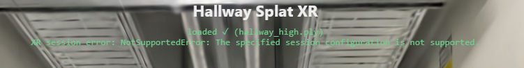

[codex / user, message 11](conversations/codex-01a1a0cd-696b-7ec1-8e8c-5a4e1ddb5b0c.md#message-11)

(No text supplied with this image.)

---

[codex / subagent, message 11](conversations/codex-01a1a10a-fb9d-7641-8dcd-841a8daa7b99.md#message-11)

(No text supplied with this image.)

---

[codex / subagent, message 11](conversations/codex-01a1a10b-fa0c-7b00-98cb-20b3e8b7b0aa.md#message-11)

(No text supplied with this image.)

## 2. 2026-11-03T10:36:47.629Z

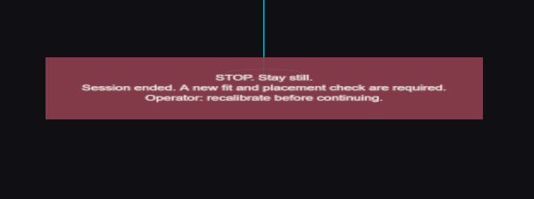

[codex / user, message 24](conversations/codex-01a1a0cd-696b-7ec1-8e8c-5a4e1ddb5b0c.md#message-24)

on the vr i only see this 

---

[codex / subagent, message 24](conversations/codex-01a1a10a-fb9d-7641-8dcd-841a8daa7b99.md#message-24)

on the vr i only see this 

---

[codex / subagent, message 24](conversations/codex-01a1a10b-fa0c-7b00-98cb-20b3e8b7b0aa.md#message-24)

on the vr i only see this 

## 3. 2026-11-03T11:06:13.703Z

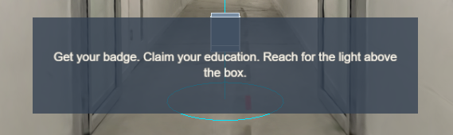

[codex / user, message 3](conversations/codex-01a1a116-8ee1-7610-9db8-fe21dc4acaa6.md#message-3)

I dont want these captions in the headset, ever.. make me a env file where ill put my api key and thats it

---

[codex / subagent, message 3](conversations/codex-01a1a116-b9ff-71d3-9b8d-a8a4d4c1c567.md#message-3)

I dont want these captions in the headset, ever.. make me a env file where ill put my api key and thats it

---

[codex / subagent, message 3](conversations/codex-01a1a117-ec25-7f41-b373-16053e9e9d18.md#message-3)

I dont want these captions in the headset, ever.. make me a env file where ill put my api key and thats it

---

[codex / subagent, message 3](conversations/codex-01a1a11f-97d8-7093-b83a-b4afe6d25ec3.md#message-3)

I dont want these captions in the headset, ever.. make me a env file where ill put my api key and thats it

## 4. 2026-11-03T11:17:46.961Z

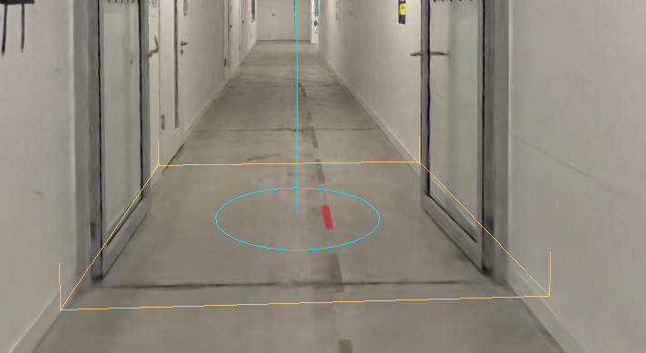

[codex / user, message 38](conversations/codex-01a1a0be-6b73-72e2-b451-f2eb8b6ea752.md#message-38)

why is the manual area so small and what happens if the user is outside of it

## 5. 2026-11-03T11:23:08.712Z

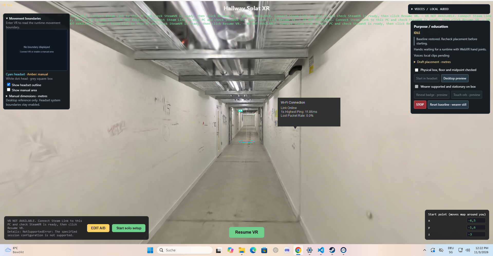

[codex / user, message 48](conversations/codex-01a1a0cd-696b-7ec1-8e8c-5a4e1ddb5b0c.md#message-48)

when i start solo setup 

## 6. 2026-11-03T13:55:04.432Z

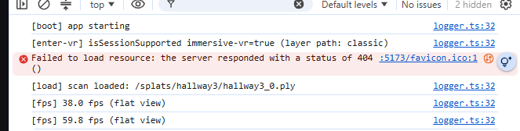

[codex / user, message 73](conversations/codex-01a1a0cd-696b-7ec1-8e8c-5a4e1ddb5b0c.md#message-73)

(No text supplied with this image.)

## 7. 2026-11-03T14:16:46.759Z

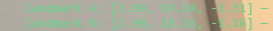

[codex / user, message 93](conversations/codex-01a1a0cd-696b-7ec1-8e8c-5a4e1ddb5b0c.md#message-93)

Those are the landmarks A & B, dont change the splat possitions in scanAssets.ts -> They were adjusted manually and shouldn't be modified in any case without our permission 

## 8. 2026-11-03T15:41:19.715Z

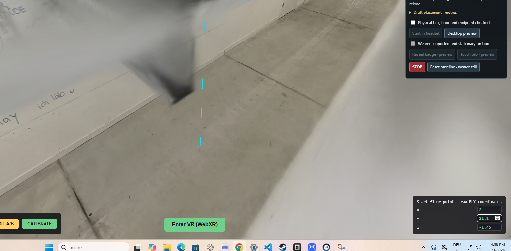

[codex / user, message 78](conversations/codex-01a1a0be-6b73-72e2-b451-f2eb8b6ea752.md#message-78)

ok scratch all of that, I will need a button on the desktop that will trigger the appearance of the box, the box should be aproximatellly on the coordinates from the screenshot, make sure that you use the floor height that is already used for other things and make sure that this coordinate has the same distance from both splat walls and if not center it exactly. here you are gonna place a 3d box and you will also use this point as a pivot for the rotation animation of the hallway to rotate to the other direction for 180 degrees, the box should be visible in the splat and the user will ideally stand there as well - later we can do the automatic trigger but for now just give me a manual button in chrome to trigger it

## 9. 2026-11-03T16:29:42.760Z

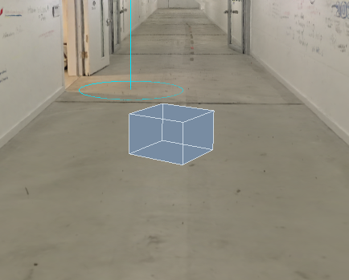

[codex / user, message 87](conversations/codex-01a1a0be-6b73-72e2-b451-f2eb8b6ea752.md#message-87)

make the box straight, the sides of the box should be parallel to the walls

## 10. 2026-11-03T16:43:33.854Z

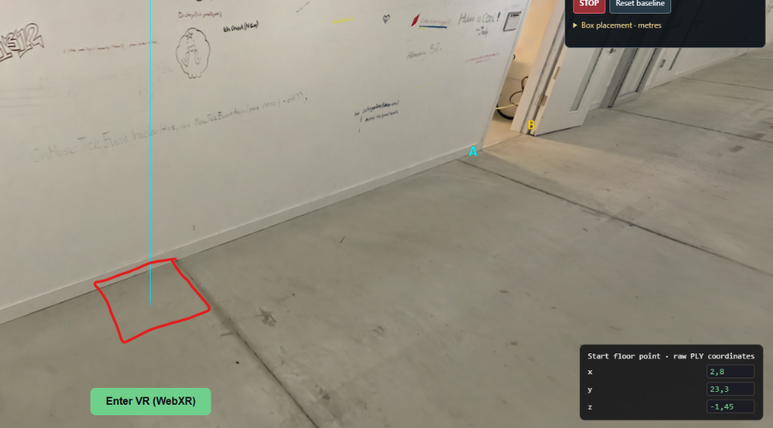

[codex / user, message 91](conversations/codex-01a1a0be-6b73-72e2-b451-f2eb8b6ea752.md#message-91)

add me another box that is also 36 x 36 cm and 43 cm high - check if the current box is of these dimensions as well... the second box needs to be placed like on the screenshot aligned with one side to the wall and with the other side to the line on the floor. here i will place actuall box in reality... this box will appear after the rotation of the hallway but I need it to be placed on this spot like before rotation, and then it will appear when I press the button after the rotation, so the final position it will look like it is in front of the open door actually but I dont think you need to worry about that if you just place it here as absolute position that is not realated to the gausian after you align it for the first time

## 11. 2026-11-03T16:59:38.213Z

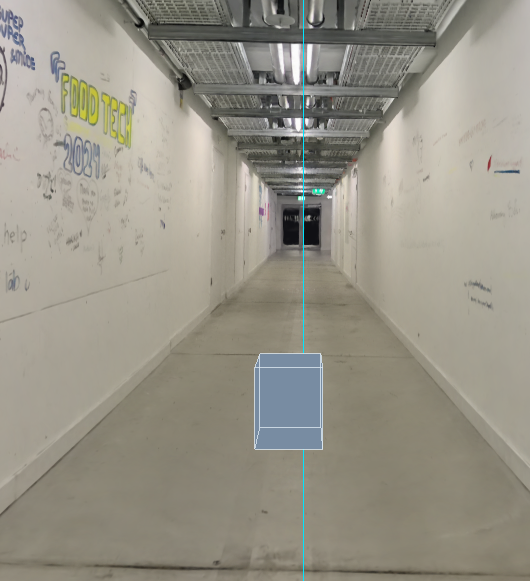

[codex / user, message 98](conversations/codex-01a1a0be-6b73-72e2-b451-f2eb8b6ea752.md#message-98)

can you verify if this box is the same distance from both walls? the center of this bix and the pivot point should be exactly the same distance from both walls... i gave you approximate coordinate, you need to adjust it for it to be perfect

## 12. 2026-11-04T09:52:19.494Z

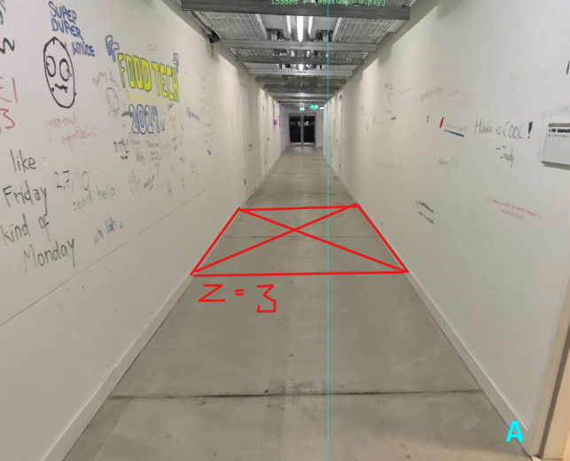

[codex / user, message 3](conversations/codex-01a1a5f7-bae1-7560-a646-8d704cd71c6b.md#message-3)

I want you to cut a hole in the floor (have a button for the trigger of that) so that there is a cutout into the void that has the size of the wall that we added, the hole starts on the position z = 3

---

[codex / subagent, message 3](conversations/codex-01a1a6cf-d0b8-7731-8169-5a296fea1c49.md#message-3)

I want you to cut a hole in the floor (have a button for the trigger of that) so that there is a cutout into the void that has the size of the wall that we added, the hole starts on the position z = 3

---

[codex / subagent, message 3](conversations/codex-01a1a6cf-f8d4-7940-bd42-762cac911f02.md#message-3)

I want you to cut a hole in the floor (have a button for the trigger of that) so that there is a cutout into the void that has the size of the wall that we added, the hole starts on the position z = 3

---

[codex / subagent, message 3](conversations/codex-01a1a6f7-9c5e-79e1-8bff-13028ffd83c6.md#message-3)

I want you to cut a hole in the floor (have a button for the trigger of that) so that there is a cutout into the void that has the size of the wall that we added, the hole starts on the position z = 3

## 13. 2026-11-04T09:56:42.374Z

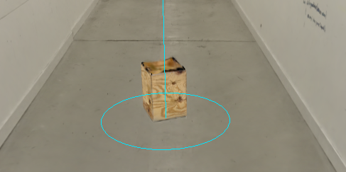

[codex / user, message 7](conversations/codex-01a1a5f4-b5bf-7ec1-908e-da8982f4b736.md#message-7)

currently its rotated and upside down, i want it to have sides paralell to the walls like the mock box was

---

[codex / subagent, message 7](conversations/codex-01a1a616-6254-70a0-a843-ba81a74ddf3d.md#message-7)

currently its rotated and upside down, i want it to have sides paralell to the walls like the mock box was

---

[codex / subagent, message 7](conversations/codex-01a1a617-ea9c-7221-9e76-b862a64d5d51.md#message-7)

currently its rotated and upside down, i want it to have sides paralell to the walls like the mock box was

---

[codex / subagent, message 7](conversations/codex-01a1a64d-5ea1-71b1-b497-8d7b995469da.md#message-7)

currently its rotated and upside down, i want it to have sides paralell to the walls like the mock box was

---

[codex / subagent, message 7](conversations/codex-01a1a650-197f-7681-8283-b3abfaa92f37.md#message-7)

currently its rotated and upside down, i want it to have sides paralell to the walls like the mock box was

---

[codex / subagent, message 7](conversations/codex-01a1a650-54de-7f72-881b-291dad85d0c1.md#message-7)

currently its rotated and upside down, i want it to have sides paralell to the walls like the mock box was

## 14. 2026-11-04T10:10:37.077Z

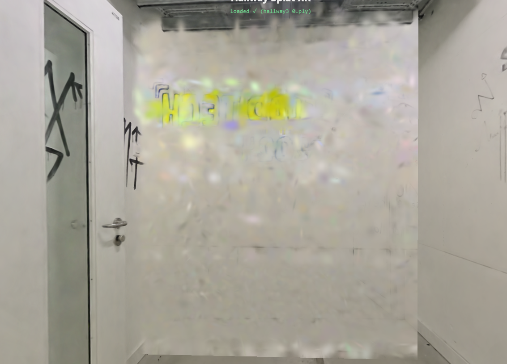

[codex / user, message 38](conversations/codex-01a1a258-516e-7001-86c4-f264ca081c67.md#message-38)

the wall looks bad from the other side, can you paste the good side on the back as well? so both sides can be "the good side" thickness can be double, do not smush them together, they should be always be moving as one wall

---

[codex / subagent, message 38](conversations/codex-01a1a6ff-a292-7aa3-be46-ebd838d818b3.md#message-38)

the wall looks bad from the other side, can you paste the good side on the back as well? so both sides can be "the good side" thickness can be double, do not smush them together, they should be always be moving as one wall

---

[codex / subagent, message 38](conversations/codex-01a1a6ff-c812-7870-a7b0-a5cbd70f9f6f.md#message-38)

the wall looks bad from the other side, can you paste the good side on the back as well? so both sides can be "the good side" thickness can be double, do not smush them together, they should be always be moving as one wall

---

[codex / subagent, message 38](conversations/codex-01a1a6ff-ec3a-7a20-a04c-e102e4eb0394.md#message-38)

the wall looks bad from the other side, can you paste the good side on the back as well? so both sides can be "the good side" thickness can be double, do not smush them together, they should be always be moving as one wall

---

[codex / subagent, message 38](conversations/codex-01a1a742-f01d-7f33-b7fe-7901e3e57b9f.md#message-38)

the wall looks bad from the other side, can you paste the good side on the back as well? so both sides can be "the good side" thickness can be double, do not smush them together, they should be always be moving as one wall

---

[codex / subagent, message 38](conversations/codex-01a1a743-273e-74e0-9162-51fb02b19d82.md#message-38)

the wall looks bad from the other side, can you paste the good side on the back as well? so both sides can be "the good side" thickness can be double, do not smush them together, they should be always be moving as one wall

---

[codex / subagent, message 38](conversations/codex-01a1a74d-8b92-7442-8dfe-70d32634dc45.md#message-38)

the wall looks bad from the other side, can you paste the good side on the back as well? so both sides can be "the good side" thickness can be double, do not smush them together, they should be always be moving as one wall

---

[codex / subagent, message 38](conversations/codex-01a1aae7-a481-7030-8ef4-8e4944773400.md#message-38)

the wall looks bad from the other side, can you paste the good side on the back as well? so both sides can be "the good side" thickness can be double, do not smush them together, they should be always be moving as one wall

---

[codex / subagent, message 38](conversations/codex-01a1aae7-d18b-7412-b54c-b0ff76165c80.md#message-38)

the wall looks bad from the other side, can you paste the good side on the back as well? so both sides can be "the good side" thickness can be double, do not smush them together, they should be always be moving as one wall

---

[codex / subagent, message 38](conversations/codex-01a1aae8-0b29-7130-9081-c80ab74ceeaf.md#message-38)

the wall looks bad from the other side, can you paste the good side on the back as well? so both sides can be "the good side" thickness can be double, do not smush them together, they should be always be moving as one wall

---

[codex / subagent, message 38](conversations/codex-01a1ab3c-2f79-7372-b245-a279a9f4cb2a.md#message-38)

the wall looks bad from the other side, can you paste the good side on the back as well? so both sides can be "the good side" thickness can be double, do not smush them together, they should be always be moving as one wall

---

[codex / subagent, message 38](conversations/codex-01a1ab3c-62c6-77f1-a723-73b219e72cec.md#message-38)

the wall looks bad from the other side, can you paste the good side on the back as well? so both sides can be "the good side" thickness can be double, do not smush them together, they should be always be moving as one wall

---

[codex / subagent, message 38](conversations/codex-01a1ab3c-8b82-7681-bfa4-9f3ddd3595a4.md#message-38)

the wall looks bad from the other side, can you paste the good side on the back as well? so both sides can be "the good side" thickness can be double, do not smush them together, they should be always be moving as one wall

## 15. 2026-11-04T10:16:08.538Z

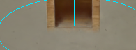

[codex / user, message 15](conversations/codex-01a1a5f4-b5bf-7ec1-908e-da8982f4b736.md#message-15)

orientation is good, can you move the splat a tiny bit up so its sitting on the floor and not merging with it

---

[codex / subagent, message 15](conversations/codex-01a1a616-6254-70a0-a843-ba81a74ddf3d.md#message-15)

orientation is good, can you move the splat a tiny bit up so its sitting on the floor and not merging with it

---

[codex / subagent, message 15](conversations/codex-01a1a617-ea9c-7221-9e76-b862a64d5d51.md#message-15)

orientation is good, can you move the splat a tiny bit up so its sitting on the floor and not merging with it

---

[codex / subagent, message 15](conversations/codex-01a1a64d-5ea1-71b1-b497-8d7b995469da.md#message-15)

orientation is good, can you move the splat a tiny bit up so its sitting on the floor and not merging with it

---

[codex / subagent, message 15](conversations/codex-01a1a650-197f-7681-8283-b3abfaa92f37.md#message-15)

orientation is good, can you move the splat a tiny bit up so its sitting on the floor and not merging with it

---

[codex / subagent, message 15](conversations/codex-01a1a650-54de-7f72-881b-291dad85d0c1.md#message-15)

orientation is good, can you move the splat a tiny bit up so its sitting on the floor and not merging with it

## 16. 2026-11-04T10:23:29.836Z

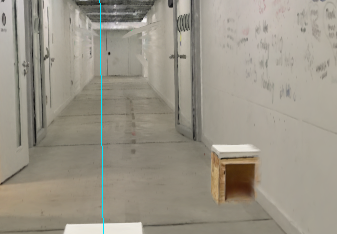

[codex / user, message 20](conversations/codex-01a1a5f4-b5bf-7ec1-908e-da8982f4b736.md#message-20)

the boxes are actually on the right spot, but I have a problem with the walls not being centered after rotation anymore? the real box in reality is aligned with the splat box but its sitting inside the gausian splat wall a bit, can we have an offset during rotation to fix that, that is: to align the walls of the flipped hallway to the real walls in reality? the walls are nicely aligned before rotation.

---

[codex / subagent, message 20](conversations/codex-01a1a616-6254-70a0-a843-ba81a74ddf3d.md#message-20)

the boxes are actually on the right spot, but I have a problem with the walls not being centered after rotation anymore? the real box in reality is aligned with the splat box but its sitting inside the gausian splat wall a bit, can we have an offset during rotation to fix that, that is: to align the walls of the flipped hallway to the real walls in reality? the walls are nicely aligned before rotation.

---

[codex / subagent, message 20](conversations/codex-01a1a617-ea9c-7221-9e76-b862a64d5d51.md#message-20)

the boxes are actually on the right spot, but I have a problem with the walls not being centered after rotation anymore? the real box in reality is aligned with the splat box but its sitting inside the gausian splat wall a bit, can we have an offset during rotation to fix that, that is: to align the walls of the flipped hallway to the real walls in reality? the walls are nicely aligned before rotation.

---

[codex / subagent, message 20](conversations/codex-01a1a64d-5ea1-71b1-b497-8d7b995469da.md#message-20)

the boxes are actually on the right spot, but I have a problem with the walls not being centered after rotation anymore? the real box in reality is aligned with the splat box but its sitting inside the gausian splat wall a bit, can we have an offset during rotation to fix that, that is: to align the walls of the flipped hallway to the real walls in reality? the walls are nicely aligned before rotation.

---

[codex / subagent, message 20](conversations/codex-01a1a650-197f-7681-8283-b3abfaa92f37.md#message-20)

the boxes are actually on the right spot, but I have a problem with the walls not being centered after rotation anymore? the real box in reality is aligned with the splat box but its sitting inside the gausian splat wall a bit, can we have an offset during rotation to fix that, that is: to align the walls of the flipped hallway to the real walls in reality? the walls are nicely aligned before rotation.

---

[codex / subagent, message 20](conversations/codex-01a1a650-54de-7f72-881b-291dad85d0c1.md#message-20)

the boxes are actually on the right spot, but I have a problem with the walls not being centered after rotation anymore? the real box in reality is aligned with the splat box but its sitting inside the gausian splat wall a bit, can we have an offset during rotation to fix that, that is: to align the walls of the flipped hallway to the real walls in reality? the walls are nicely aligned before rotation.

## 17. 2026-11-04T10:30:05.523Z

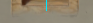

[codex / user, message 25](conversations/codex-01a1a5f4-b5bf-7ec1-908e-da8982f4b736.md#message-25)

both boxes are still inside the floor so I would move them up a bit 

---

[codex / subagent, message 25](conversations/codex-01a1a64d-5ea1-71b1-b497-8d7b995469da.md#message-25)

both boxes are still inside the floor so I would move them up a bit 

---

[codex / subagent, message 25](conversations/codex-01a1a650-197f-7681-8283-b3abfaa92f37.md#message-25)

both boxes are still inside the floor so I would move them up a bit 

---

[codex / subagent, message 25](conversations/codex-01a1a650-54de-7f72-881b-291dad85d0c1.md#message-25)

both boxes are still inside the floor so I would move them up a bit 

## 18. 2026-11-04T13:05:40.703Z

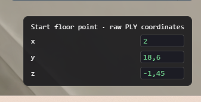

[codex / user, message 7](conversations/codex-01a1a60d-0690-7413-a72f-9db54afb01a7.md#message-7)

i want to use this panel in the rotated mode as well, this is a panel for me so I can estimate the coordinates at any point, at it there should be coordinates I can later use to put something in the gausian splat while its both rotated and not 

## 19. 2026-11-04T13:18:17.891Z

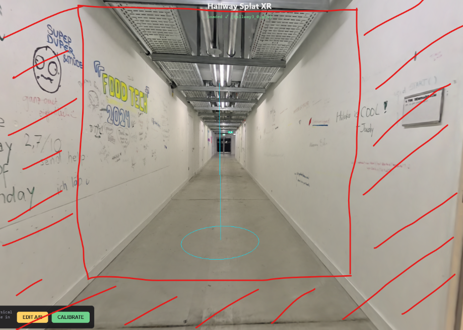

[codex / user, message 3](conversations/codex-01a1a6b5-d63e-7c60-9f15-eadbe9e2ec28.md#message-3)

can you make me another splat from the halway3 splat that is currently used and have it as a seperate "object" I want to have it cut off perfectly ortagonal to the splat walls and floor approximately in this spot. do not change the existing interaction gameplay or coordinates of anything and just give me my new cut off hallway splat

## 20. 2026-11-04T13:29:21.133Z

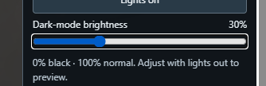

[codex / user, message 16](conversations/codex-01a1a60d-0690-7413-a72f-9db54afb01a7.md#message-16)

two seconds after the second box appears I want the lights to go out with the dark mode brightness 30% and they need to go out with a glitch, so to have like a second of flickering with this light flicker sound i pasted in public audio, fade it in and out and dont make it loud

## 21. 2026-11-04T13:38:34.519Z

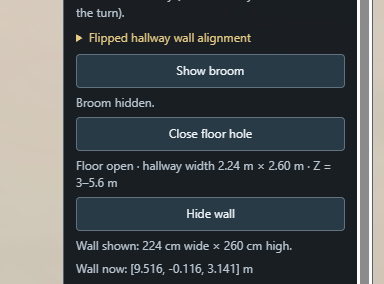

[codex / user, message 59](conversations/codex-01a1a258-516e-7001-86c4-f264ca081c67.md#message-59)

are these comands fucked up and have the legacy way of placing the things? I want the buttons, the desktop preview and the vr experience to all move the thing the same way, the buttons are just a manual way of placing sth. check that

---

[codex / subagent, message 59](conversations/codex-01a1a6ff-a292-7aa3-be46-ebd838d818b3.md#message-59)

are these comands fucked up and have the legacy way of placing the things? I want the buttons, the desktop preview and the vr experience to all move the thing the same way, the buttons are just a manual way of placing sth. check that

---

[codex / subagent, message 59](conversations/codex-01a1a6ff-c812-7870-a7b0-a5cbd70f9f6f.md#message-59)

are these comands fucked up and have the legacy way of placing the things? I want the buttons, the desktop preview and the vr experience to all move the thing the same way, the buttons are just a manual way of placing sth. check that

---

[codex / subagent, message 59](conversations/codex-01a1a6ff-ec3a-7a20-a04c-e102e4eb0394.md#message-59)

are these comands fucked up and have the legacy way of placing the things? I want the buttons, the desktop preview and the vr experience to all move the thing the same way, the buttons are just a manual way of placing sth. check that

---

[codex / subagent, message 59](conversations/codex-01a1a742-f01d-7f33-b7fe-7901e3e57b9f.md#message-59)

are these comands fucked up and have the legacy way of placing the things? I want the buttons, the desktop preview and the vr experience to all move the thing the same way, the buttons are just a manual way of placing sth. check that

---

[codex / subagent, message 59](conversations/codex-01a1a743-273e-74e0-9162-51fb02b19d82.md#message-59)

are these comands fucked up and have the legacy way of placing the things? I want the buttons, the desktop preview and the vr experience to all move the thing the same way, the buttons are just a manual way of placing sth. check that

---

[codex / subagent, message 59](conversations/codex-01a1a74d-8b92-7442-8dfe-70d32634dc45.md#message-59)

are these comands fucked up and have the legacy way of placing the things? I want the buttons, the desktop preview and the vr experience to all move the thing the same way, the buttons are just a manual way of placing sth. check that

---

[codex / subagent, message 59](conversations/codex-01a1aae7-a481-7030-8ef4-8e4944773400.md#message-59)

are these comands fucked up and have the legacy way of placing the things? I want the buttons, the desktop preview and the vr experience to all move the thing the same way, the buttons are just a manual way of placing sth. check that

---

[codex / subagent, message 59](conversations/codex-01a1aae7-d18b-7412-b54c-b0ff76165c80.md#message-59)

are these comands fucked up and have the legacy way of placing the things? I want the buttons, the desktop preview and the vr experience to all move the thing the same way, the buttons are just a manual way of placing sth. check that

---

[codex / subagent, message 59](conversations/codex-01a1aae8-0b29-7130-9081-c80ab74ceeaf.md#message-59)

are these comands fucked up and have the legacy way of placing the things? I want the buttons, the desktop preview and the vr experience to all move the thing the same way, the buttons are just a manual way of placing sth. check that

---

[codex / subagent, message 59](conversations/codex-01a1ab3c-2f79-7372-b245-a279a9f4cb2a.md#message-59)

are these comands fucked up and have the legacy way of placing the things? I want the buttons, the desktop preview and the vr experience to all move the thing the same way, the buttons are just a manual way of placing sth. check that

---

[codex / subagent, message 59](conversations/codex-01a1ab3c-62c6-77f1-a723-73b219e72cec.md#message-59)

are these comands fucked up and have the legacy way of placing the things? I want the buttons, the desktop preview and the vr experience to all move the thing the same way, the buttons are just a manual way of placing sth. check that

---

[codex / subagent, message 59](conversations/codex-01a1ab3c-8b82-7681-bfa4-9f3ddd3595a4.md#message-59)

are these comands fucked up and have the legacy way of placing the things? I want the buttons, the desktop preview and the vr experience to all move the thing the same way, the buttons are just a manual way of placing sth. check that

## 22. 2026-11-04T13:45:56.700Z

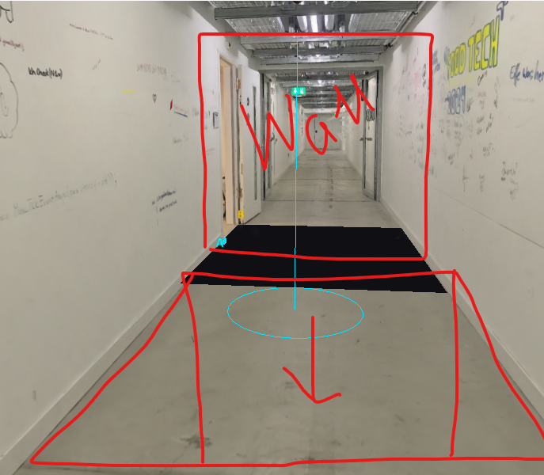

[codex / user, message 15](conversations/codex-01a1a5f7-bae1-7560-a646-8d704cd71c6b.md#message-15)

ok amaying, this is where the hole is currentlz places with the button and where the wall is animated to come to. I want to have buttons to check the wall start position and wall movement end position what is in simulatio,. i also want to move the hole a bit to this side you see from the sketch, and when the wall stops moving then it glitches out and the hole is behid it from the user perspective.. apart from the buttons add that sequence to the both desktop preview and vr experience

---

[codex / subagent, message 15](conversations/codex-01a1a6cf-d0b8-7731-8169-5a296fea1c49.md#message-15)

ok amaying, this is where the hole is currentlz places with the button and where the wall is animated to come to. I want to have buttons to check the wall start position and wall movement end position what is in simulatio,. i also want to move the hole a bit to this side you see from the sketch, and when the wall stops moving then it glitches out and the hole is behid it from the user perspective.. apart from the buttons add that sequence to the both desktop preview and vr experience

---

[codex / subagent, message 15](conversations/codex-01a1a6cf-f8d4-7940-bd42-762cac911f02.md#message-15)

ok amaying, this is where the hole is currentlz places with the button and where the wall is animated to come to. I want to have buttons to check the wall start position and wall movement end position what is in simulatio,. i also want to move the hole a bit to this side you see from the sketch, and when the wall stops moving then it glitches out and the hole is behid it from the user perspective.. apart from the buttons add that sequence to the both desktop preview and vr experience

---

[codex / subagent, message 15](conversations/codex-01a1a6f7-9c5e-79e1-8bff-13028ffd83c6.md#message-15)

ok amaying, this is where the hole is currentlz places with the button and where the wall is animated to come to. I want to have buttons to check the wall start position and wall movement end position what is in simulatio,. i also want to move the hole a bit to this side you see from the sketch, and when the wall stops moving then it glitches out and the hole is behid it from the user perspective.. apart from the buttons add that sequence to the both desktop preview and vr experience

## 23. 2026-11-04T15:56:59.320Z

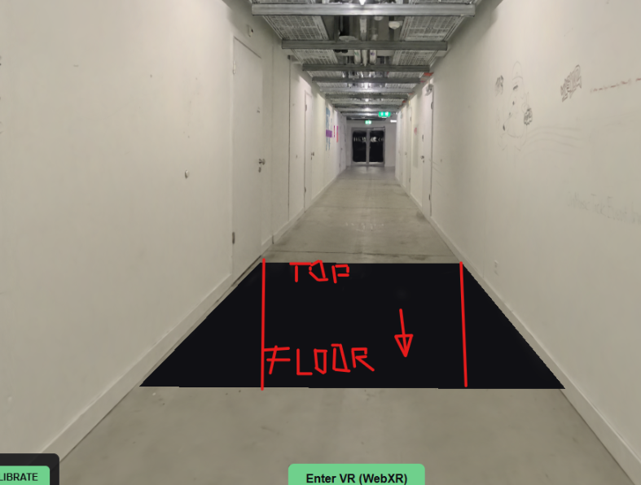

[codex / user, message 11](conversations/codex-01a1a6b5-d63e-7c60-9f15-eadbe9e2ec28.md#message-11)

I need you to place the hallway cutout to be connected exactly where the hole is, align the cutout... so the side where the second box is there needs to be the part with the floor and on the oposite side the ceiling part of the hallway cutout. on the sides the walls.. it should be tied to the hole always

## 24. 2026-11-05T10:50:19.189Z

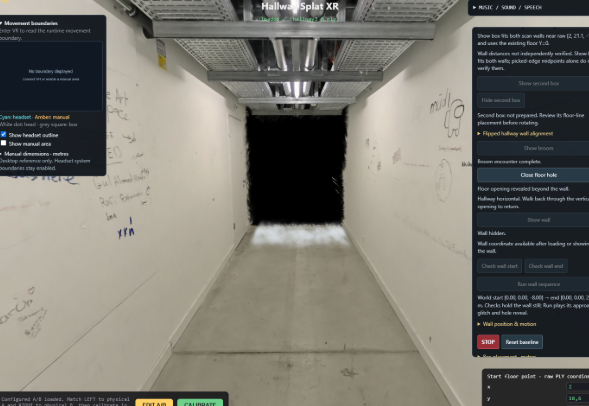

[codex / user, message 53](conversations/codex-01a1a5f7-bae1-7560-a646-8d704cd71c6b.md#message-53)

this cut to the void is too perfectly cut, I dont want such a perfect outline but the messy fade in disinagreting gausians, that have organic patches of more and less spots with gaussians and then in general the feeling is that more and more is disappearing, i also want more explosions, the gausian walls sides are exploding on like 5 spots from both sides, align them semi randomly, it needs to feel spontaneous and when the part explodes it starts disinegrating, the first explosions are far back and then they come closer and closer also for each explosion trigger the sound effect called rumbling sound in the files

