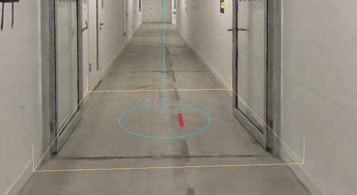
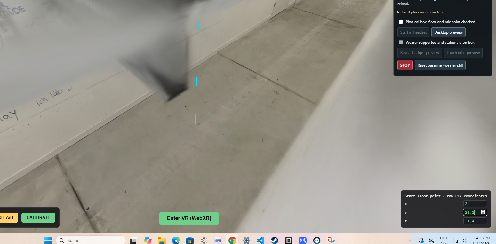
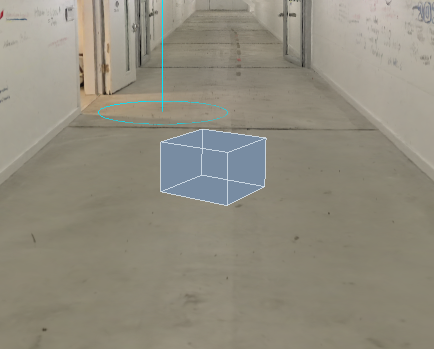
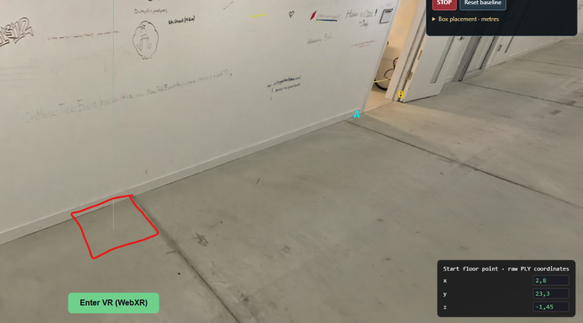
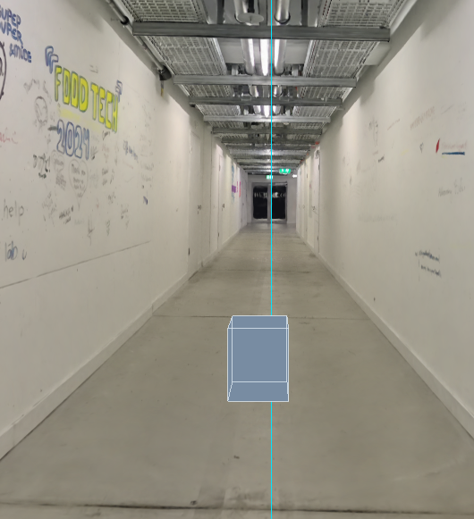

# Plan hallway onboarding flow

Provider: codex; source: user; session: 01a1a0be-6b73-72e2-b451-f2eb8b6ea752.

Original local record: \\?\C:\Users\user\.codex\sessions\2026\11\03\rollout-2026-11-03T10-29-56-01a1a0be-6b73-72e2-b451-f2eb8b6ea752.jsonl.

Created: 2026-11-03T09:29:56.342Z. Export snapshot: 2026-11-05T11:08:59.327Z.

This transcript contains stored user-facing user/assistant messages, with image links. System/developer prompts, tool payloads and internal reasoning are omitted. Credential-shaped strings are redacted. A delegated thread's user-role messages may be inherited context or instructions from another agent.

## 1. user · 2026-11-03T09:29:57.569Z

# AGENTS.md instructions for C:\Users\user\Documents\Hallway_Project\02_Git\calibrated

<INSTRUCTIONS>
# Rules for coding agents

## Start here

Read `ai/strategy.md`, then the relevant sections of `docs/PROJECT_PLAN.md`, `docs/CALIBRATION.md`, and `docs/VALIDATION.md`.

This repository is in active implementation (viewer, XR session, calibration; hardware-validated on the Quest Browser and SteamVR/Steam Link routes). Continue through the agreed work without asking for a new “go” after every step, but keep the plan/build/check/log loop and record decisions in `ai/strategy.md`.

## Work loop

0. **Git and network operations:** Never push, pull, or fetch. Commits are local only.
   Before publishing anything, **ask the user** — they push and pull manually via
   GitHub Desktop. Never trigger credential prompts or other network authentication.

1. Record the current task and acceptance criteria in `ai/strategy.md`.
2. Build one reviewable step at a time. Keep modules small and separate calibration mathematics from rendering and device input.
3. Run the checks relevant to the change. Once implemented, use `npm test` for logic and `npm run check` for desktop browser behavior. These commands do not exist during the planning phase.
4. Read generated reports and inspect screenshots before describing them. Repair failures, then record the outcome and next step in `ai/strategy.md`.
5. Distinguish automated checks, desktop visual checks, and tests performed on the real PC/Quest/hallway. Never report a hardware milestone as passed from a browser screenshot or simulated pose.

For documentation changes, check consistency and relative links; do not create application tests just to test prose. Keep generated `.check/` results unedited.

## Calibration invariants

- In calibrated mode, one XR unit is one metre. The parent rig for the tracked camera and controllers stays at identity; transform the scan root into XR space.
- No joystick locomotion, teleportation, artificial turning, or user-scale control in calibrated mode.
- Fit explicitly paired physical/scan landmarks. A controller grip pose is not the physical probe tip; account for its measured offset.
- Keep validation landmarks separate from fit landmarks. Report fit residuals and held-out errors separately.
- Recenter, reference-space reset, viewer-tracking interruption, changed scan data, or a new session invalidate acceptance and require the recovery procedure. Invalid controller poses block active capture; loss of an unused controller alone does not invalidate alignment.
- A saved transform is a candidate for revalidation, never evidence of present alignment. Splats provide appearance, not certified wall geometry or collision protection.

## Scope and tools

Use existing project conventions and verify current APIs against the pinned dependencies. Routine reversible changes and dependency choices inside the authorized task do not need separate permission; record material architectural changes. Ask when missing information prevents a sound decision.

Do not change agent model, provider, credentials, or permission defaults as part of ordinary project work. Never print secrets. Do not dump large scan binaries into agent context; inspect metadata or use purpose-built processing when the task requires it. Keep private scans and calibration captures out of Git.

Use bounded checks where possible. When a development server is needed, track its process and stop it when finished unless the user needs it left running. Report blockers with evidence and continue independent work when possible.

## Provenance

Adapted from the Photolipsia agentic kit's small-step plan/build/check/log workflow. See `docs/REFERENCES.md` for source and licensing details.

</INSTRUCTIONS>
<environment_context>
  <cwd>C:\Users\user\Documents\Hallway_Project\02_Git\calibrated</cwd>
  <shell>powershell</shell>
  <current_date>2026-11-03</current_date>
  <timezone>Europe/Zurich</timezone>
  <filesystem><workspace_roots><root>C:\Users\user\Documents\Hallway_Project\02_Git\calibrated</root></workspace_roots><permission_profile type="managed"><file_system type="restricted"><entry access="read"><special>:root</special></entry><entry access="write"><path>C:\Users\user\Documents\Hallway_Project\02_Git\calibrated</path></entry><entry access="write"><special>:slash_tmp</special></entry><entry access="write"><special>:tmpdir</special></entry><entry access="read"><path>C:\Users\user\Documents\Hallway_Project\02_Git\calibrated\.git</path></entry><entry access="read"><path>C:\Users\user\Documents\Hallway_Project\02_Git\calibrated\.agents</path></entry><entry access="read"><path>C:\Users\user\Documents\Hallway_Project\02_Git\calibrated\.codex</path></entry><entry access="read"><path>C:\Users\user\Documents\Hallway_Project\02_Git\calibrated\.aws</path></entry></file_system></permission_profile></filesystem>
</environment_context>

## 2. user · 2026-11-03T09:29:57.584Z

<external_codex_apps_open_page>{"page_id":null}</external_codex_apps_open_page>

## 3. user · 2026-11-03T09:29:57.595Z

# Context from my IDE setup:

## Active file: docs/PROJECT_PLAN.md

## Open tabs:
- PROJECT_PLAN.md: docs/PROJECT_PLAN.md
- HEADSET_SETUP.md: docs/HEADSET_SETUP.md
- CALIBRATION.md: docs/CALIBRATION.md
- BACKLOG.md: docs/BACKLOG.md
- strategy.md: ai/strategy.md

## My request:
I want you to plan how do we do this: I want the environment to have this flow:

Tech stack to add: use eleven labs to generate voices guiding you through the installation, I want them spooky and whispering-repeating and like multiple voices overlay but you should still hear what they are prompting you to do (ill provide api key)

1. Task prompt: find your purpose and bring it back here

- user enters the hallway and vision== reality at this point
- some time for the user to explore the touch reality and the vision that are niceli calibrated (this should already work but I want to add the meta default hands so that he can also see his hands)

2. Voices start saying that you need to get badge/your education

- in the environment there should be a cube and the badge is hanging from the ceiling (mock this with a 3d cube just standing on the floor of the hallway splat and something near the ceiling like a glowing orb)
- this cube and badge mock should be inthe middle of the hallway and not near the walls, litreally in the middle

3. the user is then supposed to step on this cube (we will position a real cube in that exact place)

- when he touches the glowing orb near the ceiling it should disappear and the voices maybe say good job/congratulations
- when the orb is touched there needs to be triggered the spinning of the environment for 180 degrees while keeping the floor on the same plane -> it needs to look like the hallway is exactly the opposite direction and then the user steps down the box probably -> explores the touch again

for now that is the whole flow I want to implement. currently the gaussians are not in a good quiality and i think that is a rendering problem, since we are doing the compute on the pc and only streaming, make the gausians the really high quality but still optimized for fast loading, maybe keep the parts that are closer to the user more detailed than those far away (use the best way for this and feel free to propose another way but I want to have better details than now) after planning start implementing, but generate me a file called interaction plan with the implementation plan and then spawn agents to help paralelise this

## 4. assistant · 2026-11-03T09:30:02.116Z

I’ll review the calibration rules and current viewer, write `docs/INTERACTION_PLAN.md`, then start implementing. I’ll use parallel agents for the interaction flow, hands and voice support, and splat quality, while keeping the physical box and hallway alignment explicit in the plan.

## 5. assistant · 2026-11-03T09:30:57.606Z

The current viewer uses flat spherical-harmonic shading and starts at 70% scan opacity, so there are concrete rendering settings to investigate. More splats alone may not add detail.

The 180° turn will be a separate experience mode: it will rotate the visual hallway around the box’s vertical axis, keep the floor level, and leave tracked hands and the physical box fixed. After that turn, wall alignment will need checking before further touch exploration.

## 6. user · 2026-11-03T09:32:11.429Z

<send_user_message_question_reply>
[{"questionItemId":"[\"request_user_input_async\",\"call_9ca0d396f35546d7bb282f4bb573e68c\",0]","question":"What are the real box dimensions, approximate hallway width/ceiling height, and intended box location? If these are not measured yet, I’ll implement editable draft placement and require an operator to confirm it before starting the physical sequence.","answer":"ill go measure now, you can approximate, its a hallway in toni areal zurich"},{"questionItemId":"[\"request_user_input_async\",\"call_9ca0d396f35546d7bb282f4bb573e68c\",1]","question":"For the 180° turn, I’m planning a smooth 4-second rotation while the user stays still on the box, with an operator stop control. Do you prefer a different duration or a fade between the two orientations?","answer":"Smooth 4-second rotation"}]
</send_user_message_question_reply>

## 7. assistant · 2026-11-03T09:34:36.734Z

The plan is saved in `docs/INTERACTION_PLAN.md`, and the three implementation agents are working. I’ve recorded your four-second rotation choice. Placement will use editable draft dimensions until your measurements arrive, so we can build and preview the sequence now.

## 8. assistant · 2026-11-03T09:40:00.426Z

The scan headers show that all four exports contain base colour only; none contains higher-order lighting detail. The rendering work will preserve what is there, add quality controls, and provide compressed local files. Higher splat counts still need an in-headset comparison.

The interaction code and operator controls are ready for integration. Next I’m wiring fingertip contact, captions, and stop/recalibration behavior.

## 9. user · 2026-11-03T09:41:01.614Z

<external_codex_apps_open_page>{"page_id":null}</external_codex_apps_open_page>

## 10. user · 2026-11-03T09:41:01.622Z

# Context from my IDE setup:

## Active file: docs/PROJECT_PLAN.md

## Open tabs:
- PROJECT_PLAN.md: docs/PROJECT_PLAN.md
- HEADSET_SETUP.md: docs/HEADSET_SETUP.md
- CALIBRATION.md: docs/CALIBRATION.md
- BACKLOG.md: docs/BACKLOG.md
- strategy.md: ai/strategy.md

## My request:
the hallway width is around 210 cm but that info should be possible to get from the gaussian splats. the user is gonna be in the same space we splatted

## 11. assistant · 2026-11-03T09:41:14.231Z

I’ll use **2.10 m** as the provisional hallway width. The scan can help locate the wall edges and centreline, but its metric scale is still unverified, so I’ll use your measurement to check it. The box will be placed on that centreline, with its lengthwise position editable until we identify the intended spot in the scan.

## 12. assistant · 2026-11-03T09:45:53.841Z

The box controls now use the provisional **2.10 m width**, and I’m adding a scan picker for the two opposite floor edges. Their midpoint will place the box on the selected cross-section’s centreline, and that point will move with a later calibration.

The compressed scan files are about **65% smaller** and retain every source splat, with compression precision recorded. I’m now checking browser behavior and the stop/recalibration paths; headset sharpness and hand availability remain hardware checks.

## 13. assistant · 2026-11-03T10:02:45.741Z

The browser check caught a separate reveal issue: the splat library was revealing the scan outward from the scan’s raw origin, which could leave an offset hallway hidden after loading finished. That is now disabled because calibration already controls the fade-in.

The synthetic calibration regression also passes: countdown timers use buffered controller poses, hands never become landmark measurements, and STOP cancels pending capture.

## 14. assistant · 2026-11-03T10:13:01.258Z

The desktop flow passes: the orb disappears once, the hallway reaches exactly 180°, the box stays fixed, STOP freezes a partial turn, and reset restores the baseline without granting calibration authority. I inspected the badge and reversed-view screenshots.

I’m finishing the bundled hand models and checking the actual compressed hallway file. Voice generation is ready, but the clips still need your local ElevenLabs key and chosen voices.

## 15. assistant · 2026-11-03T10:17:13.495Z

The hand-model download approval was interrupted, so I’m keeping the offline joint-hand fallback. The app supports optional local skinned models, but native Meta system hands still depend on what Steam Link and Chrome expose.

The remaining check is the actual private scan load and interruption handling. No headset or hallway acceptance is being inferred from these desktop checks.

## 16. assistant · 2026-11-03T10:21:23.051Z

The actual compressed ultra scan loads, and I inspected its screenshot. The walls and floor render, but the ceiling still shows smearing, so the fine-detail issue is not yet proven solved. The code now provides a smaller detailed preset and fixes the reveal issue; a source-viewer and headset comparison is still needed to isolate the remaining blur.

The interaction and interruption checks pass. I’m recording the final results and setup instructions now.

## 17. user · 2026-11-03T10:21:34.052Z

# Context from my IDE setup:

## Active file: .gitignore

## Open tabs:
- .gitignore: .gitignore
- .ignore: .ignore
- VOICE_SETUP.md: docs/VOICE_SETUP.md
- .env.local: docs/.env.local
- VALIDATION.md: docs/VALIDATION.md

## My request:
try again hand-model download approval was interrupted

## 18. assistant · 2026-11-03T10:21:42.411Z

I’ll retry the hand-model download and wire the local meshes in if it succeeds. I’ll also check the env-file location: the voice generator reads `.env.local` from the repository root, while your open tab appears to be `docs/.env.local`. I won’t read or print its contents.

## 19. assistant · 2026-11-03T10:23:20.427Z

The retry succeeded. Both hand models are now stored locally with their MIT licence and wired in as the default, with joint hands as a fallback. They are the generic skinned WebXR hands used by Three.js; showing them through Steam Link still requires the runtime to expose hand joints.

## 20. assistant · 2026-11-03T10:31:54.697Z

Retry succeeded: both skinned WebXR hand models are downloaded, bundled locally, and enabled. I inspected the [hand preview](C:/Users/user/Documents/Hallway_Project/02_Git/calibrated/.check/hands.png).

The [interaction plan](C:/Users/user/Documents/Hallway_Project/02_Git/calibrated/docs/INTERACTION_PLAN.md) and first implementation are complete, including orb collection, the four-second turn, placement controls, and STOP/reset.

Validation passed: **28 tests, 10 desktop checks, and production build**. Steam Link hand tracking still needs headset verification.

Voices await your ElevenLabs configuration. Compressed scans are approximately 65% smaller; remaining ceiling blur needs further comparison.

## 21. user · 2026-11-03T10:31:54.777Z

<environment_context>
  <current_date>2026-11-03</current_date>
  <timezone>Europe/Zurich</timezone>
  <filesystem><workspace_roots><root>C:\Users\user\Documents\Hallway_Project\02_Git\calibrated</root></workspace_roots><permission_profile type="disabled"><file_system type="unrestricted" /></permission_profile></filesystem>
  <subagents>
    <agent name="/root/hands_audio" />
    <agent name="/root/interaction" />
    <agent name="/root/splat_quality" />
  </subagents>
</environment_context>

## 22. user · 2026-11-03T10:31:54.790Z

# Context from my IDE setup:

## Active file: docs/PROJECT_PLAN.md

## Open tabs:
- PROJECT_PLAN.md: docs/PROJECT_PLAN.md
- HEADSET_SETUP.md: docs/HEADSET_SETUP.md
- CALIBRATION.md: docs/CALIBRATION.md
- BACKLOG.md: docs/BACKLOG.md
- strategy.md: ai/strategy.md

## My request:
the box im gonna use in reality is 36 x 36 cm and 43 cm high so use that for your box as well

## 23. assistant · 2026-11-03T10:31:57.961Z

I’ll set the virtual box to 36 × 36 cm and 43 cm high, then check the placement controls and tests.

## 24. assistant · 2026-11-03T10:33:53.490Z

Updated the virtual box to **36 × 36 cm, 43 cm high**, with its base on the floor. The placement controls and plan reflect those dimensions.

All 28 tests and 10 desktop checks pass.

## 25. user · 2026-11-03T10:55:12.605Z

<environment_context>
  <current_date>2026-11-03</current_date>
  <timezone>Europe/Zurich</timezone>
  <filesystem><workspace_roots><root>C:\Users\user\Documents\Hallway_Project\02_Git\calibrated</root></workspace_roots><permission_profile type="managed"><file_system type="restricted"><entry access="read"><special>:root</special></entry><entry access="write"><path>C:\Users\user\Documents\Hallway_Project\02_Git\calibrated</path></entry><entry access="write"><special>:slash_tmp</special></entry><entry access="write"><special>:tmpdir</special></entry><entry access="read"><path>C:\Users\user\Documents\Hallway_Project\02_Git\calibrated\.git</path></entry><entry access="read"><path>C:\Users\user\Documents\Hallway_Project\02_Git\calibrated\.agents</path></entry><entry access="read"><path>C:\Users\user\Documents\Hallway_Project\02_Git\calibrated\.codex</path></entry><entry access="read"><path>C:\Users\user\Documents\Hallway_Project\02_Git\calibrated\.aws</path></entry></file_system></permission_profile></filesystem>
  <subagents>
    <agent name="/root/hands_audio" />
    <agent name="/root/interaction" />
    <agent name="/root/splat_quality" />
  </subagents>
</environment_context>

## 26. user · 2026-11-03T10:55:12.616Z

<external_codex_apps_open_page>{"page_id":null}</external_codex_apps_open_page>

## 27. user · 2026-11-03T10:55:12.624Z

# Context from my IDE setup:

## Active file: docs/PROJECT_PLAN.md

## Open tabs:
- PROJECT_PLAN.md: docs/PROJECT_PLAN.md
- .env.local: docs/.env.local
- .gitignore: .gitignore
- .ignore: .ignore
- VOICE_SETUP.md: docs/VOICE_SETUP.md

## My request:
how do the desktop developer controls work, there is a lot of stuff but i dont know whats happening, explain

## 28. assistant · 2026-11-03T10:55:15.785Z

I’ll check the current controls and explain what each one does, which ones affect the headset, and the order to use them.

## 29. assistant · 2026-11-03T10:57:48.472Z

**CALIBRATE aligns the hallway. “Start in headset” begins the story.** Those are separate steps.

The page currently mixes placement setup, desktop testing and live headset controls, which makes it feel busy.

**For a normal headset run, use this order:**

1. **Set the box position before entering VR**, if needed. Open **Draft placement**. The dimensions already match your real box: **36 × 36 cm, 43 cm high**.
2. Click **Enter VR** at the bottom centre.
3. Click **CALIBRATE** at the bottom left. During the seven-second countdown, place the left controller on landmark A and the right controller on B. The hallway is deliberately hidden during this step and fades in after a successful fit.
4. Check the physical alignment, then tick **Physical box, floor and midpoint checked**.
5. Click **Start in headset**. The purpose prompt starts, followed by **20 seconds of exploration**. Then the box and glowing orb appear.
6. Once the wearer is standing securely on the box, tick **Wearer supported and stationary on box**. This enables collection. Their tracked index fingertip touching the orb triggers the four-second turn.

A successful calibration clears the placement checkbox, so tick it **after** calibration.

**To test everything on the PC without a headset:**

**Desktop preview → Reveal badge · preview → tick the stationary checkbox → Touch orb · preview**

“Reveal badge” skips the exploration wait. “Touch orb” simulates the touch. Those two preview buttons are disabled during VR because the live interaction uses the wearer’s actual fingertip.

**The placement fields work like this. All lengths are in metres:**

| Field | What it changes |
|---|---|
| **Centreline X / Z** | The box and orb’s horizontal position. |
| **Floor Y** | The floor height used to place the box’s bottom. |
| **Hallway width** | The clearance calculation. It does not resize the scan. Currently `2.10`. |
| **Box width / depth / height** | The virtual box dimensions: `0.36 / 0.36 / 0.43`. |
| **Orb height above floor** | The orb’s height measured from the floor. Currently `2.10`. |
| **Orb radius** | The orb’s size and fingertip contact area. Currently `0.14`. |
| **Explore seconds** | Time before the badge appears. Currently `20`. |
| **Turn seconds** | Duration of the 180° turn. Currently `4`. |

After editing a field, click **Apply placement**. Until you apply it, starting and confirming placement are disabled.

**Pick two floor edges** lets you click where opposite walls meet the floor. Their midpoint positions the box across the hallway’s width. You choose the cross-section along the hallway; it does not automatically find the hallway’s lengthwise midpoint.

**STOP and Reset have different jobs:**

- **STOP** freezes the current turn, stops voices and capture, and requires recalibration.
- **Reset baseline · wearer still** restores the hallway’s original, pre-turn orientation and clears the confirmation checkboxes. Reset does not perform calibration.

**The remaining controls are for setup or diagnosis:**

- **EDIT A/B:** changes the scan landmarks used for calibration. These are separate from the floor-edge picks used to position the box.
- **Start point X/Y/Z**, bottom right: shifts the entire hallway around the starting position. Leave these alone during ordinary runs.
- **ENABLE VOICES:** allows browser audio and loads generated local clips. **PREVIEW VOICE** auditions the purpose cue; **Mute** stops playback. Missing clips mean captions remain available until voices are generated.
- **Hands status:** reports whether usable hand joints are arriving from the headset.
- **FPS / XR debug text:** diagnostic information; these are readouts rather than controls.

The main status follows:

**IDLE → READY → EXPLORING → BADGE → ROTATING → REVERSED**

**READY** means the fit succeeded and placement still needs confirmation. **STOPPED** means the sequence has been interrupted; the accompanying message explains the recovery step.

## 30. user · 2026-11-03T11:00:21.102Z

# Context from my IDE setup:

## Active file: docs/PROJECT_PLAN.md

## Open tabs:
- PROJECT_PLAN.md: docs/PROJECT_PLAN.md
- .env.local: docs/.env.local
- .gitignore: .gitignore
- .ignore: .ignore
- VOICE_SETUP.md: docs/VOICE_SETUP.md

## My request:
ok can i see the boundary box for the movement in chrome desktop as well

## 31. assistant · 2026-11-03T11:00:25.498Z

I’ll check whether the headset exposes its movement boundary to Chrome and add a desktop outline when that data is available.

## 32. user · 2026-11-03T11:01:21.817Z

<send_user_message_question_reply>
[{"questionItemId":"[\"request_user_input_async\",\"call_8f80830a13de4c18b473146671ebb258\",0]","question":"Do you mean the headset’s actual movement boundary (SteamVR/Quest play area), or a manually sized movement box inside the hallway? I’m checking the headset boundary first.","answer":"both? what is the diffrerence"}]
</send_user_message_question_reply>

## 33. assistant · 2026-11-03T11:02:12.239Z

The **headset boundary** is the play area configured in SteamVR/Quest. Chrome can display it only if the runtime shares it through WebXR. It may be a polygon rather than a rectangle. [WebXR specification](https://www.w3.org/TR/webxr/#xrboundedreferencespace)

A **manual movement box** is an outline you set for this installation, such as the hallway section you intend to use. Changing it does not change the headset boundary or constrain movement.

I’ll make both available in the desktop view with different colours and labels, so you can compare the intended area with the boundary reported by the headset.

## 34. assistant · 2026-11-03T11:06:16.035Z

The desktop view will use **cyan for the headset-reported boundary** and **amber for your manual area**. A small top view will show the wearer’s position during VR; the 3D floor outlines will be available when inspecting the scene on the desktop.

If SteamVR does not share its boundary, the panel will say so. The manual area will still be available.

## 35. assistant · 2026-11-03T11:10:31.187Z

Both outlines now render in Chrome, and the tests confirm they stay fixed when the scan moves or rotates. The top view also shows live head position when available, including with a manual area if the runtime does not provide bounds.

The browser checks passed with simulated boundary data. I’m finishing the last tracking check; whether SteamVR shares the real play area still needs a headset test.

## 36. assistant · 2026-11-03T11:12:18.415Z

Both are now available. **Reload Chrome and open “Movement boundaries” at the top left.**

- **Cyan:** the play area reported by SteamVR, when it shares boundary data with Chrome.
- **Amber:** a manual area you define for the installation. It does not change the headset’s boundary settings.

For the manual outline, open **Manual dimensions · metres**, set its location and size, click **Apply manual area**, then tick **Show manual area**. The initial 2.10 × 2.10 m values are drafts.

During VR, the desktop top view shows your live head position and the installation box. After exiting, any retained headset outline is labelled a snapshot.

[See the synthetic desktop preview](C:/Users/user/Documents/Hallway_Project/02_Git/calibrated/.check/boundary.png).

43 tests, 14 desktop checks and the build pass. Actual SteamVR boundary availability still needs a headset check.

## 37. user · 2026-11-03T11:17:46.949Z

<external_codex_apps_open_page>{"page_id":null}</external_codex_apps_open_page>

## 38. user · 2026-11-03T11:17:46.961Z

# Context from my IDE setup:

## Active file: docs/PROJECT_PLAN.md

## Open tabs:
- PROJECT_PLAN.md: docs/PROJECT_PLAN.md
- .env.local: .env.local
- .env.local: docs/.env.local
- .gitignore: .gitignore
- .ignore: .ignore

## My request:
why is the manual area so small and what happens if the user is outside of it

## 39. assistant · 2026-11-03T11:18:11.676Z

I’ll check the current boundary logic so I can tell you exactly what happens outside the amber outline.

## 40. assistant · 2026-11-03T11:18:40.059Z

It’s small because I set a **2.10 × 2.10 m placeholder square**. You supplied the hallway’s width, but its movement-area length hasn’t been set.

To make it follow the hallway, keep **Width = 2.10**, set **Depth** to the measured length you want to use, adjust **Centre X/Z**, then click **Apply manual area**.

**Crossing the amber line currently triggers nothing in the app.** Tracking and the experience continue. It is a visual planning outline; it does not enforce a movement limit or trigger a warning. The headset’s own system boundary remains separate.

Also, the **cyan circle with the vertical line in your screenshot is the starting-position marker**, not the headset’s movement boundary.

## 41. user · 2026-11-03T12:54:40.560Z

# Context from my IDE setup:

## Active file: docs/PROJECT_PLAN.md

## Open tabs:
- PROJECT_PLAN.md: docs/PROJECT_PLAN.md
- .env.local: .env.local
- .env.local: docs/.env.local
- .gitignore: .gitignore
- .ignore: .ignore

## My request:
Change the Box postion to x - 6.5 y -1.6 z 0. Also please review the code to calibrate and 

## 42. assistant · 2026-11-03T12:54:51.558Z

I’ll check the coordinate fields before setting the box to X = −6.5, Y = −1.6, Z = 0, then review the calibration code. Your message cuts off after “calibrate and”; I can start the review while you finish that thought.

## 43. user · 2026-11-03T12:55:13.214Z

<send_user_message_question_reply>
[{"questionItemId":"[\"request_user_input_async\",\"call_3d248de5ccc54227933c23e42acc763f\",0]","question":"Your request ends at “review the code to calibrate and”. What else did you want reviewed or changed? I’ll review the current calibration flow in the meantime.","answer":"check out the file shich is responsible for the callibration"}]
</send_user_message_question_reply>

## 44. assistant · 2026-11-03T12:55:38.856Z

The calibration entry point is `src/xr/calibrationCapture.ts`. I’ll review how it reads the controllers and applies the alignment, along with the placement checks and solver it calls.

## 45. assistant · 2026-11-03T12:58:54.306Z

The current file uses the seven-second countdown and buffered controller positions. I found a case where selecting the same scan landmark for A and B can still produce a “calibrated” result with no determined heading.

For the position change, I’m using the coordinates as the box centre. With the 43 cm height, its bottom will be at Y = −1.815 m.

## 46. assistant · 2026-11-03T13:02:25.945Z

The box centre is now set to (−6.5, −1.6, 0), with its dimensions unchanged.

The calibration review found no rotation-sign or transform-composition error. It did find two acceptance risks: a disconnected controller’s last held position can still be used as a floor measurement, and duplicate landmarks can pass without determining a heading.

## 47. user · 2026-11-03T13:04:14.171Z

<external_codex_apps_open_page>{"page_id":null}</external_codex_apps_open_page>

## 48. user · 2026-11-03T13:04:14.181Z

# Context from my IDE setup:

## Active file: docs/PROJECT_PLAN.md

## Open tabs:
- PROJECT_PLAN.md: docs/PROJECT_PLAN.md
- .env.local: .env.local
- .env.local: docs/.env.local
- .gitignore: .gitignore
- .ignore: .ignore

## My request:
those are the cordinates from the PLY

## 49. assistant · 2026-11-03T13:04:41.766Z

Got it—I treated them as XR-world coordinates. I’ll correct that so the box centre is anchored at **PLY-local (−6.5, −1.6, 0)** and follows the scan’s placement and calibration, then stays fixed during the artistic turn.

## 50. assistant · 2026-11-03T13:10:39.040Z

I’m fixing the coordinate handling and adding a regression check for it. The operator fields will show the converted XR position, with a separate label for the original PLY point. A manual position edit or a new floor-edge pick will still be able to override that default.

## 51. assistant · 2026-11-03T13:13:58.488Z

The checks confirm the box now uses the PLY point through the scan’s transforms and stays fixed during the 180° turn. They also cover the override rules, including keeping a later manual position from being replaced by old floor-edge picks.

## 52. assistant · 2026-11-03T13:15:04.096Z

Corrected: **(−6.5, −1.6, 0) is now treated as PLY-local coordinates**. The box follows the scan’s placement and calibration, while staying upright and fixed during the artistic turn. Reload the viewer.

I also reviewed [calibrationCapture.ts](C:/Users/user/Documents/Hallway_Project/02_Git/calibrated/src/xr/calibrationCapture.ts). Two open issues remain:

- A disconnected controller’s last held position can be accepted as a floor measurement.
- Duplicate landmarks can pass without determining a heading; the current 1 m fit-error limit is permissive.

**47 tests, 17 desktop checks and the build pass.** Physical alignment still needs headset verification.

## 53. user · 2026-11-03T13:15:04.194Z

# Context from my IDE setup:

## Open tabs:
- strategy.md: ai/strategy.md
- calibrationCapture.ts: src/xr/calibrationCapture.ts
- PROJECT_PLAN.md: docs/PROJECT_PLAN.md
- .env.local: .env.local
- .env.local: docs/.env.local

# Files pasted by the user:

## "# CALIBRATION SYSTEM — HALLWAY PROJECT (WebXR + Gaussian Splatting) ## Context …": C:\Users\user\.codex/attachments/00a5c258-5c6f-46ce-9937-3112bd99accc/Pasted text.txt

## "## FOCUS: the CONFIRM state in src/xr/calibrationCapture.ts — current state and…": C:\Users\user\.codex/attachments/d35cc99d-bff6-4c23-862e-b78af88ec115/Pasted text.txt

## My request:
Check the following, compare it with the code, fix it, debug it and test it. 

## 54. assistant · 2026-11-03T13:15:08.318Z

I’ll read both notes, compare them with the current calibration code, then fix and test the confirmed issues. I’ll keep the review focused on calibration and the CONFIRM state.

## 55. assistant · 2026-11-03T13:19:43.216Z

The notes match the main defect: CONFIRM currently has no retry limit or timeout. I’ll add both exits and make sure the wake-controller hint remains visible on return to READY. I’ll also check the deadline before accepting a confirmation, so a late trigger cannot apply a fit.

## 56. assistant · 2026-11-03T13:23:38.057Z

The browser checks pass, including the three-attempt limit, exact 30-second timeout, and rejection of late confirmations. I’m checking the actual headset message rendering and production build now. Physical controller and headset behavior still needs a hardware test.

## 57. assistant · 2026-11-03T13:24:28.073Z

Final review caught one related message bug: a temporary tracking warning could remain on the title screen after tracking recovered. I’m fixing that and adding a regression check. The CONFIRM messages fit correctly in the rendered HUD.

## 58. assistant · 2026-11-03T13:26:15.294Z

All 47 logic tests and the production build pass. The final browser run will also cover loading or tracking warnings that clear between frames, so the title screen returns to usable instructions without starting calibration automatically.

## 59. assistant · 2026-11-03T13:27:31.377Z

Compared both notes with the code and fixed [calibrationCapture.ts](C:/Users/user/Documents/Hallway_Project/02_Git/calibrated/src/xr/calibrationCapture.ts).

- CONFIRM returns to READY after **3 failed confirmations or 30 seconds**, with instructions to wake both controllers.
- Late confirmations cannot apply a calibration.
- Fresh attempts clear old measurements and reset the retry budget.
- Hands still only confirm physical-controller measurements.
- Temporary loading/tracking warnings clear correctly when conditions recover.

Validation passed: **47 logic tests, 17 isolated browser checks, type checking and production build**. I also inspected the rendered HUD messages and updated the documentation.

Physical controller reconnection and CONFIRM recovery still need testing on the Steam Link headset.

## 60. user · 2026-11-03T13:31:32.415Z

<external_codex_apps_open_page>{"page_id":null}</external_codex_apps_open_page>

## 61. user · 2026-11-03T13:31:32.424Z

# Context from my IDE setup:

## Open tabs:
- strategy.md: ai/strategy.md
- calibrationCapture.ts: src/xr/calibrationCapture.ts
- PROJECT_PLAN.md: docs/PROJECT_PLAN.md
- .env.local: .env.local
- .env.local: docs/.env.local

## My request:
Echange the current PLY with the one on the following folder: C:\Users\user\Documents\Hallway_Project\02_Git\calibrated\public\splats\hallway3

We have to reestimate calibration points A and B, so do we have to repostition the moveing BOX and the starting point of the PLY

## 62. assistant · 2026-11-03T13:31:37.998Z

I’ll inspect the new scan and how the app selects it, then switch the default asset. I’ll also check which saved positions need replacing when the scan changes: landmarks A/B, the box, and the starting view.

## 63. assistant · 2026-11-03T13:34:03.166Z

Yes—the virtual positions need re-establishing. The new scan uses different coordinates; the old A/B points are outside its bounds. The real box and standing location can stay where they are, but their locations must be identified in the new scan.

I’m switching the asset and clearing the old coordinate defaults. The box will keep its 36 × 36 × 43 cm dimensions, and the existing pickers will let you set A/B and box placement.

## 64. assistant · 2026-11-03T13:39:26.939Z

The new asset has 2.1 million splats. I prepared a compressed copy that retains every splat, reducing the file from about 143 MB to 51 MB. All quality presets now use hallway3, including old bookmarked URLs.

The old A/B and box coordinates are cleared. I’m testing the selection controls and loading the actual new scan in the isolated desktop browser.

## 65. user · 2026-11-03T13:39:42.691Z

# Context from my IDE setup:

## Open tabs:
- strategy.md: ai/strategy.md
- calibrationCapture.ts: src/xr/calibrationCapture.ts
- PROJECT_PLAN.md: docs/PROJECT_PLAN.md
- .env.local: .env.local
- .env.local: docs/.env.local

## My request:
no compression

## 66. assistant · 2026-11-03T13:39:54.682Z

Understood. I’ll load the original PLY directly and remove the compressed copy I just generated. The A/B and box placement resets still apply because the scan’s coordinates changed.

## 67. assistant · 2026-11-03T13:43:03.461Z

The original PLY loads successfully without compression, and the 52 logic tests plus browser checks pass. The actual scan screenshot shows that the draft camera framing needs adjusting so you can inspect the hallway and select A/B more easily. I’m fixing that desktop view; physical alignment will still come from the new landmark fit.

## 68. user · 2026-11-03T13:43:54.381Z

# Context from my IDE setup:

## Open tabs:
- strategy.md: ai/strategy.md
- calibrationCapture.ts: src/xr/calibrationCapture.ts
- PROJECT_PLAN.md: docs/PROJECT_PLAN.md
- .env.local: .env.local
- .env.local: docs/.env.local

## My request:
Those are the coordinates of the PLY

x 3 y -2.1 z 4.5 = position of the starting point
x 3 y -2.1 z 2 = position of the "Moving" Box

## 69. assistant · 2026-11-03T13:44:45.588Z

I’ll use these as PLY coordinates. Both points share Y = −2.1, which suggests Y may be the vertical axis in this export. I need to confirm that and whether the box point marks its base or centre before applying them; those choices affect its height above the floor.

## 70. user · 2026-11-03T13:45:27.433Z

<send_user_message_question_reply>
[{"questionItemId":"[\"request_user_input_async\",\"call_ace0d27801914c1bb9a068e298668340\",0]","question":"For hallway3, is Y the vertical axis, with y = −2.1 marking the floor? The current provisional Z-up rotation would put these two points 2.5 m apart vertically.","answer":"Yes, Y is up and −2.1 is floor"},{"questionItemId":"[\"request_user_input_async\",\"call_ace0d27801914c1bb9a068e298668340\",1]","question":"Does the box point (3, −2.1, 2) mark its bottom centre on the floor, or the centre of the box’s volume?","answer":"Bottom centre on floor"}]
</send_user_message_question_reply>

## 71. assistant · 2026-11-03T13:46:07.038Z

Confirmed. I’ll use Y-up and treat both points as floor anchors. The start point will map to the XR floor origin, placing the box’s base 2.5 m ahead at (0, 0, −2.5), with its centre 21.5 cm above the floor. A/B still need selecting in the new scan.

## 72. assistant · 2026-11-03T13:50:55.311Z

The supplied positions pass the checks: the start maps to the floor origin, and the box base maps to (0, 0, −2.5). All 59 logic tests, 18 browser checks, and the production build pass.

The original PLY loads directly, but its desktop image still looks distorted. The coordinate changes are verified in software; visual quality and physical alignment remain unverified.

## 73. assistant · 2026-11-03T13:51:44.198Z

Applied your coordinates with **Y-up** and **no compression**:

| Floor anchor | Raw PLY coordinates | Initial XR position |
|---|---|---|
| Start | (3, −2.1, 4.5) | (0, 0, 0) |
| Box base | (3, −2.1, 2) | (0, 0, −2.5) |

The box remains **36 × 36 × 43 cm**, extending upward from its base.

**59 tests, 18 browser checks and the build pass.** Select new landmarks using **EDIT A/B** before calibration.

The original PLY loads, though its desktop rendering still looks distorted. Physical alignment remains unverified.

## 74. user · 2026-11-03T15:33:15.232Z

<external_codex_apps_open_page>{"page_id":null}</external_codex_apps_open_page>

## 75. user · 2026-11-03T15:33:15.241Z

# Context from my IDE setup:

## Active file: src/calibration/landmarks.ts

## Open tabs:
- landmarks.ts: src/calibration/landmarks.ts
- scanAsset.ts: src/viewer/scanAsset.ts
- Pasted text.txt: c:\Users\user\.codex\attachments\d35cc99d-bff6-4c23-862e-b78af88ec115\Pasted text.txt
- main.ts: src/main.ts
- movementBoundary.ts: src/xr/movementBoundary.ts

## My request:
how does the spin animation and the box to step on work now

## 76. assistant · 2026-11-03T15:33:20.771Z

I’ll check the current box placement, orb trigger, and rotation code so I can explain what happens now.

## 77. assistant · 2026-11-03T15:35:12.031Z

The **box stays stationary; the scanned hallway spins around it**.

The current sequence is:

1. **Calibrate A/B**, check the real box placement, tick **Physical box, floor and midpoint checked**, then click **Start in headset**.
2. The participant gets **20 seconds of exploration**.
3. The virtual box and glowing orb appear. The box is **36 × 36 cm, 43 cm high**. The orb’s centre defaults to **2.1 m above the box’s floor**.
4. The participant steps onto the real box. **The app does not detect stepping up**—the operator must tick **Wearer supported and stationary on box**.
5. A tracked **index fingertip** entering the orb collects it. A controller ray or distant pinch cannot collect it. The orb disappears and the congratulations cue starts.
6. The hallway rotates **180° over four seconds**, smoothly accelerating and slowing down, around the box’s vertical axis. The box, hands and tracked viewpoint remain fixed. It stays reversed afterward.

**STOP** freezes the sequence and requires fresh calibration. **Reset baseline** restores the original hallway orientation.

For desktop testing: **Desktop preview → Reveal badge → tick stationary → Touch orb · preview**.

There is a current placement mismatch: [scanAsset.ts](C:/Users/user/Documents/Hallway_Project/02_Git/calibrated/src/viewer/scanAsset.ts:22) still contains box base `[3, −2.1, 2]`, while your scan rotation and starting point have since changed. Before calibration, that now projects to approximately **1 m left, 20.7 m forward and 3.45 m above the starting floor**. The earlier “2.5 m ahead” placement no longer applies. The box anchor needs correcting or overriding through the placement panel before physical use.

## 78. user · 2026-11-03T15:41:19.715Z

# Context from my IDE setup:

## Active file: src/calibration/landmarks.ts

## Open tabs:
- landmarks.ts: src/calibration/landmarks.ts
- scanAsset.ts: src/viewer/scanAsset.ts
- Pasted text.txt: c:\Users\user\.codex\attachments\d35cc99d-bff6-4c23-862e-b78af88ec115\Pasted text.txt
- main.ts: src/main.ts
- movementBoundary.ts: src/xr/movementBoundary.ts

## My request:
ok scratch all of that, I will need a button on the desktop that will trigger the appearance of the box, the box should be aproximatellly on the coordinates from the screenshot, make sure that you use the floor height that is already used for other things and make sure that this coordinate has the same distance from both splat walls and if not center it exactly. here you are gonna place a 3d box and you will also use this point as a pivot for the rotation animation of the hallway to rotate to the other direction for 180 degrees, the box should be visible in the splat and the user will ideally stand there as well - later we can do the automatic trigger but for now just give me a manual button in chrome to trigger it

## 79. assistant · 2026-11-03T15:41:26.791Z

I’ll replace the automatic sequence with desktop buttons to show the box and start the turn. I’ll use the screenshot’s location as the draft position, reuse the existing floor height, and check the scan’s opposite walls to centre the box and rotation pivot.

## 80. assistant · 2026-11-03T15:44:29.119Z

The screenshot shows an approximate raw location of `(2, 21.1, −1.45)`. I’ll use the same floor plane as the cyan origin marker and calibration grid, with the box extending upward by 43 cm.

The controls will be **Show box** and **Rotate hallway 180°**. Timers, stepping, hand contact, and voices will no longer trigger this sequence.

## 81. assistant · 2026-11-03T15:51:35.513Z

The scan fit puts the centre at about raw `(1.967, 21.1, −1.45)`, a 3.3 cm shift from the screenshot’s X coordinate. The fitted walls are about 2.23 m apart, with the box centre 1.116 m from each. The base stays on floor Y = 0.

The manual show/rotate checks pass so far. I’m finishing the real-scan screenshot and checking STOP, reset, and tracking-loss behavior.

## 82. assistant · 2026-11-03T15:54:45.467Z

The box is visible in the real-scan screenshot, and the turn keeps it fixed. The original PLY, calibration landmarks, and protected scan settings are unchanged.

Final review found one edge case: beginning a new wall-edge selection could leave the previous placement usable before both new edges were picked. I’m closing that gap and adding a browser regression check.

## 83. assistant · 2026-11-03T15:59:03.284Z

Implemented. Refresh Chrome and use **Hallway controls**:

- **Show box** reveals the 36 × 36 × 43 cm box on the existing floor, Y = 0.
- **Rotate hallway 180°** turns the scan smoothly over four seconds around the box. The box stays fixed and visible.
- **STOP** freezes the turn; **Reset baseline** restores the original heading.

The fitted centre is approximately raw **(1.967, 21.1, −1.45)**, equally distant from both fitted scan walls. Automatic triggers are removed.

**78 tests, 18 desktop checks, and the build pass.** Your protected scan settings remain unchanged. Physical alignment still needs checking.

## 84. user · 2026-11-03T16:17:01.316Z

# Context from my IDE setup:

## Active file: src/calibration/landmarks.ts

## Open tabs:
- landmarks.ts: src/calibration/landmarks.ts
- scanAsset.ts: src/viewer/scanAsset.ts
- Pasted text.txt: c:\Users\user\.codex\attachments\d35cc99d-bff6-4c23-862e-b78af88ec115\Pasted text.txt
- main.ts: src/main.ts
- movementBoundary.ts: src/xr/movementBoundary.ts

## My request:
push to git 

## 85. assistant · 2026-11-03T16:17:08.513Z

I’ll review the pending changes, check for private files or credentials, then commit and push them to the current branch.

## 86. assistant · 2026-11-03T16:19:14.988Z

Pushed [d8c6c86](https://github.com/leonarda4/calibrated/commit/d8c6c866df871b39a21fdb1164664b62477b0454) to `origin/main`.

Remote verified; working tree is clean.

## 87. user · 2026-11-03T16:29:42.760Z

# Context from my IDE setup:

## Active file: src/calibration/landmarks.ts

## Open tabs:
- landmarks.ts: src/calibration/landmarks.ts
- scanAsset.ts: src/viewer/scanAsset.ts
- Pasted text.txt: c:\Users\user\.codex\attachments\d35cc99d-bff6-4c23-862e-b78af88ec115\Pasted text.txt
- main.ts: src/main.ts
- movementBoundary.ts: src/xr/movementBoundary.ts

## My request:
make the box straight, the sides of the box should be parallel to the walls

## 88. assistant · 2026-11-03T16:29:46.626Z

I’ll align the box’s horizontal edges with the fitted hallway walls, while keeping its floor position and rotation pivot fixed.

## 89. assistant · 2026-11-03T16:33:19.729Z

The wall fit already provides the hallway’s direction, but the box wasn’t using it. I’ve connected that direction to the box’s heading, including after calibration. The browser check now confirms its sides remain parallel to a hallway rotated by calibration.

## 90. assistant · 2026-11-03T16:34:44.481Z

Done. The box’s sides now align with the fitted hallway walls, including after calibration. Its floor position and rotation pivot stay fixed.

Refresh Chrome and click **Show box** again.

Verified: **80 tests, 18 desktop checks, and production build pass.**

## 91. user · 2026-11-03T16:43:33.854Z

# Context from my IDE setup:

## Active file: src/calibration/landmarks.ts

## Open tabs:
- landmarks.ts: src/calibration/landmarks.ts
- scanAsset.ts: src/viewer/scanAsset.ts
- Pasted text.txt: c:\Users\user\.codex\attachments\d35cc99d-bff6-4c23-862e-b78af88ec115\Pasted text.txt
- main.ts: src/main.ts
- movementBoundary.ts: src/xr/movementBoundary.ts

## My request:
add me another box that is also 36 x 36 cm and 43 cm high - check if the current box is of these dimensions as well... the second box needs to be placed like on the screenshot aligned with one side to the wall and with the other side to the line on the floor. here i will place actuall box in reality... this box will appear after the rotation of the hallway but I need it to be placed on this spot like before rotation, and then it will appear when I press the button after the rotation, so the final position it will look like it is in front of the open door actually but I dont think you need to worry about that if you just place it here as absolute position that is not realated to the gausian after you align it for the first time

## 92. assistant · 2026-11-03T16:43:39.924Z

I’ll verify the first box’s dimensions, then add a matching second box near the screenshot’s marked location. I’ll align it against the wall and floor line before the turn, keep that placement fixed in world space, and add a separate button to reveal it after the rotation.

## 93. user · 2026-11-03T16:45:47.699Z

<send_user_message_question_reply>
[{"questionItemId":"[\"request_user_input_async\",\"call_9467ea38f55f40e38d09e9122e31d12e\",0]","question":"The screenshot shows raw floor coordinates (2.8, 23.3, −1.45). Should I treat that point as the wall/floor-line corner where two box edges meet, or approximately the box’s centre?","answer":"approximate it with the center and use that coordinate after you revise it and align it with wall and line"}]
</send_user_message_question_reply>

## 94. assistant · 2026-11-03T16:47:06.072Z

The first box is already **36 × 36 cm and 43 cm high**. I’ll give the second box the same dimensions and treat the screenshot coordinate as an approximate centre to refine against the wall and floor line.

Its placement will be captured before the turn. The new **Show second box** button will stay disabled until the hallway has finished rotating.

## 95. assistant · 2026-11-03T16:52:41.544Z

The local scan shows a dark floor band near raw Y ≈ 22.99. Using that as the line guide and fitting the nearby wall places the second box’s base at about **(2.952, 23.171, −1.45)**.

I’m also adding a **Pick second-box floor line** control so you can refine that guide before rotating. Revealing the box afterward will use the stored world position without consulting the rotated scan.

## 96. assistant · 2026-11-03T16:56:35.883Z

The reveal behavior passes the desktop checks: the second box stays hidden during the turn, appears only when its button is pressed afterward, and retains the same position and orientation. Reset, tracking loss, and a new calibration clear it.

I’m finishing the visual check against the original scan. Both meshes’ edge dimensions have also been verified as **36 × 36 × 43 cm**.

## 97. assistant · 2026-11-03T16:59:38.114Z

Added. Both boxes are **36 × 36 cm and 43 cm high**.

The second box is aligned against the fitted wall and floor-line guide near raw **(2.95, 23.17, −1.45)**. Its position and orientation are stored **before rotation** and stay fixed in world space.

Refresh Chrome, then:

1. **Show box**
2. **Rotate hallway 180°**
3. **Show second box**

For fine adjustment, use **Pick second-box floor line** before rotating.

**93 tests, 20 desktop checks, build, and original-scan checks pass.** Physical placement still needs checking.

## 98. user · 2026-11-03T16:59:38.213Z

# Context from my IDE setup:

## Active file: src/calibration/landmarks.ts

## Open tabs:
- landmarks.ts: src/calibration/landmarks.ts
- scanAsset.ts: src/viewer/scanAsset.ts
- Pasted text.txt: c:\Users\user\.codex\attachments\d35cc99d-bff6-4c23-862e-b78af88ec115\Pasted text.txt
- main.ts: src/main.ts
- movementBoundary.ts: src/xr/movementBoundary.ts

## My request:
can you verify if this box is the same distance from both walls? the center of this bix and the pivot point should be exactly the same distance from both walls... i gave you approximate coordinate, you need to adjust it for it to be perfect

## 99. assistant · 2026-11-03T16:59:47.471Z

I’ll check the centre-to-wall distances using the scan data and confirm that the rotation pivot uses the same point as the box. I’ll adjust the placement if that check finds an offset.

## 100. assistant · 2026-11-03T17:05:10.500Z

The box and rotation pivot already use the same X/Z coordinates. The cyan line in the screenshot marks the XR origin, which is a different point.

The independent wall check found only about **0.17 mm** difference between the two fitted-wall distances. I’m correcting that small offset, replacing the assumed equal-distance labels with measured values, and making the marker follow the actual pivot. The scan’s wall-fit uncertainty is much larger—about 4 cm—so this verifies centring in the scan model, not perfect physical alignment.

## 101. assistant · 2026-11-03T17:11:20.287Z

The corrected pivot measures **1.1158925 m from each independently fitted wall**, with zero difference at the reported precision. The correction was about **0.085 mm**.

The browser checks also confirm that the box centre, rotation axis, and cyan pivot marker agree. A deliberate off-centre edit now shows unequal distances; pressing **Show box** restores the fitted centre.

## 102. assistant · 2026-11-03T17:17:40.552Z

Verified and corrected the fitted centre:

- **Left wall:** 1.1158925 m
- **Right wall:** 1.1158925 m
- **Difference:** zero at reported precision

The rotation axis passes through the box’s horizontal centre. The cyan marker now follows that pivot; previously it marked the XR origin.

Refresh Chrome and click **Show box** again.

This is exact within the fitted scan model. The wall-fit residual is approximately **4 cm**, so perfect physical centring still requires real-world measurement.
