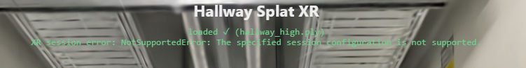
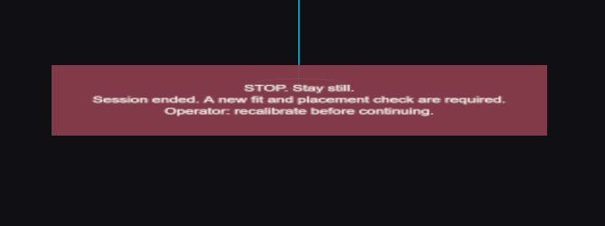

# help me test the think with the vr headset, how do i run that

Provider: codex; source: subagent; session: 01a1a10a-fb9d-7641-8dcd-841a8daa7b99.

Original local record: C:\Users\user\.codex\sessions\2026\11\03\rollout-2026-11-03T11-53-33-01a1a10a-fb9d-7641-8dcd-841a8daa7b99.jsonl.

Created: 2026-11-03T10:53:33.982Z. Export snapshot: 2026-11-05T11:08:59.327Z.

This transcript contains stored user-facing user/assistant messages, with image links. System/developer prompts, tool payloads and internal reasoning are omitted. Credential-shaped strings are redacted. A delegated thread's user-role messages may be inherited context or instructions from another agent.

<a id="message-1"></a>

## 1. user · 2026-11-03T10:53:34.001Z

# AGENTS.md instructions for C:\Users\user\Documents\Hallway_Project\02_Git\calibrated

<INSTRUCTIONS>
# Rules for coding agents

## Start here

Read `ai/strategy.md`, then the relevant sections of `docs/PROJECT_PLAN.md`, `docs/CALIBRATION.md`, and `docs/VALIDATION.md`.

This repository is in active implementation (viewer, XR session, calibration; hardware-validated on the Quest Browser and SteamVR/Steam Link routes). Continue through the agreed work without asking for a new “go” after every step, but keep the plan/build/check/log loop and record decisions in `ai/strategy.md`.

## Work loop

0. **Git and network operations:** Never push, pull, or fetch. Commits are local only.
   Before publishing anything, **ask the user** — they push and pull manually via
   GitHub Desktop. Never trigger credential prompts or other network authentication.

1. Record the current task and acceptance criteria in `ai/strategy.md`.
2. Build one reviewable step at a time. Keep modules small and separate calibration mathematics from rendering and device input.
3. Run the checks relevant to the change. Once implemented, use `npm test` for logic and `npm run check` for desktop browser behavior. These commands do not exist during the planning phase.
4. Read generated reports and inspect screenshots before describing them. Repair failures, then record the outcome and next step in `ai/strategy.md`.
5. Distinguish automated checks, desktop visual checks, and tests performed on the real PC/Quest/hallway. Never report a hardware milestone as passed from a browser screenshot or simulated pose.

For documentation changes, check consistency and relative links; do not create application tests just to test prose. Keep generated `.check/` results unedited.

## Calibration invariants

- In calibrated mode, one XR unit is one metre. The parent rig for the tracked camera and controllers stays at identity; transform the scan root into XR space.
- No joystick locomotion, teleportation, artificial turning, or user-scale control in calibrated mode.
- Fit explicitly paired physical/scan landmarks. A controller grip pose is not the physical probe tip; account for its measured offset.
- Keep validation landmarks separate from fit landmarks. Report fit residuals and held-out errors separately.
- Recenter, reference-space reset, viewer-tracking interruption, changed scan data, or a new session invalidate acceptance and require the recovery procedure. Invalid controller poses block active capture; loss of an unused controller alone does not invalidate alignment.
- A saved transform is a candidate for revalidation, never evidence of present alignment. Splats provide appearance, not certified wall geometry or collision protection.

## Scope and tools

Use existing project conventions and verify current APIs against the pinned dependencies. Routine reversible changes and dependency choices inside the authorized task do not need separate permission; record material architectural changes. Ask when missing information prevents a sound decision.

Do not change agent model, provider, credentials, or permission defaults as part of ordinary project work. Never print secrets. Do not dump large scan binaries into agent context; inspect metadata or use purpose-built processing when the task requires it. Keep private scans and calibration captures out of Git.

Use bounded checks where possible. When a development server is needed, track its process and stop it when finished unless the user needs it left running. Report blockers with evidence and continue independent work when possible.

## Provenance

Adapted from the Photolipsia agentic kit's small-step plan/build/check/log workflow. See `docs/REFERENCES.md` for source and licensing details.

</INSTRUCTIONS>
<environment_context>
  <cwd>C:\Users\user\Documents\Hallway_Project\02_Git\calibrated</cwd>
  <shell>powershell</shell>
  <current_date>2026-11-03</current_date>
  <timezone>Europe/Zurich</timezone>
  <filesystem><workspace_roots><root>C:\Users\user\Documents\Hallway_Project\02_Git\calibrated</root></workspace_roots><permission_profile type="managed"><file_system type="restricted"><entry access="read"><special>:root</special></entry><entry access="write"><path>C:\Users\user\Documents\Hallway_Project\02_Git\calibrated</path></entry><entry access="write"><special>:slash_tmp</special></entry><entry access="write"><special>:tmpdir</special></entry><entry access="read"><path>C:\Users\user\Documents\Hallway_Project\02_Git\calibrated\.git</path></entry><entry access="read"><path>C:\Users\user\Documents\Hallway_Project\02_Git\calibrated\.agents</path></entry><entry access="read"><path>C:\Users\user\Documents\Hallway_Project\02_Git\calibrated\.codex</path></entry><entry access="read"><path>C:\Users\user\Documents\Hallway_Project\02_Git\calibrated\.aws</path></entry></file_system></permission_profile></filesystem>
</environment_context>

<a id="message-2"></a>

## 2. user · 2026-11-03T10:53:34.001Z

<external_codex_apps_open_page>{"page_id":null}</external_codex_apps_open_page>

<a id="message-3"></a>

## 3. user · 2026-11-03T10:53:34.001Z

# Context from my IDE setup:

## Active file: docs/RENDER_QUALITY.md

## Open tabs:
- RENDER_QUALITY.md: docs/RENDER_QUALITY.md
- PROJECT_PLAN.md: docs/PROJECT_PLAN.md
- HEADSET_SETUP.md: docs/HEADSET_SETUP.md
- CALIBRATION.md: docs/CALIBRATION.md
- BACKLOG.md: docs/BACKLOG.md

## My request:
help me test the think with the vr headset, how do i run that


<a id="message-4"></a>

## 4. assistant · 2026-11-03T10:53:34.001Z

I’ll check the project’s headset setup and run commands, then give you the steps for testing it in VR.


<a id="message-5"></a>

## 5. assistant · 2026-11-03T10:53:34.002Z

The project uses Chrome on the PC → SteamVR → Steam Link → Quest. The compressed scans are already prepared. After entering VR, use the PC’s CALIBRATE button; the new experience also requires a physical placement check before “Start in headset” becomes available.


<a id="message-6"></a>

## 6. assistant · 2026-11-03T10:53:34.002Z

Use **Steam Link on the Quest and Chrome on your PC**.

1. Open **SteamVR** on the PC. Make sure it is the active **OpenXR runtime**.
2. Put on the Quest, open **Steam Link**, and connect to the PC.
3. In your VS Code terminal, from the project folder, run:

   ```powershell
   npm run dev
   ```

   Leave that terminal running.

4. Open this in **PC Chrome** and accept the local certificate warning:

   [Launch the viewer](https://localhost:5173/?quality=balanced&format=ksplat&xrDebug=1)

5. Wait for the scan to load, then click **Enter VR (WebXR)**. Check that both eyes show the hallway and head movement works.
6. Have someone at the PC click **CALIBRATE** while you hold both controllers. During the countdown, place **LEFT on physical landmark A** and **RIGHT on B**. Wait for the result.

For the new box/orb experience, use the right-side PC panel: check the real placement, tick **Physical box, floor and midpoint checked**, then click **Start in headset**. Orb collection needs tracked fingertips; the panel reports whether Steam Link supplies them.

Start with stationary viewing and keep the boundary enabled. There is **no passthrough** on this route. Leave the box/turn test until its physical placement is checked with an assistant present.

If it fails, tell me which step and the status text shown on the PC.

<a id="message-7"></a>

## 7. user · 2026-11-03T10:53:34.002Z

# Context from my IDE setup:

## Open tabs:
- report.json: .check/report.json
- RENDER_QUALITY.md: docs/RENDER_QUALITY.md
- PROJECT_PLAN.md: docs/PROJECT_PLAN.md
- HEADSET_SETUP.md: docs/HEADSET_SETUP.md
- CALIBRATION.md: docs/CALIBRATION.md

## My request:
PS C:\Users\user\Documents\Hallway_Project\02_Git\calibrated> npm run dev
npm : Die Datei "C:\Program Files\nodejs\npm.ps1" kann nicht geladen werden, da die Ausführung von Skripts auf diesem System deaktiviert ist. Weitere 
Informationen finden Sie unter "about_Execution_Policies" (https:/go.microsoft.com/fwlink/?LinkID=135170).
In Zeile:1 Zeichen:1
+ npm run dev
+ ~~~
    + CategoryInfo          : Sicherheitsfehler: (:) [], PSSecurityException
    + FullyQualifiedErrorId : UnauthorizedAccess
PS C:\Users\user\Documents\Hallway_Project\02_Git\calibrated> 


<a id="message-8"></a>

## 8. assistant · 2026-11-03T10:53:34.002Z

PowerShell is blocking the `npm.ps1` launcher. Run this instead—no settings change needed:

```powershell
npm.cmd run dev
```

Leave the terminal running, then open [the viewer in PC Chrome](https://localhost:5173/?quality=balanced&format=ksplat&xrDebug=1) and continue with **Enter VR**.

<a id="message-9"></a>

## 9. user · 2026-11-03T10:53:34.003Z

# Context from my IDE setup:

## Open tabs:
- report.json: .check/report.json
- RENDER_QUALITY.md: docs/RENDER_QUALITY.md
- PROJECT_PLAN.md: docs/PROJECT_PLAN.md
- HEADSET_SETUP.md: docs/HEADSET_SETUP.md
- CALIBRATION.md: docs/CALIBRATION.md

## My request:
i dont see the enter vr in headset


<a id="message-10"></a>

## 10. assistant · 2026-11-03T10:53:34.003Z

**Enter VR is on the PC’s Chrome page**, not in the headset’s Steam Link menu.

1. Keep **Steam Link connected** to the PC.
2. On the PC, open [the viewer in Chrome](https://localhost:5173/?quality=balanced&format=ksplat&xrDebug=1).
3. Click **Enter VR (WebXR)** on that page. The hallway should then appear in the headset.

If you don’t see the button **on the PC page either**, what text appears there?

<a id="message-11"></a>

## 11. user · 2026-11-03T10:53:34.003Z

# Context from my IDE setup:

## Active file: .check/report.json

## Open tabs:
- report.json: .check/report.json
- RENDER_QUALITY.md: docs/RENDER_QUALITY.md
- PROJECT_PLAN.md: docs/PROJECT_PLAN.md
- HEADSET_SETUP.md: docs/HEADSET_SETUP.md
- CALIBRATION.md: docs/CALIBRATION.md

## My request:




<a id="message-12"></a>

## 12. assistant · 2026-11-03T10:53:34.003Z

The scan loaded, but Chrome reports that the VR session configuration isn’t supported. I’ll check what the app requests so we can narrow down the cause.


<a id="message-13"></a>

## 13. assistant · 2026-11-03T10:53:34.004Z

SteamVR is already set as the active runtime, and its log recognizes the Quest. I also found Chrome test sessions using software rendering. I’m checking whether your viewer is open in one of those sessions, since that could affect VR startup.


<a id="message-14"></a>

## 14. assistant · 2026-11-03T10:53:34.004Z

The scan loaded, but **Chrome couldn’t start the VR session**. I checked: SteamVR is already the selected runtime and recognizes your Quest. The exact cause is still unclear.

Try this:

1. Close all Chrome windows.
2. Keep the Quest connected through **Steam Link**, with SteamVR showing the headset connected.
3. Reopen Chrome on the PC and open [the viewer with diagnostics](https://localhost:5173/?xrDebug=1&xrLayers=0).
4. Click **Enter VR** once while wearing the headset.

If the same error returns, try the [official WebXR VR sample](https://immersive-web.github.io/webxr-samples/immersive-vr-session.html) in PC Chrome and click **Enter XR**.

Tell me whether that sample opens in the headset. That will help separate a project problem from a Chrome/SteamVR connection problem.

<a id="message-15"></a>

## 15. user · 2026-11-03T10:53:34.004Z

# Context from my IDE setup:

## Active file: docs/VALIDATION.md

## Open tabs:
- VALIDATION.md: docs/VALIDATION.md
- RENDER_QUALITY.md: docs/RENDER_QUALITY.md
- PROJECT_PLAN.md: docs/PROJECT_PLAN.md
- report.json: .check/report.json
- HEADSET_SETUP.md: docs/HEADSET_SETUP.md

## My request:
it says stop stay still headset view interrupted. recalirate... operator: recalibrate before continuing. two times in the headset and i dont see the splats


<a id="message-16"></a>

## 16. assistant · 2026-11-03T10:53:34.004Z

VR is starting now, but the app is stopping the experience after a headset interruption. I’ll check why that leaves the splats hidden and why the warning appears twice.


<a id="message-17"></a>

## 17. assistant · 2026-11-03T10:53:34.005Z

I found two issues: both the calibration panel and the experience panel show the same STOP warning, and a visibility change during startup can lock calibration before tracking is ready. The splats stay hidden until calibration succeeds.

I’ll make startup wait for a visible, tracked headset and show one warning. Later tracking interruptions will still require manual recalibration.


<a id="message-18"></a>

## 18. assistant · 2026-11-03T10:53:34.005Z

The changes are in place and all 28 logic tests pass. The browser check hit an occupied test port; I’m resolving that so I can verify the startup and recovery paths before you retry.


<a id="message-19"></a>

## 19. assistant · 2026-11-03T10:53:34.006Z

The browser regressions pass: startup waits for tracking, hidden or untracked views cannot begin capture, and later interruptions still require manual recalibration. The duplicate STOP panel is removed. I’m finishing the build and screenshot review; the headset retest is still needed.


<a id="message-20"></a>

## 20. assistant · 2026-11-03T10:53:34.007Z

I fixed the duplicate warning and a startup issue that could block calibration. Automated checks and the build pass; it still needs your headset retest.

1. **Exit VR**, refresh the PC page, then enter VR again.
2. Keep the headset on and close the Quest/SteamVR menus.
3. Have someone click **CALIBRATE on the PC**.
4. During the **7-second countdown**, place **LEFT controller on A**, **RIGHT on B**.
5. After a successful fit, the splats should fade in over one second.

**The scan is intentionally hidden until calibration succeeds.** Removing the headset or opening a system menu after tracking starts can trigger the STOP message and require recalibration.

<a id="message-21"></a>

## 21. user · 2026-11-03T10:53:34.007Z

<environment_context>
  <current_date>2026-11-03</current_date>
  <timezone>Europe/Zurich</timezone>
  <filesystem><workspace_roots><root>C:\Users\user\Documents\Hallway_Project\02_Git\calibrated</root></workspace_roots><permission_profile type="disabled"><file_system type="unrestricted" /></permission_profile></filesystem>
</environment_context>

<a id="message-22"></a>

## 22. user · 2026-11-03T10:53:34.008Z

# Context from my IDE setup:

## Active file: docs/PROJECT_PLAN.md

## Open tabs:
- PROJECT_PLAN.md: docs/PROJECT_PLAN.md
- .env.local: docs/.env.local
- .gitignore: .gitignore
- .ignore: .ignore
- VOICE_SETUP.md: docs/VOICE_SETUP.md

## My request:
what are the commands to restart


<a id="message-23"></a>

## 23. assistant · 2026-11-03T10:53:34.008Z

In the terminal running the app, press **Ctrl+C**, then run:

```powershell
npm.cmd run dev
```

Then refresh the page in **PC Chrome**, click **Enter VR**, and recalibrate.

<a id="message-24"></a>

## 24. user · 2026-11-03T10:53:34.008Z

# Context from my IDE setup:

## Active file: docs/PROJECT_PLAN.md

## Open tabs:
- PROJECT_PLAN.md: docs/PROJECT_PLAN.md
- .env.local: docs/.env.local
- .gitignore: .gitignore
- .ignore: .ignore
- VOICE_SETUP.md: docs/VOICE_SETUP.md

## My request:
on the vr i only see this 




<a id="message-25"></a>

## 25. assistant · 2026-11-03T10:53:34.008Z

That message says the VR session has ended. I’ll check why the stopped screen remains visible and whether there’s a session error behind it.


<a id="message-26"></a>

## 26. assistant · 2026-11-03T10:53:34.008Z

The Steam Link log shows repeated video-packet timeouts, then “Connection inactive” at 11:36. That points to a stream disconnect, though it doesn’t establish why the connection dropped.

The app also leaves the scan hidden after an interrupted calibration ends. I’ll fix that desktop view and make the message say to re-enter VR before recalibrating.


<a id="message-27"></a>

## 27. assistant · 2026-11-03T10:53:34.009Z

The recovery changes pass the logic tests, browser checks and build. They fix the stale black screen after session end; they don’t prevent a Steam Link disconnect. The next step is to reconnect Steam Link, then start a fresh VR session from PC Chrome.


<a id="message-28"></a>

## 28. assistant · 2026-11-03T10:53:34.009Z

That message means **the VR session ended**. Steam Link’s log also shows a connection drop.

I fixed the stale black screen after session end. Tests and build pass, but the connection still needs a headset retest.

1. Leave `npm.cmd run dev` running.
2. In the Quest, reopen **Steam Link** and reconnect to the PC.
3. Refresh [the viewer in PC Chrome](https://localhost:5173/?xrDebug=1&xrLayers=0), then click **Enter VR**.
4. Keep the headset on, close system menus, and have someone click **CALIBRATE** on the PC.

Place the controllers on A/B during the seven-second countdown. The splats appear after a successful fit.

<a id="message-29"></a>

## 29. user · 2026-11-03T10:53:34.009Z

<environment_context>
  <current_date>2026-11-03</current_date>
  <timezone>Europe/Zurich</timezone>
  <filesystem><workspace_roots><root>C:\Users\user\Documents\Hallway_Project\02_Git\calibrated</root></workspace_roots><permission_profile type="managed"><file_system type="restricted"><entry access="read"><special>:root</special></entry><entry access="write"><path>C:\Users\user\Documents\Hallway_Project\02_Git\calibrated</path></entry><entry access="write"><special>:slash_tmp</special></entry><entry access="write"><special>:tmpdir</special></entry><entry access="read"><path>C:\Users\user\Documents\Hallway_Project\02_Git\calibrated\.git</path></entry><entry access="read"><path>C:\Users\user\Documents\Hallway_Project\02_Git\calibrated\.agents</path></entry><entry access="read"><path>C:\Users\user\Documents\Hallway_Project\02_Git\calibrated\.codex</path></entry><entry access="read"><path>C:\Users\user\Documents\Hallway_Project\02_Git\calibrated\.aws</path></entry></file_system></permission_profile></filesystem>
</environment_context>

<a id="message-30"></a>

## 30. user · 2026-11-03T10:53:34.009Z

# Context from my IDE setup:

## Active file: docs/PROJECT_PLAN.md

## Open tabs:
- PROJECT_PLAN.md: docs/PROJECT_PLAN.md
- .env.local: docs/.env.local
- .gitignore: .gitignore
- .ignore: .ignore
- VOICE_SETUP.md: docs/VOICE_SETUP.md

## My request:
how to reopen **Steam Link** and reconnect to the PC.  


<a id="message-31"></a>

## 31. assistant · 2026-11-03T10:53:34.009Z

I’ll check the steps for reopening Steam Link on the Quest.


<a id="message-32"></a>

## 32. assistant · 2026-11-03T10:53:34.009Z

1. **On the PC:** keep **Steam** and **SteamVR** open.
2. **In the headset:** press the **Meta button on the right controller** to open the Quest menu.
3. If Steam Link is still running, choose **Quit/Close**.
4. Open **Apps / Library**, search for **Steam Link**, and launch it.
5. Select your **PC’s name**, then **Connect**. If a pairing code appears, follow the prompt on the PC. [Steam’s setup guide](https://help.steampowered.com/en/faqs/view/0E2C-406B-9135-38A4)

Once you see SteamVR in the headset, refresh the viewer in **PC Chrome** and click **Enter VR**.

If your PC isn’t listed, check that the Quest and PC are on the same local network.

<a id="message-33"></a>

## 33. user · 2026-11-03T10:53:34.010Z

# Context from my IDE setup:

## Active file: docs/PROJECT_PLAN.md

## Open tabs:
- PROJECT_PLAN.md: docs/PROJECT_PLAN.md
- .env.local: docs/.env.local
- .gitignore: .gitignore
- .ignore: .ignore
- VOICE_SETUP.md: docs/VOICE_SETUP.md

## My request:
where do i check whats the name of this one


<a id="message-34"></a>

## 34. assistant · 2026-11-03T10:53:34.010Z

I’ll check this PC’s name so you can match it in Steam Link.


<a id="message-35"></a>

## 35. assistant · 2026-11-03T10:53:34.010Z

This PC’s name is **`inv50075`**. Select that name in Steam Link inside the headset.

You can also check it in PowerShell with:

```powershell
hostname
```

<a id="message-36"></a>

## 36. user · 2026-11-03T10:53:34.010Z

# Context from my IDE setup:

## Active file: docs/PROJECT_PLAN.md

## Open tabs:
- PROJECT_PLAN.md: docs/PROJECT_PLAN.md
- .env.local: docs/.env.local
- .gitignore: .gitignore
- .ignore: .ignore
- VOICE_SETUP.md: docs/VOICE_SETUP.md

## My request:
what then


<a id="message-37"></a>

## 37. assistant · 2026-11-03T10:53:34.010Z

After selecting **inv50075**:

1. Click **Connect** in Steam Link and wait for SteamVR to appear.
2. On the PC, open [the viewer in Chrome](https://localhost:5173/?xrDebug=1&xrLayers=0).
3. Click **Enter VR (WebXR)**.
4. Keep the headset on and close any system menus.
5. Have someone click **CALIBRATE** on the PC. During the **7-second countdown**, place the **left controller on A** and **right controller on B**.

The hallway should fade in after calibration succeeds.

<a id="message-38"></a>

## 38. user · 2026-11-03T10:53:34.010Z

# Context from my IDE setup:

## Active file: docs/PROJECT_PLAN.md

## Open tabs:
- PROJECT_PLAN.md: docs/PROJECT_PLAN.md
- .env.local: docs/.env.local
- .gitignore: .gitignore
- .ignore: .ignore
- VOICE_SETUP.md: docs/VOICE_SETUP.md

## My request:
what is the trigger and why are the remotes not recognised when i put them on the floor


<a id="message-39"></a>

## 39. assistant · 2026-11-03T10:53:34.010Z

I’ll check how the app recognizes the controllers during calibration and what happens when you put them down.


<a id="message-40"></a>

## 40. user · 2026-11-03T10:53:34.010Z

# Context from my IDE setup:

## Active file: docs/PROJECT_PLAN.md

## Open tabs:
- PROJECT_PLAN.md: docs/PROJECT_PLAN.md
- .env.local: docs/.env.local
- .gitignore: .gitignore
- .ignore: .ignore
- VOICE_SETUP.md: docs/VOICE_SETUP.md

## My request:
i see my hands and not controllers


<a id="message-41"></a>

## 41. assistant · 2026-11-03T10:53:34.010Z

That suggests the Quest has switched to **hand tracking**. Calibration needs the physical controllers.

The **trigger** is the curved front button under your **index finger**. The side button under your middle finger is the grip.

Try this:

1. Pick up both controllers. Press **A on the right** and **X on the left** to wake them.
2. If putting them down brings your hands back, open **Quest Settings**, search **Hand tracking**, and temporarily turn it **off**.
3. Return to the viewer and re-enter VR if the session ended.
4. Hold both controllers until the calibration screen says **Remotes: 2 (L+R)**.
5. Have someone click **CALIBRATE**, then place them on A/B during the countdown, keeping them in view of the headset.

The app shows pointing rays rather than full controller models. Hand tracking will be needed again later for touching the orb.

<a id="message-42"></a>

## 42. user · 2026-11-03T10:53:34.011Z

# Context from my IDE setup:

## Active file: docs/PROJECT_PLAN.md

## Open tabs:
- PROJECT_PLAN.md: docs/PROJECT_PLAN.md
- .env.local: docs/.env.local
- .gitignore: .gitignore
- .ignore: .ignore
- VOICE_SETUP.md: docs/VOICE_SETUP.md

## My request:
listen here, i need you to rethink the whole starting the callibration flow beacuse i cannot have two people all the time. I want to be able to press start on the computer and go in the hall and put on my headset and for it to recognise the controllers and not my hands neceserilly... i dont want to turn it fucking off because i need my hands tracked in the experience later, it is a software thing.. Make the flow easier and error messages not so ambiguous


<a id="message-43"></a>

## 43. assistant · 2026-11-03T10:53:34.011Z

I’ll redesign this for one person: start setup on the PC, put on the headset in the hallway, then place and confirm each controller without a seven-second rush. Hand tracking will stay enabled for the experience. I’ll also make each message name what’s missing and how to recover.


<a id="message-44"></a>

## 44. assistant · 2026-11-03T10:58:40.190Z

Updated these files:

- `docs/HEADSET_SETUP.md`
- `docs/CALIBRATION.md`
- `docs/PROJECT_PLAN.md`
- `docs/VALIDATION.md`

They describe solo PC startup, sequential grounded controller captures, enabled hand tracking, saved-point retention, headset restart and honest session-reentry limits. Removed current countdown/hand-tracking-off/operator dependencies. Supervised physical validation remains separate.

Verified 16 relative links; whitespace checks pass. No hardware acceptance claimed.

<a id="message-45"></a>

## 45. assistant · 2026-11-03T11:02:34.208Z

Updated `tests/browser/calibrationScenario.mjs` with the solo adapter regressions, including isolated mocked time, current-frame controller-only capture, hand takeover, reset/restart and session-end behavior.

Syntax and whitespace checks pass. Full browser check left for your integrated run.

<a id="message-46"></a>

## 46. assistant · 2026-11-03T11:27:40.433Z

The strongest explanation is **the automated browser check overwrote SteamVR’s registration for normal Chrome**:

- 12:16:56: normal Chrome XR PID `9440` registered its app key.
- 12:17:49: automated, software-rendered Chrome PID `31496` replaced that same key.
- 12:18:03: PID `31496` exited; SteamVR cleared the key.
- 12:22 onward: PID `9440` repeatedly failed with “No app info” / `VRInitError_Init_AppInfoInitFailed`.

Both registrations used vrserver PID `6792`; these records do not support a SteamVR restart as the immediate cause.

For test isolation, the exact Chromium flag is:

```text
--force-webxr-runtime=no-xr-runtime
```

Not `none`. [Switch definitions](https://raw.githubusercontent.com/chromium/chromium/main/content/public/common/content_switches.cc) and [provider gating](https://raw.githubusercontent.com/chromium/chromium/main/content/browser/xr/service/xr_runtime_manager_impl.cc) confirm its purpose.

Chromium maps several session-creation failures to the same generic `NotSupportedError`; the separate console message beginning “Could not create a session because…” identifies its internal failure category. [Mapping source](https://raw.githubusercontent.com/chromium/chromium/main/third_party/blink/renderer/modules/xr/xr_system.cc)

After isolating checks, safely recover by having the user fully exit/reopen normal Chrome with SteamVR already connected. Verify the new Chrome PID registers and transitions successfully, and subsequent checks add **no automated Chrome registrations**. No process or runtime was changed by this audit.

<a id="message-47"></a>

## 47. assistant · 2026-11-03T12:09:19.016Z

Updated README and the four assigned docs to the restored seven-second calibration flow. Preserved hand tracking, desktop XR isolation, bounded error details, movement boundaries and installation guidance.

Checked 31 relative links: none broken. Whitespace checks pass. Fresh hardware validation remains explicitly pending.

<a id="message-48"></a>

## 48. assistant · 2026-11-03T12:21:58.087Z

Recommend one cohesive installation commit including interaction, hands/assets/licenses, voices, calibration/session recovery, boundary diagnostics, quality/compression, checks and accompanying docs. Quality belongs: it was part of the installation scope and is already referenced by shared viewer code, package scripts and tests.

Exclude `.env*`, generated audio, `.check`, scan binaries, private metadata/captures and dependencies/build output. Ignore rules cover these; no private assets or env files are currently tracked.

Optional cleanup: `ai/strategy.md:219` contains incidental local process IDs/timestamps. Keep its project decision record, but those details can be summarized before publishing. No other unrelated pending work identified.

<a id="message-49"></a>

## 49. assistant · 2026-11-03T12:30:26.189Z

Targeted fix is sound. Key pitfalls:

- `calibrationActive` also covers READY/hiding hands; use `isCapturing()` for COUNTDOWN/CONFIRM.
- READY without a fit can wait through focus changes without a latched STOP.
- Cancel real capture immediately on `visibilitychange`; hidden sessions may deliver no further frames.
- `visible-blurred` suppresses input poses by specification, so null controller poses there do not prove tracking loss. [WebXR visibility states](https://www.w3.org/TR/webxr/#xrvisibilitystate)
- Preserve invalidation after a fit; recovery must require an explicit physical-controller trigger and fresh A/B.
- Put recovery action before diagnostic details: the HUD currently truncates after five wrapped lines, potentially hiding its footer.

Test READY focus transitions, COUNTDOWN/CONFIRM cancellation without another frame, restored-view messaging, blocked triggers while unready, physical-trigger restart, hand rejection and no automatic acceptance. Keep the hardware-isolated harness. No edits or runtime actions performed.

<a id="message-50"></a>

## 50. assistant · 2026-11-03T12:33:27.975Z

Updated `tests/browser/experienceScenario.mjs` for READY focus changes, immediate capture cancellation, precise visibility states and visible recovery actions without restored authority. Existing hand/rig checks remain.

Updated recovery paragraphs in `docs/HEADSET_SETUP.md` and `docs/CALIBRATION.md`. Syntax, whitespace and seven relative links pass. Full browser validation left for your integrated run.

<a id="message-51"></a>

## 51. assistant · 2026-11-03T12:36:04.583Z

Added the synthetic HUD artifact in `tests/browser/experienceScenario.mjs` only. It captures actual pause/recovery texture pixels into two labelled rows and writes `.check/pause-recovery-synthetic.png`.

Existing assertions remain. No checks or production edits performed.

<a id="message-52"></a>

## 52. assistant · 2026-11-03T14:02:02.213Z

Minimal literal change: set `ACTIVE_SCAN.rotation` to `[0, -Math.SQRT1_2, 0, Math.SQRT1_2]`. Existing placement math then yields root translation `[4.5, 2.1, -3]`, preserves the start at XR origin and places the box base at `[2.5, 0, 0]`.

A Y rotation changes heading; it preserves vertical coordinates and cannot level a genuinely vertical floor. Honor the requested yaw, but don’t claim floor correction or silently substitute X/Z.

Keep generic identity-placement tests; add active-asset yaw/up-vector coverage and update hard-coded initial box expectations/docs. The synthetic corridor uses the inverse asset transform, so its screenshot cannot demonstrate correction of the real scan’s floor. No edits performed.
