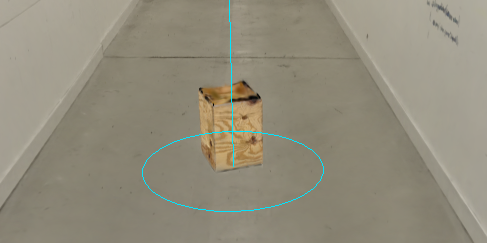
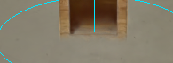
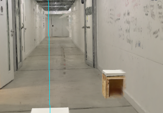

# Animate WoodenBox splat entrance

Provider: codex; source: user; session: 01a1a5f4-b5bf-7ec1-908e-da8982f4b736.

Original local record: \\?\C:\Users\user\.codex\sessions\2026\11\04\rollout-2026-11-04T10-47-20-01a1a5f4-b5bf-7ec1-908e-da8982f4b736.jsonl.

Created: 2026-11-04T09:47:20.385Z. Export snapshot: 2026-11-05T11:08:59.327Z.

This transcript contains stored user-facing user/assistant messages, with image links. System/developer prompts, tool payloads and internal reasoning are omitted. Credential-shaped strings are redacted. A delegated thread's user-role messages may be inherited context or instructions from another agent.

## 1. user · 2026-11-04T09:50:28.778Z

# AGENTS.md instructions for C:\Users\user\Documents\Hallway_Project\02_Git\calibrated

<INSTRUCTIONS>
# Rules for coding agents

## Start here

Read `ai/strategy.md`, then the relevant sections of `docs/PROJECT_PLAN.md`, `docs/CALIBRATION.md`, and `docs/VALIDATION.md`.

This repository is in active implementation (viewer, XR session, calibration; hardware-validated on the Quest Browser and SteamVR/Steam Link routes). Continue through the agreed work without asking for a new “go” after every step, but keep the plan/build/check/log loop and record decisions in `ai/strategy.md`.

## Work loop

0. **Git and network operations:** Never push, pull, or fetch. Commits are local only.
   Before publishing anything, **ask the user** — they push and pull manually via
   GitHub Desktop. Never trigger credential prompts or other network authentication.

1. Record the current task and acceptance criteria in `ai/strategy.md`.
2. Build one reviewable step at a time. Keep modules small and separate calibration mathematics from rendering and device input.
3. Run the checks relevant to the change. Once implemented, use `npm test` for logic and `npm run check` for desktop browser behavior. These commands do not exist during the planning phase.
4. Read generated reports and inspect screenshots before describing them. Repair failures, then record the outcome and next step in `ai/strategy.md`.
5. Distinguish automated checks, desktop visual checks, and tests performed on the real PC/Quest/hallway. Never report a hardware milestone as passed from a browser screenshot or simulated pose.

For documentation changes, check consistency and relative links; do not create application tests just to test prose. Keep generated `.check/` results unedited.

## Calibration invariants

- In calibrated mode, one XR unit is one metre. The parent rig for the tracked camera and controllers stays at identity; transform the scan root into XR space.
- No joystick locomotion, teleportation, artificial turning, or user-scale control in calibrated mode.
- Fit explicitly paired physical/scan landmarks. A controller grip pose is not the physical probe tip; account for its measured offset.
- Keep validation landmarks separate from fit landmarks. Report fit residuals and held-out errors separately.
- Recenter, reference-space reset, viewer-tracking interruption, changed scan data, or a new session invalidate acceptance and require the recovery procedure. Invalid controller poses block active capture; loss of an unused controller alone does not invalidate alignment.
- A saved transform is a candidate for revalidation, never evidence of present alignment. Splats provide appearance, not certified wall geometry or collision protection.

## Scope and tools

`src/viewer/scanAsset.ts` contains manually adjusted scan placement. Do not modify this file, including rotation, start point, camera or anchors, without explicit user permission. Configure calibration landmarks in `src/calibration/landmarks.ts` instead; tests must accommodate the manual asset settings.

Use existing project conventions and verify current APIs against the pinned dependencies. Routine reversible changes and dependency choices inside the authorized task do not need separate permission; record material architectural changes. Ask when missing information prevents a sound decision.

Do not change agent model, provider, credentials, or permission defaults as part of ordinary project work. Never print secrets. Do not dump large scan binaries into agent context; inspect metadata or use purpose-built processing when the task requires it. Keep private scans and calibration captures out of Git.

Use bounded checks where possible. When a development server is needed, track its process and stop it when finished unless the user needs it left running. Report blockers with evidence and continue independent work when possible.

## Provenance

Adapted from the Photolipsia agentic kit's small-step plan/build/check/log workflow. See `docs/REFERENCES.md` for source and licensing details.

</INSTRUCTIONS>
<environment_context>
  <cwd>C:\Users\user\Documents\Hallway_Project\02_Git\calibrated</cwd>
  <shell>powershell</shell>
  <current_date>2026-11-04</current_date>
  <timezone>Europe/Zurich</timezone>
  <filesystem><workspace_roots><root>C:\Users\user\Documents\Hallway_Project\02_Git\calibrated</root></workspace_roots><permission_profile type="managed"><file_system type="restricted"><entry access="read"><special>:root</special></entry><entry access="write"><path>C:\Users\user\Documents\Hallway_Project\02_Git\calibrated</path></entry><entry access="write"><special>:slash_tmp</special></entry><entry access="write"><special>:tmpdir</special></entry><entry access="read"><path>C:\Users\user\Documents\Hallway_Project\02_Git\calibrated\.git</path></entry><entry access="read"><path>C:\Users\user\Documents\Hallway_Project\02_Git\calibrated\.agents</path></entry><entry access="read"><path>C:\Users\user\Documents\Hallway_Project\02_Git\calibrated\.codex</path></entry><entry access="read"><path>C:\Users\user\Documents\Hallway_Project\02_Git\calibrated\.aws</path></entry></file_system></permission_profile></filesystem>
</environment_context>

## 2. user · 2026-11-04T09:50:28.792Z

<external_codex_apps_open_page>{"page_id":null}</external_codex_apps_open_page>

## 3. user · 2026-11-04T09:50:28.805Z

# Context from my IDE setup:

## Active file: src/calibration/landmarks.ts

## Open tabs:
- landmarks.ts: src/calibration/landmarks.ts
- scanAsset.ts: src/viewer/scanAsset.ts
- Pasted text.txt: c:\Users\user\.codex\attachments\d35cc99d-bff6-4c23-862e-b78af88ec115\Pasted text.txt
- main.ts: src/main.ts
- movementBoundary.ts: src/xr/movementBoundary.ts

## My request:
instead of the 3d box that is mocked I want to place this splat public\splats\WoodenBox.ply with the entrance animation going up from the floor with easying in and out back in the floor (below the floor level

## 4. assistant · 2026-11-04T09:50:31.923Z

I’ll find the mocked box and its animation, then replace it with `WoodenBox.ply` and an eased rise from below the floor followed by a descent back beneath it.

## 5. assistant · 2026-11-04T09:51:04.693Z

The installation has two mocked boxes. I’ll use the wooden splat for both, keep their existing positions and trigger footprints, and add eased Show/Hide motion. I’ll also preload them with the hallway so showing a box won’t need a new load.

## 6. assistant · 2026-11-04T09:53:36.914Z

The supplied PLY contains 27,577 splats. I’m mapping its bounds to the existing 36 × 36 × 43 cm boxes and adding a 1.5-second rise and descent. I’ll clip the animation at the floor so the splats don’t show through while submerged.

## 7. user · 2026-11-04T09:56:42.374Z

# Context from my IDE setup:

## Active file: src/calibration/landmarks.ts

## Open tabs:
- landmarks.ts: src/calibration/landmarks.ts
- scanAsset.ts: src/viewer/scanAsset.ts
- Pasted text.txt: c:\Users\user\.codex\attachments\d35cc99d-bff6-4c23-862e-b78af88ec115\Pasted text.txt
- main.ts: src/main.ts
- movementBoundary.ts: src/xr/movementBoundary.ts

## My request:
currently its rotated and upside down, i want it to have sides paralell to the walls like the mock box was

## 8. assistant · 2026-11-04T09:56:46.401Z

I’ll correct the splat’s orientation so it stands upright with its sides parallel to the hallway walls, matching the mock box.

## 9. assistant · 2026-11-04T10:00:15.697Z

The source box’s faces are rotated about 19° within the PLY. I’ve removed that rotation and corrected which end faces upward. The box now inherits the same hallway-aligned heading as the mock; I’m checking the rendered result and Show/Hide behavior.

## 10. assistant · 2026-11-04T10:05:33.861Z

The corrected render shows the box’s white top facing upward, and the orientation checks pass. The animation checks also confirm that it starts fully below the floor and keeps its placement fixed. I’m finishing the browser checks and production build.

## 11. assistant · 2026-11-04T10:07:53.652Z

The corrected box looks upright with its sides aligned, and the Show/Hide checks pass against the actual PLY. The build also passes. A final browser run hit a file-watcher conflict with generated build files; I’m resolving that check-runner issue before the last pass.

## 12. assistant · 2026-11-04T10:10:42.138Z

All checks pass: 139 logic tests, the full desktop browser suite, and the production build. I’ve inspected the corrected wooden box and its rise/descent screenshots. It now stands upright with its sides aligned to the hallway; headset testing remains pending.

## 13. assistant · 2026-11-04T10:15:08.664Z

The final verification is running against the latest workspace changes. The box checks are passing, including the hidden endpoint: its top finishes 4 cm below the floor.

## 14. assistant · 2026-11-04T10:16:08.341Z

Fixed: both wooden splat boxes are upright, with sides parallel to the hallway walls. Show/Hide eases them up from and back below the floor over 1.5 seconds.

140 tests, 31 desktop checks, and build pass. Headset verification remains pending.

## 15. user · 2026-11-04T10:16:08.538Z

# Context from my IDE setup:

## Active file: src/calibration/landmarks.ts

## Open tabs:
- landmarks.ts: src/calibration/landmarks.ts
- scanAsset.ts: src/viewer/scanAsset.ts
- Pasted text.txt: c:\Users\user\.codex\attachments\d35cc99d-bff6-4c23-862e-b78af88ec115\Pasted text.txt
- main.ts: src/main.ts
- movementBoundary.ts: src/xr/movementBoundary.ts

## My request:
orientation is good, can you move the splat a tiny bit up so its sitting on the floor and not merging with it

## 16. assistant · 2026-11-04T10:16:13.581Z

I’ll lift the box splats slightly so their bases clear the floor, while keeping the placement and trigger positions fixed.

## 17. assistant · 2026-11-04T10:18:30.448Z

Both box splats now sit 2 cm higher. The actual-splat browser checks confirm the lift and the fully hidden endpoint below the floor; I’m finishing the remaining checks.

## 18. assistant · 2026-11-04T10:19:36.310Z

Raised both box splats by **2 cm** to reduce floor blending, keeping their orientation and animations intact.

140 tests and 31 desktop checks pass. Refresh the page to see the adjustment.

## 19. user · 2026-11-04T10:23:29.825Z

<external_codex_apps_open_page>{"page_id":null}</external_codex_apps_open_page>

## 20. user · 2026-11-04T10:23:29.836Z

# Context from my IDE setup:

## Active file: src/calibration/landmarks.ts

## Open tabs:
- landmarks.ts: src/calibration/landmarks.ts
- scanAsset.ts: src/viewer/scanAsset.ts
- Pasted text.txt: c:\Users\user\.codex\attachments\d35cc99d-bff6-4c23-862e-b78af88ec115\Pasted text.txt
- main.ts: src/main.ts
- movementBoundary.ts: src/xr/movementBoundary.ts

## My request:
the boxes are actually on the right spot, but I have a problem with the walls not being centered after rotation anymore? the real box in reality is aligned with the splat box but its sitting inside the gausian splat wall a bit, can we have an offset during rotation to fix that, that is: to align the walls of the flipped hallway to the real walls in reality? the walls are nicely aligned before rotation.

## 21. assistant · 2026-11-04T10:23:36.191Z

I’ll check how the hallway turns around the first box, then add a way to adjust the flipped hallway’s sideways offset while keeping both boxes fixed. I’ll also check whether the scan’s width changes across the turn, since an offset alone may not align both walls.

## 22. assistant · 2026-11-04T10:27:35.199Z

The turn math is correct, but it swaps hallway sections whose fitted wall positions, widths and directions differ slightly. I’ll add a signed centimetre adjustment that eases in during the turn and can be tuned afterward. It can improve alignment at the box, but a sideways shift alone may not match both walls along the whole corridor.

## 23. user · 2026-11-04T10:30:00.155Z

<send_user_message_question_reply>
[{"questionItemId":"[\"request_user_input_async\",\"call_6f87ea6010a440f8a9b7f35a064513d1\",0]","question":"Do you know the sideways correction needed after the flip—for example, “10 cm left when facing down the original hallway”? I’m adding a centimetre adjustment you can tune on the PC; I can’t determine the physical offset from the screenshot.","answer":"lets say its 10 cm for now, i will test it. so the walls need to be moved 10 cm in this directon when they are rotated (during rotation the offset is corrected)"}]
</send_user_message_question_reply>

## 24. user · 2026-11-04T10:30:05.513Z

<external_codex_apps_open_page>{"page_id":null}</external_codex_apps_open_page>

## 25. user · 2026-11-04T10:30:05.523Z

# Context from my IDE setup:

## Active file: src/calibration/landmarks.ts

## Open tabs:
- landmarks.ts: src/calibration/landmarks.ts
- scanAsset.ts: src/viewer/scanAsset.ts
- Pasted text.txt: c:\Users\user\.codex\attachments\d35cc99d-bff6-4c23-862e-b78af88ec115\Pasted text.txt
- main.ts: src/main.ts
- movementBoundary.ts: src/xr/movementBoundary.ts

## My request:
both boxes are still inside the floor so I would move them up a bit 

## 26. assistant · 2026-11-04T10:30:50.528Z

I’ll start with a 10 cm hallway correction, blended into the turn, and raise both box splats another 3 cm—5 cm total.

I’m taking the hallway direction to mean toward the wall beside the second box in your screenshot. The signed control will let you reverse it if needed.

## 27. assistant · 2026-11-04T10:35:24.620Z

The 10 cm turn correction and 5 cm total box lift are implemented. The original hallway view stays unchanged, and the correction eases in as it turns. Logic tests and the build pass; I’m now checking the controls and fixed box positions in the browser.

## 28. assistant · 2026-11-04T10:37:32.810Z

The browser checks pass too: the 10 cm shift leaves both box splats fixed, and their appearances now sit 5 cm above the logical floor. You can tune or reverse the shift under **Flipped hallway wall alignment**. The amount and direction still need your headset check.

## 29. assistant · 2026-11-04T10:38:18.470Z

Raised both box splats another **3 cm—5 cm total**.

The hallway now eases **10 cm right during the flip**, relative to the original hallway direction. Tune or reverse it under **Flipped hallway wall alignment**.

144 tests, 33 desktop checks, and build pass. Physical alignment still needs your headset test.

## 30. user · 2026-11-04T11:23:29.281Z

# Context from my IDE setup:

## Active file: src/calibration/landmarks.ts

## Open tabs:
- landmarks.ts: src/calibration/landmarks.ts
- scanAsset.ts: src/viewer/scanAsset.ts
- Pasted text.txt: c:\Users\user\.codex\attachments\d35cc99d-bff6-4c23-862e-b78af88ec115\Pasted text.txt
- main.ts: src/main.ts
- movementBoundary.ts: src/xr/movementBoundary.ts

## My request:
remove the box raises, in vr they are too high, make them sit on the floor, also can you move all other things from the hallway with the offset as well? the wall and the broom and the hole are ment to be in the rotated coordinate space so they should be still centered (broom) and the wall should go from one wall in the splats to the other (covering the whole hallway width) the same with the hole, the second chair should always be aligned with the wall from the splats in reality is gonna stand exactly next to the wall

## 31. assistant · 2026-11-04T11:23:36.290Z

I’ll remove the boxes’ visual lift and check the coordinate handling for the other objects. I’ll make the broom, wall, hole and second box follow the shifted, rotated hallway, while keeping the first box’s physical turn pivot fixed.

## 32. user · 2026-11-04T11:24:35.708Z

<send_user_message_question_reply>
[{"questionItemId":"[\"request_user_input_async\",\"call_c839c4c3e34c4ad3b112f4feb6b54633\",0]","question":"Should the wall keep its current post-turn route from Z = −8 to −2, with the objects following the corrected hallway sideways, or should their lengthwise positions rotate around the first box too?","answer":"Keep the Z = −8 to −2 route"}]
</send_user_message_question_reply>

## 33. user · 2026-11-04T11:25:00.075Z

<external_codex_apps_open_page>{"page_id":null}</external_codex_apps_open_page>

## 34. user · 2026-11-04T11:25:00.085Z

# Context from my IDE setup:

## Active file: src/calibration/landmarks.ts

## Open tabs:
- landmarks.ts: src/calibration/landmarks.ts
- scanAsset.ts: src/viewer/scanAsset.ts
- Pasted text.txt: c:\Users\user\.codex\attachments\d35cc99d-bff6-4c23-862e-b78af88ec115\Pasted text.txt
- main.ts: src/main.ts
- movementBoundary.ts: src/xr/movementBoundary.ts

## My request:
no actually make it come from the other side

## 35. assistant · 2026-11-04T11:26:44.564Z

I’ll switch the wall’s approach to **Z = +8 toward +2**, keeping the delay and player-clearance checks. Both box lifts will return to zero, and I’ll fit the broom, wall, hole and second box to the corrected hallway at their lengthwise positions.

## 36. assistant · 2026-11-04T11:36:56.991Z

The scan fits show that the old fixed 2.10 m wall and hole width was too narrow at some stations. They now use the current fitted wall span, and the broom uses the current centreline. The second box keeps its lengthwise position and places an edge against the selected current wall. Both box lifts are removed.

## 37. assistant · 2026-11-04T11:48:57.375Z

The implementation and 157 logic tests pass. The browser run caught old checks that assumed a fixed-width wall and a permanently frozen second box; I’m updating those checks and verifying the new behavior against the actual scan. The first box remains the fixed pivot.

## 38. assistant · 2026-11-04T11:57:21.392Z

The browser checks now confirm that offset adjustments keep the first box fixed while re-centring the broom, keeping the hole and wall against the fitted boundaries, and moving the second box with its selected wall. I’m finishing the original-scan render checks; both box visuals are back at floor level.

## 39. assistant · 2026-11-04T12:00:23.924Z

The full suite passes: **157 logic tests and 38 browser checks**, including original-scan renders. I inspected the rendered wall, hole and second chair; the wall spans the fitted corridor, and the chair’s footprint edge meets its current fitted wall. The build passes too. Physical alignment still needs your VR check.

## 40. assistant · 2026-11-04T12:01:30.132Z

Updated:

- Removed both box lifts.
- Broom centres in the corrected hallway.
- Wall and hole span the current fitted walls.
- Second chair follows its selected wall; first box stays fixed.
- Wall approaches from **Z +8 → +2**.

157 logic tests, 38 desktop checks—including original-scan renders—and build pass. Please recheck alignment in VR.

## 41. user · 2026-11-04T12:36:34.091Z

# Context from my IDE setup:

## Active file: src/calibration/landmarks.ts

## Open tabs:
- landmarks.ts: src/calibration/landmarks.ts
- scanAsset.ts: src/viewer/scanAsset.ts
- Pasted text.txt: c:\Users\user\.codex\attachments\d35cc99d-bff6-4c23-862e-b78af88ec115\Pasted text.txt
- main.ts: src/main.ts
- movementBoundary.ts: src/xr/movementBoundary.ts

## My request:
make the wall appear and go from -8 to -2 instead

## 42. assistant · 2026-11-04T12:36:46.803Z

I’ll switch the wall back to **Z −8 → −2**, keeping its timing, hallway alignment and player-clearance behavior.

## 43. user · 2026-11-04T12:37:20.189Z

# Context from my IDE setup:

## Active file: src/calibration/landmarks.ts

## Open tabs:
- landmarks.ts: src/calibration/landmarks.ts
- scanAsset.ts: src/viewer/scanAsset.ts
- Pasted text.txt: c:\Users\user\.codex\attachments\d35cc99d-bff6-4c23-862e-b78af88ec115\Pasted text.txt
- main.ts: src/main.ts
- movementBoundary.ts: src/xr/movementBoundary.ts

## My request:
how do i check if my headset has sounds

## 44. assistant · 2026-11-04T12:37:49.394Z

Start with a headset-only test: raise the Quest volume and play a video or system sound without Steam Link. If that works, the headset speakers are working and we can check PC audio routing.

I’ll verify the Steam Link steps while finishing the wall’s −8 → −2 change.

## 45. assistant · 2026-11-04T12:38:47.258Z

For this app, keep Steam Link connected and:

1. Open **VOICES / LOCAL AUDIO** at the top right.
2. Uncheck **Mute**, click **ENABLE VOICES**, then **PREVIEW VOICE**.
3. Listen through the headset. The local voice files are present.

If sound plays on the PC instead, check the selected output in **Windows Sound settings** and **SteamVR → Settings → Audio**, plus both volume controls. [Steam’s audio troubleshooting](https://help.steampowered.com/en/faqs/view/7D79-694F-CD36-CC9A) recommends checking those outputs and testing Windows audio.

## 46. user · 2026-11-04T12:39:38.498Z

# Context from my IDE setup:

## Active file: src/calibration/landmarks.ts

## Open tabs:
- landmarks.ts: src/calibration/landmarks.ts
- scanAsset.ts: src/viewer/scanAsset.ts
- Pasted text.txt: c:\Users\user\.codex\attachments\d35cc99d-bff6-4c23-862e-b78af88ec115\Pasted text.txt
- main.ts: src/main.ts
- movementBoundary.ts: src/xr/movementBoundary.ts

## My request:
where do i find **Windows Sound settings** and **SteamVR → Settings → Audio**, plus both volume controls  

## 47. assistant · 2026-11-04T12:40:28.103Z

Both settings windows are on your **PC**:

- **Windows Sound:** press **Windows + R**, type `ms-settings:sound`, then press **Enter**. Select the output device under **Output**.
- **SteamVR Audio:** find the small **SteamVR desktop window** showing the headset/controller icons. Click **☰ → Settings → Audio**.
- **PC volume:** click the speaker icon beside the Windows clock and raise the slider.
- **Headset volume:** use the physical **+ / − volume buttons** on the Quest.

Keep Steam Link connected while checking the PC outputs so its audio device is available.

## 48. assistant · 2026-11-04T12:44:01.055Z

The wall’s **−8 → −2** route check has passed, including pausing near the player and resuming at the same speed. The remaining regression checks are finishing. For audio, the Windows shortcut and SteamVR menu steps above are ready to use while Steam Link is connected.

## 49. assistant · 2026-11-04T12:45:53.824Z

On your **PC**:

1. **Windows Sound:** press **Windows + R**, type `ms-settings:sound`, press **Enter**. [Microsoft reference](https://learn.microsoft.com/en-us/windows/apps/develop/launch/launch-settings)
2. **SteamVR Audio:** open the small SteamVR window showing headset/controller icons, then **☰ → Settings → Audio**. [Steam support](https://help.steampowered.com/en/faqs/view/7D79-694F-CD36-CC9A)
3. **Volume controls:** use the volume slider in Windows Sound and the physical **+ / − buttons on your Quest**.

Keep Steam Link connected. In our app, open **VOICES / LOCAL AUDIO → ENABLE VOICES → PREVIEW VOICE**.

The wall is also switched to **−8 → −2**; 157 logic tests and 33 desktop checks pass.

## 50. user · 2026-11-04T12:56:35.613Z

# Context from my IDE setup:

## Active file: src/calibration/landmarks.ts

## Open tabs:
- landmarks.ts: src/calibration/landmarks.ts
- scanAsset.ts: src/viewer/scanAsset.ts
- Pasted text.txt: c:\Users\user\.codex\attachments\d35cc99d-bff6-4c23-862e-b78af88ec115\Pasted text.txt
- main.ts: src/main.ts
- movementBoundary.ts: src/xr/movementBoundary.ts

## My request:
can you flip the walll to come from the other side

## 51. assistant · 2026-11-04T12:57:01.235Z

I’ll switch it to approach from **Z +8 toward +2**, keeping the delay, speed and player-clearance behavior.

## 52. user · 2026-11-04T12:57:53.680Z

# Context from my IDE setup:

## Active file: src/calibration/landmarks.ts

## Open tabs:
- landmarks.ts: src/calibration/landmarks.ts
- scanAsset.ts: src/viewer/scanAsset.ts
- Pasted text.txt: c:\Users\user\.codex\attachments\d35cc99d-bff6-4c23-862e-b78af88ec115\Pasted text.txt
- main.ts: src/main.ts
- movementBoundary.ts: src/xr/movementBoundary.ts

## My request:
the wall is coming from the good side in the desktop preview and when i try the solo vr test its the wong side

## 53. assistant · 2026-11-04T12:58:24.308Z

Since the desktop preview is correct, I’ll keep that direction and check the VR route calculation. The wall should approach from the same side of the calibrated hallway, even when VR uses different world axes.

## 54. assistant · 2026-11-04T13:04:53.363Z

The wall currently uses SteamVR’s world Z axis for its route. Calibration can turn that axis relative to the hallway, which explains the side changing in VR. I’m making the route follow the calibrated hallway frame while keeping the desktop direction and player-distance checks.

## 55. assistant · 2026-11-04T13:07:39.250Z

The coordinate fix is in place, and all 160 logic tests pass. I’m checking the actual wall renderer with simulated 180° and 90° calibration changes, including entry blocking and the player-distance pause. Headset verification will still need your test.

## 56. assistant · 2026-11-04T13:09:30.056Z

The browser checks confirm that the wall keeps the same hallway-side approach under opposite and sideways XR axes. Its entry sweep and 75 cm player buffer also work in that frame. The production build passes; the full regression run is still finishing.

## 57. assistant · 2026-11-04T13:11:10.004Z

The desktop route, simulated VR route, rendered positions, and player-clearance checks have passed. The full run is now finishing the calibration and interruption checks.

## 58. assistant · 2026-11-04T13:12:13.075Z

Fixed the coordinate mismatch: the VR wall now follows the calibrated hallway direction, preserving the desktop’s −8 → −2 approach.

Passed 160 logic tests, 34 browser checks, and the production build.

Reload, perform a fresh VR calibration, then retry the solo test. The headset direction still needs your confirmation.

## 59. user · 2026-11-04T13:12:13.142Z

# Context from my IDE setup:

## Active file: src/calibration/landmarks.ts

## Open tabs:
- landmarks.ts: src/calibration/landmarks.ts
- scanAsset.ts: src/viewer/scanAsset.ts
- Pasted text.txt: c:\Users\user\.codex\attachments\d35cc99d-bff6-4c23-862e-b78af88ec115\Pasted text.txt
- main.ts: src/main.ts
- movementBoundary.ts: src/xr/movementBoundary.ts

## My request:
the first box with the pivot point i want to dissapear with a glitch effect a second after the room is turned, it does not dissapear by going back to the floor but glitches out

## 60. assistant · 2026-11-04T13:12:19.727Z

I’ll make the first box wait one second after the hallway finishes turning, then glitch out in place. I’ll keep its pivot fixed and use the existing floor descent for manual Hide.

## 61. assistant · 2026-11-04T13:13:46.430Z

I’ll use a brief sliced dissolve: small bands jitter sideways and break apart over about half a second. Only the first box will be affected; its anchor and the hallway will stay fixed.

## 62. assistant · 2026-11-04T13:17:52.970Z

The timing checks pass for both manual and live turns, including a custom eight-second rotation. The box stays at full height during the effect, then hides; STOP, reset, and tracking recovery cancel it. I’m checking the rendered result with the actual wooden-box asset now.

## 63. assistant · 2026-11-04T13:18:54.533Z

The render check passed with the actual box asset: the glitch changes the box’s pixels while its visual pose, pivot, hallway, and second-box pose stay fixed. The box is hidden at the end without a descent. I’m inspecting the before/during/after images and finishing the regression checks.

## 64. assistant · 2026-11-04T13:20:27.867Z

Done. One second after the hallway finishes turning, the first box now glitches out in place over 0.55 seconds instead of sinking into the floor. Its pivot stays fixed.

Passed 165 logic tests, 35 browser checks, and the build. Reload to try it; headset appearance still needs testing.

## 65. user · 2026-11-05T08:58:14.667Z

<environment_context>
  <current_date>2026-11-05</current_date>
  <timezone>Europe/Zurich</timezone>
  <filesystem><workspace_roots><root>C:\Users\user\Documents\Hallway_Project\02_Git\calibrated</root></workspace_roots><permission_profile type="managed"><file_system type="restricted"><entry access="read"><special>:root</special></entry><entry access="write"><path>C:\Users\user\Documents\Hallway_Project\02_Git\calibrated</path></entry><entry access="write"><special>:slash_tmp</special></entry><entry access="write"><special>:tmpdir</special></entry><entry access="read"><path>C:\Users\user\Documents\Hallway_Project\02_Git\calibrated\.git</path></entry><entry access="read"><path>C:\Users\user\Documents\Hallway_Project\02_Git\calibrated\.agents</path></entry><entry access="read"><path>C:\Users\user\Documents\Hallway_Project\02_Git\calibrated\.codex</path></entry><entry access="read"><path>C:\Users\user\Documents\Hallway_Project\02_Git\calibrated\.aws</path></entry></file_system></permission_profile></filesystem>
  <subagents>
    <agent name="/root/broom_hole_alignment" />
    <agent name="/root/hallway_frame_review" />
    <agent name="/root/wall_hallway_alignment" />
    <agent name="/root/measure_flipped_corridor" />
    <agent name="/root/review_rotation_alignment" />
  </subagents>
</environment_context>

## 66. user · 2026-11-05T08:58:14.678Z

<external_codex_apps_open_page>{"page_id":null}</external_codex_apps_open_page>

## 67. user · 2026-11-05T08:58:14.690Z

# Context from my IDE setup:

## Active file: docs/CALIBRATION.md

## Open tabs:
- CALIBRATION.md: docs/CALIBRATION.md
- INTERACTION_PLAN.md: docs/INTERACTION_PLAN.md
- BACKLOG.md: docs/BACKLOG.md
- landmarks.ts: src/calibration/landmarks.ts
- scanAsset.ts: src/viewer/scanAsset.ts

## My request:
add the fog fx (from public) in the hallway deep down where the user is not able to go, so everywhere outside of the movement bounding box there should be fog but only to look like in hallway depth (the classroom and the walls should obviously not have it) in total there are 3 hallway ends that have fog

## 68. assistant · 2026-11-05T08:58:20.596Z

I’ll inspect the fog asset and the movement bounds, then place the effect at the three distant hallway ends, keeping it out of the classrooms and walls.

## 69. assistant · 2026-11-05T09:01:14.692Z

I found a baked 3D fog texture designed for low, rolling floor fog. The scan map also shows why filling everything outside the bounds would fog the side rooms, so I’m restricting it to the hallway interiors. I’m checking whether the third end means the added hallway through the floor opening.

## 70. assistant · 2026-11-05T09:09:08.780Z

I’m treating the third end as the added hallway through the floor opening, pending your confirmation. The fog will follow the rendered hallway, while its exclusion from the movement area stays tied to the physical bounds. In VR, it will use live bounds or an explicitly enabled manual outline; the desktop preview will use the draft outline.

## 71. assistant · 2026-11-05T09:15:20.709Z

The fog is rendering at all three selected ends. Pixel checks show no change on the sampled wall, inside the movement area, or from the side-room viewpoint. It also follows calibration and the quarter-turn, and the third volume hides when the opening closes. I’m checking the original scan now.

## 72. assistant · 2026-11-05T09:20:20.099Z

The original scan passes the placement checks too: both main ends and the added hallway show fog, while the sampled walls, classroom view, and movement area stay clear. The full regression run caught a lighting mismatch—the fog dims differently from the splats—so I’m correcting that before finishing.

## 73. assistant · 2026-11-05T09:26:48.458Z

The fog now matches the hallway’s dimming and calibration fade, and the floor opening stays clear. Those checks pass with the original scan. I’m finishing the complete regression run and the documentation.

## 74. user · 2026-11-05T09:29:33.914Z

<send_user_message_question_reply>
[{"questionItemId":"[\"request_user_input_async\",\"call_989fb4e34887442ba0149eccffee57aa\",0]","question":"I’m treating the three fog areas as the two ends of the main hallway plus the end of its side branch, with fog following the hallway when it turns. Is that the layout you mean?","answer":"Yes, those three ends"},{"questionItemId":"[\"request_user_input_async\",\"call_bc99c074fb9f46b8b7e5cc1599e10774\",0]","question":"The scan map shows two ends of the main hallway, and the app also has the hallway through the floor opening. Should that added hallway be the third foggy end? I’ll keep the scanned side rooms clear.","answer":"Yes — two main ends plus the added hallway"}]
</send_user_message_question_reply>

## 75. assistant · 2026-11-05T09:29:45.664Z

Confirmed: two main hallway ends plus the added hallway through the floor opening. That matches the implementation. The original-scan fog checks and build pass; the final full regression run is finishing.

## 76. assistant · 2026-11-05T09:31:23.604Z

The full regression suite now passes. The fog is in place at the three confirmed ends, with the movement area and side rooms kept clear. The remaining check is how it looks and performs in the headset.

## 77. assistant · 2026-11-05T09:32:27.391Z

Added the supplied low fog at all three confirmed hallway ends. It stays outside the movement bounds, keeps classrooms and walls clear, and follows the hallway turns.

Passed 278 logic tests, 46 desktop checks, original-scan fog checks, and the build.

Reload to try it. VR needs live movement bounds or an enabled manual outline; headset appearance still needs testing.

## 78. user · 2026-11-05T10:00:16.810Z

<external_codex_apps_open_page>{"page_id":null}</external_codex_apps_open_page>

## 79. user · 2026-11-05T10:00:16.820Z

# Context from my IDE setup:

## Active file: docs/CALIBRATION.md

## Open tabs:
- CALIBRATION.md: docs/CALIBRATION.md
- INTERACTION_PLAN.md: docs/INTERACTION_PLAN.md
- BACKLOG.md: docs/BACKLOG.md
- landmarks.ts: src/calibration/landmarks.ts
- scanAsset.ts: src/viewer/scanAsset.ts

## My request:
remove fog from all ends and remove all code you used for the movement area bounding box to approximate where it should be. I just want to have fog in the downwards hallway with fixed coordinates that is 3 meters after the broom position and until the end of the hallway.. I want to see the fog in the hallway always (during turning its already there)

## 80. assistant · 2026-11-05T10:00:24.610Z

I’ll remove the fog at the main hallway ends and its movement-boundary logic. The remaining fog will use a fixed interval in the downward hallway, starting three metres beyond the broom and extending to that hallway’s end, including throughout the turn.

## 81. assistant · 2026-11-05T10:03:13.450Z

The broom is authored two metres inside the added hallway, so the fog will start at five metres from its entrance. It will extend to a fixed 33-metre endpoint covering the export, with no movement-boundary checks or wait for the broom to appear.

## 82. assistant · 2026-11-05T10:10:41.680Z

The main hallway fog and all fog-specific movement-area calculations are removed. The remaining volume uses the fixed 5–33 metre interval. I’m checking rendered views before, midway through, and after the turn to verify it stays present.

## 83. assistant · 2026-11-05T10:12:41.480Z

The original-scan render checks pass: both main hallway ends stay clear, and the downward-hallway fog is visible before, midway through, and after both the turn and return. Its interval stays fixed, and the checks confirm it never reads the movement bounds.

## 84. assistant · 2026-11-05T10:15:49.965Z

Done. Fog now uses fixed coordinates **5–33 m inside the downward hallway**, starting three metres beyond the broom. It’s visible before, during, and after turning.

Removed the main hallway fog and all fog movement-boundary calculations.

Passed 297 tests, 48 desktop checks, and the build.

## 85. user · 2026-11-05T10:44:00.680Z

# Context from my IDE setup:

## Active file: docs/CALIBRATION.md

## Open tabs:
- CALIBRATION.md: docs/CALIBRATION.md
- INTERACTION_PLAN.md: docs/INTERACTION_PLAN.md
- BACKLOG.md: docs/BACKLOG.md
- landmarks.ts: src/calibration/landmarks.ts
- scanAsset.ts: src/viewer/scanAsset.ts

## My request:
I need to have a prompt to sit on the box after the second box appears from the voice sound fx, and then they are gonna trigger the wall coming in, while they are sitting the wall is gonna be moving and after 5 sec of the wall appearence trigger they are gonna be prompted with the try to go to the classroom voice prompt

## 86. assistant · 2026-11-05T10:44:06.916Z

I’ll check the available voice clips and add the sit-on-the-box prompt after the second box appears. I’ll keep sitting as the wall trigger, then schedule the classroom prompt five seconds after the wall actually appears.

## 87. assistant · 2026-11-05T10:47:15.807Z

Both supplied clips are present: `SitDownOnTheBox.wav` and `GoBackToTheClassRoom.wav`. I’ll play the sit instruction once the second box finishes rising. The five-second classroom delay will start when the wall becomes visible, so time spent waiting to sit or look away won’t count toward it.

## 88. assistant · 2026-11-05T10:55:03.837Z

The focused browser test passes the requested order: the sit prompt follows the completed box rise, and the classroom prompt is dispatched exactly five seconds after the wall’s first visible frame. Waiting for the second-box trigger or look-away doesn’t start that clock. I’m checking the actual WAV playback queue and the full regressions next.

## 89. assistant · 2026-11-05T11:02:51.908Z

The voice sequence passes: sit instruction after the box rise, the existing seated/look-away wall trigger, then the classroom instruction five seconds after visible wall appearance. The actual sit and classroom WAVs also pass the playback-queue check without interrupting the music. I’m finishing the regression and cancellation checks.

## 90. assistant · 2026-11-05T11:08:25.220Z

Implemented the sequence:

1. Second box finishes rising → “Sit down on the box” voice.
2. Existing sitting/look-away trigger brings in the wall.
3. Five seconds after the wall appears → classroom voice prompt.

Focused wall/audio checks and build pass. The full browser suite hits a separate fracture-rendering failure. Audible playback still needs a headset test.
