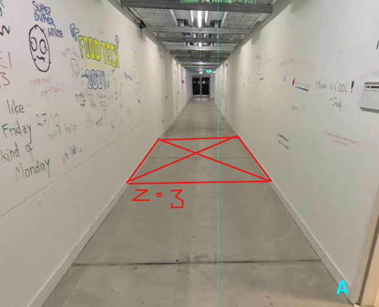
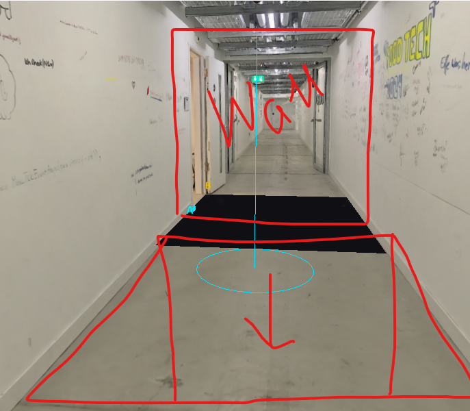
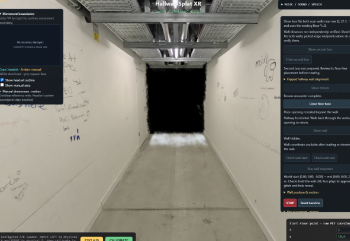

# Add floor cutout trigger

Provider: codex; source: user; session: 01a1a5f7-bae1-7560-a646-8d704cd71c6b.

Original local record: \\?\C:\Users\user\.codex\sessions\2026\11\04\rollout-2026-11-04T10-50-38-01a1a5f7-bae1-7560-a646-8d704cd71c6b.jsonl.

Created: 2026-11-04T09:50:38.308Z. Export snapshot: 2026-11-05T11:08:59.327Z.

This transcript contains stored user-facing user/assistant messages, with image links. System/developer prompts, tool payloads and internal reasoning are omitted. Credential-shaped strings are redacted. A delegated thread's user-role messages may be inherited context or instructions from another agent.

## 1. user · 2026-11-04T09:52:19.468Z

# AGENTS.md instructions for C:\Users\user\Documents\Hallway_Project\02_Git\calibrated

<INSTRUCTIONS>
# Rules for coding agents

## Start here

Read `ai/strategy.md`, then the relevant sections of `docs/PROJECT_PLAN.md`, `docs/CALIBRATION.md`, and `docs/VALIDATION.md`.

This repository is in active implementation (viewer, XR session, calibration; hardware-validated on the Quest Browser and SteamVR/Steam Link routes). Continue through the agreed work without asking for a new “go” after every step, but keep the plan/build/check/log loop and record decisions in `ai/strategy.md`.

## Work loop

0. **Git and network operations:** Never push, pull, or fetch. Commits are local only.
   Before publishing anything, **ask the user** — they push and pull manually via
   GitHub Desktop. Never trigger credential prompts or other network authentication.

1. Record the current task and acceptance criteria in `ai/strategy.md`.
2. Build one reviewable step at a time. Keep modules small and separate calibration mathematics from rendering and device input.
3. Run the checks relevant to the change. Once implemented, use `npm test` for logic and `npm run check` for desktop browser behavior. These commands do not exist during the planning phase.
4. Read generated reports and inspect screenshots before describing them. Repair failures, then record the outcome and next step in `ai/strategy.md`.
5. Distinguish automated checks, desktop visual checks, and tests performed on the real PC/Quest/hallway. Never report a hardware milestone as passed from a browser screenshot or simulated pose.

For documentation changes, check consistency and relative links; do not create application tests just to test prose. Keep generated `.check/` results unedited.

## Calibration invariants

- In calibrated mode, one XR unit is one metre. The parent rig for the tracked camera and controllers stays at identity; transform the scan root into XR space.
- No joystick locomotion, teleportation, artificial turning, or user-scale control in calibrated mode.
- Fit explicitly paired physical/scan landmarks. A controller grip pose is not the physical probe tip; account for its measured offset.
- Keep validation landmarks separate from fit landmarks. Report fit residuals and held-out errors separately.
- Recenter, reference-space reset, viewer-tracking interruption, changed scan data, or a new session invalidate acceptance and require the recovery procedure. Invalid controller poses block active capture; loss of an unused controller alone does not invalidate alignment.
- A saved transform is a candidate for revalidation, never evidence of present alignment. Splats provide appearance, not certified wall geometry or collision protection.

## Scope and tools

`src/viewer/scanAsset.ts` contains manually adjusted scan placement. Do not modify this file, including rotation, start point, camera or anchors, without explicit user permission. Configure calibration landmarks in `src/calibration/landmarks.ts` instead; tests must accommodate the manual asset settings.

Use existing project conventions and verify current APIs against the pinned dependencies. Routine reversible changes and dependency choices inside the authorized task do not need separate permission; record material architectural changes. Ask when missing information prevents a sound decision.

Do not change agent model, provider, credentials, or permission defaults as part of ordinary project work. Never print secrets. Do not dump large scan binaries into agent context; inspect metadata or use purpose-built processing when the task requires it. Keep private scans and calibration captures out of Git.

Use bounded checks where possible. When a development server is needed, track its process and stop it when finished unless the user needs it left running. Report blockers with evidence and continue independent work when possible.

## Provenance

Adapted from the Photolipsia agentic kit's small-step plan/build/check/log workflow. See `docs/REFERENCES.md` for source and licensing details.

</INSTRUCTIONS>
<environment_context>
  <cwd>C:\Users\user\Documents\Hallway_Project\02_Git\calibrated</cwd>
  <shell>powershell</shell>
  <current_date>2026-11-04</current_date>
  <timezone>Europe/Zurich</timezone>
  <filesystem><workspace_roots><root>C:\Users\user\Documents\Hallway_Project\02_Git\calibrated</root></workspace_roots><permission_profile type="managed"><file_system type="restricted"><entry access="read"><special>:root</special></entry><entry access="write"><path>C:\Users\user\Documents\Hallway_Project\02_Git\calibrated</path></entry><entry access="write"><special>:slash_tmp</special></entry><entry access="write"><special>:tmpdir</special></entry><entry access="read"><path>C:\Users\user\Documents\Hallway_Project\02_Git\calibrated\.git</path></entry><entry access="read"><path>C:\Users\user\Documents\Hallway_Project\02_Git\calibrated\.agents</path></entry><entry access="read"><path>C:\Users\user\Documents\Hallway_Project\02_Git\calibrated\.codex</path></entry><entry access="read"><path>C:\Users\user\Documents\Hallway_Project\02_Git\calibrated\.aws</path></entry></file_system></permission_profile></filesystem>
</environment_context>

## 2. user · 2026-11-04T09:52:19.477Z

<external_codex_apps_open_page>{"page_id":null}</external_codex_apps_open_page>

## 3. user · 2026-11-04T09:52:19.494Z

# Context from my IDE setup:

## Active file: src/calibration/landmarks.ts

## Open tabs:
- landmarks.ts: src/calibration/landmarks.ts
- scanAsset.ts: src/viewer/scanAsset.ts
- Pasted text.txt: c:\Users\user\.codex\attachments\d35cc99d-bff6-4c23-862e-b78af88ec115\Pasted text.txt
- main.ts: src/main.ts
- movementBoundary.ts: src/xr/movementBoundary.ts

## My request:
I want you to cut a hole in the floor (have a button for the trigger of that) so that there is a cutout into the void that has the size of the wall that we added, the hole starts on the position z = 3

## 4. assistant · 2026-11-04T09:52:24.858Z

I’ll check how the wall and scan are rendered, then add a button-controlled floor opening starting at z = 3 and matching the wall’s size.

## 5. assistant · 2026-11-04T09:53:19.965Z

The wall is 2.10 × 2.60 m, so I’ll use those dimensions for the opening: 2.10 m across the hallway and 2.60 m along it, from z = 3 to z = 5.6. The button will remove the rendered floor in that area and restore it when closed.

## 6. assistant · 2026-11-04T09:55:47.125Z

The floor cutout and Open/Close button are wired in. The opening stays fixed in world space through the hallway turn, and uses the existing STOP, reset, calibration and tracking recovery controls to close it. I’m now checking the rendered result and the existing controls.

## 7. assistant · 2026-11-04T10:00:02.025Z

The rendered checks confirm a sharp rectangular opening, intact surrounding floor and walls, and exact restoration when closed. I’ve inspected the synthetic view; next I’ll check the original hallway scan and finish the full regression run.

## 8. assistant · 2026-11-04T10:02:29.405Z

The hole’s pixel and recovery checks pass. The full suite has hit failures in the wooden-box and narration changes currently being edited in this workspace. I’m preserving those edits and continuing the original-scan check.

## 9. assistant · 2026-11-04T10:07:01.693Z

All 139 logic tests and the production build now pass. I’m finishing the original-scan capture and will rerun the browser suite against the updated box and narration code.

## 10. assistant · 2026-11-04T10:09:19.926Z

A file watcher interrupted the original-scan check when it hit a locked generated scan file. I’ve disabled watching in the isolated check server and restarted verification.

## 11. assistant · 2026-11-04T10:14:06.504Z

I’ve inspected the opening in the original hallway scan: it matches the rectangle, with the surrounding floor and walls intact. The focused original-scan checks pass, and the final full browser run is underway.

## 12. assistant · 2026-11-04T10:15:43.732Z

The full synthetic browser suite, all 140 logic tests, and the production build now pass. Only the final original-scan capture is still running.

## 13. assistant · 2026-11-04T10:18:00.901Z

Added **Open floor hole / Close floor hole** in Hallway controls. Refresh the page to use it.

The opening is **2.10 × 2.60 m**, matching the wall’s face, from **z = 3 to z = 5.6**. STOP/reset closes it automatically.

Verified on the original scan. All 140 logic tests, 35 browser checks and the build pass. Headset validation remains pending.

## 14. user · 2026-11-04T13:45:56.677Z

<external_codex_apps_open_page>{"page_id":null}</external_codex_apps_open_page>

## 15. user · 2026-11-04T13:45:56.700Z

# Context from my IDE setup:

## Active file: src/calibration/landmarks.ts

## Open tabs:
- landmarks.ts: src/calibration/landmarks.ts
- scanAsset.ts: src/viewer/scanAsset.ts
- Pasted text.txt: c:\Users\user\.codex\attachments\d35cc99d-bff6-4c23-862e-b78af88ec115\Pasted text.txt
- main.ts: src/main.ts
- movementBoundary.ts: src/xr/movementBoundary.ts

## My request:
ok amaying, this is where the hole is currentlz places with the button and where the wall is animated to come to. I want to have buttons to check the wall start position and wall movement end position what is in simulatio,. i also want to move the hole a bit to this side you see from the sketch, and when the wall stops moving then it glitches out and the hole is behid it from the user perspective.. apart from the buttons add that sequence to the both desktop preview and vr experience

## 16. assistant · 2026-11-04T13:46:04.865Z

I’ll add buttons to inspect the wall’s actual start and end poses, move the hole toward the viewer as shown, and connect the wall-stop, glitch and hole reveal to both desktop preview and VR. I’ll also check what currently happens when the wall reaches its endpoint.

## 17. user · 2026-11-04T13:49:21.001Z

<send_user_message_question_reply>
[{"questionItemId":"[\"request_user_input_async\",\"call_4857ca7a3405429a85541ca01b31c69d\",0]","question":"I’m reading the sequence as: the wall approaches, stops, glitches away, then reveals the hole immediately behind it. Should the hole sit just beyond the wall’s final face, or in front of that position toward the viewer as the lower red outline suggests?","answer":"it should appear while the user is seeing the wall, so when the wall glitches out the hole seems to have always been there"}]
</send_user_message_question_reply>

## 18. assistant · 2026-11-04T13:49:39.544Z

Got it—the hole should open while the wall still hides it, so the glitch reveals a hole that appears to have been there all along. I’ll open it behind the stopped wall before the glitch begins, using the wall’s fitted endpoint to place it.

## 19. assistant · 2026-11-04T13:54:19.528Z

The wall currently travels from hallway Z = −8 to −2, while the old hole used a separate positive-Z position. I’m linking the hole to the wall’s endpoint so they line up in preview and calibrated VR, and adding buttons that show each endpoint without starting the sequence.

## 20. assistant · 2026-11-04T14:01:44.282Z

The before/during/after views show the intended reveal: the wall hides the open hole, glitches away at its fixed stop position, then leaves the hole visible. The endpoint buttons also match the rendered wall coordinates. I’m finishing the calibrated-coordinate and cancellation checks.

## 21. assistant · 2026-11-04T14:08:34.913Z

The checks now cover player pauses, replaying the inspected route, stopping during the arrival hold, and rotated/translated calibration frames. All 184 logic tests pass. The full browser regression and original-scan captures are running.

## 22. assistant · 2026-11-04T14:11:12.059Z

The full synthetic desktop suite now passes, including the alignment controls. The remaining check is rendering the original hallway and scanned wall so I can inspect the real-asset reveal.

## 23. assistant · 2026-11-04T14:14:28.125Z

Added **Check wall start**, **Check wall end**, and **Run wall sequence**. The check buttons hold the actual simulation poses and display their coordinates.

In both desktop preview and VR, the relocated hole opens behind the still-visible wall. The wall then glitches away, revealing it.

Original-scan visuals verified; 184 tests, 43 browser checks and build pass. Headset validation remains pending. Refresh to use the controls.

## 24. user · 2026-11-04T14:26:26.679Z

<external_codex_apps_open_page>{"page_id":null}</external_codex_apps_open_page>

## 25. user · 2026-11-04T14:26:26.693Z

# Context from my IDE setup:

## Active file: src/calibration/landmarks.ts

## Open tabs:
- landmarks.ts: src/calibration/landmarks.ts
- scanAsset.ts: src/viewer/scanAsset.ts
- Pasted text.txt: c:\Users\user\.codex\attachments\d35cc99d-bff6-4c23-862e-b78af88ec115\Pasted text.txt
- main.ts: src/main.ts
- movementBoundary.ts: src/xr/movementBoundary.ts

## My request:
I think there is a bug where sometimes the whole interactuion flow is played and sometimes there is no trigger nor the voice that the first box appeared, i need every game to have the same interaction and if you recalibrate it starts from the beginning

## 26. assistant · 2026-11-04T14:26:31.853Z

I’ll trace how calibration starts the interaction and how recalibration cancels the previous run, then make each fresh calibration restart the same box, trigger and narration sequence from the beginning.

## 27. assistant · 2026-11-04T14:28:47.542Z

I found several concrete ways this can happen: manual-only mode survives recalibration, a failed second-box placement can leave the first box visible without its narration or trigger, and an immediate headset trigger can cut the box announcement short. The audio loader also retains failed downloads across games. I’m fixing those paths and adding repeated-game checks.

## 28. assistant · 2026-11-04T14:36:59.538Z

I also found why a valid calibration could break the flow: the second box was using SteamVR’s world-Z axis rather than the calibrated hallway direction. That could make placement fail depending on the tracking origin. It now uses the shared hallway frame. All 195 logic tests pass; the browser checks are running.

## 29. assistant · 2026-11-04T14:47:31.666Z

The repeated-game checks now pass from seven previous game states and across four calibration orientations. The browser also decoded and scheduled the real cached voice clips at zero output gain, including recovery after a failed load and suspended audio. I’m recording the results and doing the final review.

## 30. assistant · 2026-11-04T14:50:01.605Z

Fixed the restart paths. Every successful recalibration now cancels the previous game and restarts the full narrated sequence from welcome.

I also fixed the placement failure that could leave a silent, untriggerable box, audio recovery, and early triggers cutting off the box announcement.

215 tests, 39 browser checks and the build pass. Refresh, then recalibrate. Headset validation remains pending.

## 31. user · 2026-11-05T08:42:56.458Z

<external_codex_apps_open_page>{"page_id":null}</external_codex_apps_open_page>

## 32. user · 2026-11-05T08:42:56.471Z

# Context from my IDE setup:

## Active file: docs/CALIBRATION.md

## Open tabs:
- CALIBRATION.md: docs/CALIBRATION.md
- INTERACTION_PLAN.md: docs/INTERACTION_PLAN.md
- BACKLOG.md: docs/BACKLOG.md
- landmarks.ts: src/calibration/landmarks.ts
- scanAsset.ts: src/viewer/scanAsset.ts

## My request:
amazing. the rotation works well, I want the rotation to work both ways, so they can go back and forth if they want, there is a hole (vertical now) and if they pass through it the world rotation should go back to the original

## 33. assistant · 2026-11-05T08:43:00.925Z

I’ll check how the turn and opening are handled, then make crossing the opening switch the world between its original and rotated positions in both desktop preview and VR.

## 34. assistant · 2026-11-05T08:45:03.659Z

The current turn locks at 90 degrees. I’ll add a four-second eased return when the headset passes through the vertical opening, then allow another turn after leaving and re-entering the floor opening. Repeat trips will keep the current game state and music.

## 35. assistant · 2026-11-05T08:49:20.319Z

The return path now uses the opening’s actual fitted shape, including its taper and calibrated orientation. It requires a clear crossing through the opening; standing near it or moving around its sides won’t trigger a return. I’m checking repeat trips and reset behavior next.

## 36. assistant · 2026-11-05T08:53:48.621Z

The rotation and crossing tests pass, including repeated returns with no accumulated rotation. I also locked placement edits while this interaction is active so they can’t separate the opening from its return trigger. The desktop check will now exercise the full back-and-forth sequence.

## 37. assistant · 2026-11-05T08:58:40.201Z

The desktop checks passed two complete trips through the opening and back, including a run with the actual hallway crop. They also confirmed that the return reaches the exact original pose and repeat trips don’t replay the story or music cue. I’m finishing the broader checks now.

## 38. assistant · 2026-11-05T09:01:33.582Z

The back-and-forth passage checks pass. The broader suite reached those checks successfully, then failed in wall movement checks while separate wall changes were being edited in the shared workspace. I’m preserving that work and running one final passage check against the latest files.

## 39. assistant · 2026-11-05T09:04:06.438Z

Implemented: walking back through the vertical opening smoothly restores the world over four seconds. Leave and re-enter the floor opening to turn again, without restarting the story or music.

274 tests, focused desktop checks and build pass. The full browser suite still hits a floor-placement assertion from concurrent wall changes. Headset validation remains pending.

## 40. user · 2026-11-05T09:33:29.252Z

# Context from my IDE setup:

## Active file: docs/CALIBRATION.md

## Open tabs:
- CALIBRATION.md: docs/CALIBRATION.md
- INTERACTION_PLAN.md: docs/INTERACTION_PLAN.md
- BACKLOG.md: docs/BACKLOG.md
- landmarks.ts: src/calibration/landmarks.ts
- scanAsset.ts: src/viewer/scanAsset.ts

## My request:
after only the first trigger and rotation I need a broom to glitch in and appear 2 seconds after the rotation ends, position it 2 meters after the added hallway entrance when it is in the position like a normal hallway.. when the user comes in close proximity (imagine a box like trigger the size of the boxes, invisible) of that broom make it glitch out after 2 seconds..

## 41. assistant · 2026-11-05T09:33:40.149Z

I’ll add a broom reveal two seconds after the first hole rotation finishes, place it two metres inside the upright hallway, and make it glitch away two seconds after entering its invisible trigger.

## 42. assistant · 2026-11-05T09:39:24.650Z

I’m using the existing 36 × 36 cm box footprint for proximity detection. The broom will stand on the added hallway’s floor, two metres from its entrance. Returning through the opening and entering again will preserve the encounter without replaying it.

## 43. assistant · 2026-11-05T09:48:48.270Z

The desktop check passed: the broom glitches in after the first rotation’s two-second delay, then glitches out two seconds after proximity entry. It stays gone on a second trip. I’m now running the full regression suite and checking the real broom asset.

## 44. assistant · 2026-11-05T09:57:27.836Z

The real broom and hallway crop render correctly: the broom is upright, rests on the floor, and both glitches visibly affect it. The checks also confirmed that it doesn’t reappear on return trips and that Hide, Reset, STOP and calibration cancel it cleanly.

## 45. assistant · 2026-11-05T10:00:54.877Z

Implemented: the broom glitches in **2 seconds after the first turn into the added hallway**, upright and **2 metres inside its entrance**.

Entering its invisible **36 × 36 cm trigger** starts a two-second delay, then it glitches out. Return trips won’t replay it; fresh calibration resets it.

285 tests, 47 browser checks and build pass. Headset validation remains pending.

## 46. user · 2026-11-05T10:00:54.985Z

# Context from my IDE setup:

## Active file: docs/CALIBRATION.md

## Open tabs:
- CALIBRATION.md: docs/CALIBRATION.md
- INTERACTION_PLAN.md: docs/INTERACTION_PLAN.md
- BACKLOG.md: docs/BACKLOG.md
- landmarks.ts: src/calibration/landmarks.ts
- scanAsset.ts: src/viewer/scanAsset.ts

## My request:
After the broom glitches out I need to have that as a trigger to have explosions in the foggy end of the hallway,i put in the fracture_nowall file, it needs to explode like the walls in the part that is not reachable is exploding from the sides.. you can overlap the animations and after a fex of those make the gaussian splats start to disinigrate from the end of the hallway so its more and more black because gaussians are disappearing.. the part where user is standing still needs to be fully visible and the part towards the hole to go back to the other rotation is fully visible as well as the trigger working and the original halway being intact

## 47. assistant · 2026-11-05T10:01:08.412Z

I’ll inspect the fracture asset and the added hallway’s fog placement, then connect the broom’s disappearance to overlapping explosions at that distant end. I’ll keep the return opening, its trigger, the area around the user and the original hallway intact.

## 48. assistant · 2026-11-05T10:10:48.522Z

The file contains an animated wall fracture with 42 debris pieces. I’m preparing it for the browser so the blasts can come from alternating sidewalls. The disintegration will stay beyond a protected corridor leading from the user back to the opening.

## 49. assistant · 2026-11-05T10:23:00.203Z

The fracture asset is now converted to a small browser animation, and the sequence is wired to the broom’s completed glitch-out. Five blasts overlap before the distant splats start disappearing. A protected section of at least six metres remains intact, and it expands if the user moves farther into the hallway.

## 50. assistant · 2026-11-05T10:33:42.251Z

The rendered checks now show the distant corridor turning black while the nearby floor remains unchanged. They also confirm that the return opening still rotates the world back. I’m finishing the reset checks and checking the effect with the original scan assets.

## 51. assistant · 2026-11-05T10:46:06.597Z

The original-asset check passes: the far end becomes opaque black, the nearby floor stays unchanged, and the return trigger still works. I also corrected a screenshot-sorting issue and verified that the near walls remain intact during the explosions. The full regression suite is now running.

## 52. user · 2026-11-05T10:50:19.170Z

<external_codex_apps_open_page>{"page_id":null}</external_codex_apps_open_page>

## 53. user · 2026-11-05T10:50:19.189Z

# Context from my IDE setup:

## Active file: docs/CALIBRATION.md

## Open tabs:
- CALIBRATION.md: docs/CALIBRATION.md
- INTERACTION_PLAN.md: docs/INTERACTION_PLAN.md
- BACKLOG.md: docs/BACKLOG.md
- landmarks.ts: src/calibration/landmarks.ts
- scanAsset.ts: src/viewer/scanAsset.ts

## My request:
this cut to the void is too perfectly cut, I dont want such a perfect outline but the messy fade in disinagreting gausians, that have organic patches of more and less spots with gaussians and then in general the feeling is that more and more is disappearing, i also want more explosions, the gausian walls sides are exploding on like 5 spots from both sides, align them semi randomly, it needs to feel spontaneous and when the part explodes it starts disinegrating, the first explosions are far back and then they come closer and closer also for each explosion trigger the sound effect called rumbling sound in the files

## 54. assistant · 2026-11-05T10:50:38.728Z

I’ll replace the straight cutoff with uneven patches of dissolving splats, tied to the explosions. I’ll use roughly five blast sites on each side, stagger them from far to near with varied timing and placement, and play the supplied rumble for each blast. The protected area and return route will stay intact.

## 55. assistant · 2026-11-05T10:59:52.395Z

The new schedule now has ten varied blast sites, moving from the far end toward the viewer. I’m replacing the flat cutoff with growing patches of damage around each blast, so splats can disappear unevenly while nearby clusters remain visible.

## 56. assistant · 2026-11-05T11:04:32.209Z

The revised logic passes all 329 tests, and the production build passes. I’m now checking the rendered effect: the first blast should visibly chip its local wall, later blasts should leave an uneven mix of gaps and surviving splats, and the return route must stay usable.

## 57. assistant · 2026-11-05T11:08:02.751Z

The first visual check showed that early thinning was too subtle in densely overlapping splats. I’m making neighboring splats dissolve in small clusters, so each explosion leaves visible, ragged damage. The native rumble check has passed, including overlapping cues and restarting for a new game.
