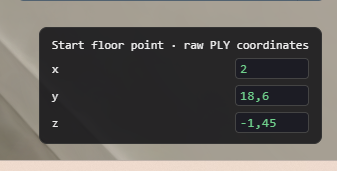
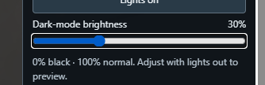

# Explain hallway pivot coordinates

Provider: codex; source: user; session: 01a1a60d-0690-7413-a72f-9db54afb01a7.

Original local record: C:\Users\user\.codex\sessions\2026\11\04\rollout-2026-11-04T11-13-54-01a1a60d-0690-7413-a72f-9db54afb01a7.jsonl.

Created: 2026-11-04T10:13:54.279Z. Export snapshot: 2026-11-05T11:08:59.327Z.

This transcript contains stored user-facing user/assistant messages, with image links. System/developer prompts, tool payloads and internal reasoning are omitted. Credential-shaped strings are redacted. A delegated thread's user-role messages may be inherited context or instructions from another agent.

<a id="message-1"></a>

## 1. user · 2026-11-04T10:14:30.730Z

# AGENTS.md instructions for C:\Users\user\Documents\Hallway_Project\02_Git\calibrated

<INSTRUCTIONS>
# Rules for coding agents

## Start here

Read `ai/strategy.md`, then the relevant sections of `docs/PROJECT_PLAN.md`, `docs/CALIBRATION.md`, and `docs/VALIDATION.md`.

This repository is in active implementation (viewer, XR session, calibration; hardware-validated on the Quest Browser and SteamVR/Steam Link routes). Continue through the agreed work without asking for a new “go” after every step, but keep the plan/build/check/log loop and record decisions in `ai/strategy.md`.

## Work loop

0. **Git and network operations:** Never push, pull, or fetch. Commits are local only.
   Before publishing anything, **ask the user** — they push and pull manually via
   GitHub Desktop. Never trigger credential prompts or other network authentication.

1. Record the current task and acceptance criteria in `ai/strategy.md`.
2. Build one reviewable step at a time. Keep modules small and separate calibration mathematics from rendering and device input.
3. Run the checks relevant to the change. Once implemented, use `npm test` for logic and `npm run check` for desktop browser behavior. These commands do not exist during the planning phase.
4. Read generated reports and inspect screenshots before describing them. Repair failures, then record the outcome and next step in `ai/strategy.md`.
5. Distinguish automated checks, desktop visual checks, and tests performed on the real PC/Quest/hallway. Never report a hardware milestone as passed from a browser screenshot or simulated pose.

For documentation changes, check consistency and relative links; do not create application tests just to test prose. Keep generated `.check/` results unedited.

## Calibration invariants

- In calibrated mode, one XR unit is one metre. The parent rig for the tracked camera and controllers stays at identity; transform the scan root into XR space.
- No joystick locomotion, teleportation, artificial turning, or user-scale control in calibrated mode.
- Fit explicitly paired physical/scan landmarks. A controller grip pose is not the physical probe tip; account for its measured offset.
- Keep validation landmarks separate from fit landmarks. Report fit residuals and held-out errors separately.
- Recenter, reference-space reset, viewer-tracking interruption, changed scan data, or a new session invalidate acceptance and require the recovery procedure. Invalid controller poses block active capture; loss of an unused controller alone does not invalidate alignment.
- A saved transform is a candidate for revalidation, never evidence of present alignment. Splats provide appearance, not certified wall geometry or collision protection.

## Scope and tools

`src/viewer/scanAsset.ts` contains manually adjusted scan placement. Do not modify this file, including rotation, start point, camera or anchors, without explicit user permission. Configure calibration landmarks in `src/calibration/landmarks.ts` instead; tests must accommodate the manual asset settings.

Use existing project conventions and verify current APIs against the pinned dependencies. Routine reversible changes and dependency choices inside the authorized task do not need separate permission; record material architectural changes. Ask when missing information prevents a sound decision.

Do not change agent model, provider, credentials, or permission defaults as part of ordinary project work. Never print secrets. Do not dump large scan binaries into agent context; inspect metadata or use purpose-built processing when the task requires it. Keep private scans and calibration captures out of Git.

Use bounded checks where possible. When a development server is needed, track its process and stop it when finished unless the user needs it left running. Report blockers with evidence and continue independent work when possible.

## Provenance

Adapted from the Photolipsia agentic kit's small-step plan/build/check/log workflow. See `docs/REFERENCES.md` for source and licensing details.

</INSTRUCTIONS>
<environment_context>
  <cwd>C:\Users\user\Documents\Hallway_Project\02_Git\calibrated</cwd>
  <shell>powershell</shell>
  <current_date>2026-11-04</current_date>
  <timezone>Europe/Zurich</timezone>
  <filesystem><workspace_roots><root>C:\Users\user\Documents\Hallway_Project\02_Git\calibrated</root></workspace_roots><permission_profile type="managed"><file_system type="restricted"><entry access="read"><special>:root</special></entry><entry access="write"><path>C:\Users\user\Documents\Hallway_Project\02_Git\calibrated</path></entry><entry access="write"><special>:slash_tmp</special></entry><entry access="write"><special>:tmpdir</special></entry><entry access="read"><path>C:\Users\user\Documents\Hallway_Project\02_Git\calibrated\.git</path></entry><entry access="read"><path>C:\Users\user\Documents\Hallway_Project\02_Git\calibrated\.agents</path></entry><entry access="read"><path>C:\Users\user\Documents\Hallway_Project\02_Git\calibrated\.codex</path></entry><entry access="read"><path>C:\Users\user\Documents\Hallway_Project\02_Git\calibrated\.aws</path></entry></file_system></permission_profile></filesystem>
</environment_context>

<a id="message-2"></a>

## 2. user · 2026-11-04T10:14:30.770Z

<external_codex_apps_open_page>{"page_id":null}</external_codex_apps_open_page>

<a id="message-3"></a>

## 3. user · 2026-11-04T10:14:30.813Z

# Context from my IDE setup:

## Active file: src/calibration/landmarks.ts

## Open tabs:
- landmarks.ts: src/calibration/landmarks.ts
- scanAsset.ts: src/viewer/scanAsset.ts
- Pasted text.txt: c:\Users\user\.codex\attachments\d35cc99d-bff6-4c23-862e-b78af88ec115\Pasted text.txt
- main.ts: src/main.ts
- movementBoundary.ts: src/xr/movementBoundary.ts

## My request:
is the pivot point regarded as a z = 0 and how do the coordinates work before and after flipping the hallway


<a id="message-4"></a>

## 4. assistant · 2026-11-04T10:14:33.210Z

I’ll check how the scan pivot, hallway flip, and calibration coordinates are defined in the code.

<a id="message-5"></a>

## 5. assistant · 2026-11-04T10:15:23.304Z

The pivot stays at its own world coordinates; the flip does not make it Z=0. The code rotates the hallway around that point while keeping the world axes fixed. I’m checking the raw PLY-to-world mapping so the numbers in `landmarks.ts` fit into that explanation.

<a id="message-6"></a>

## 6. assistant · 2026-11-04T10:16:45.232Z

**No—the pivot is not automatically world Z=0.** It is the point the hallway rotates around. Its coordinates stay fixed during the turn.

With your current default placement, the box/pivot station is approximately **Z=2.5 before calibration**. Calibration or placement edits can change that. The cyan marker moves to the pivot when the box appears; this does not reset the coordinate origin.

There are two coordinate systems to distinguish:

- **Raw PLY coordinates**, used in [landmarks.ts](/C:/Users/user/Documents/Hallway_Project/02_Git/calibrated/src/calibration/landmarks.ts:9). These identify points inside the original scan.
- **World coordinates**, used for the pivot, tracked headset and world-position controls. Here, Y is up and X/Z are horizontal axes.

Your current [scan placement](/C:/Users/user/Documents/Hallway_Project/02_Git/calibrated/src/viewer/scanAsset.ts:4) converts raw coordinates like this **before calibration**:

```text
world X = 2 − raw X
world Y = raw Z + 1.45
world Z = raw Y − 18.6
```

So raw `[2, 18.6, -1.45]` becomes world `[0, 0, 0]`, and the box station `[2, 21.1, -1.45]` becomes `[0, 0, 2.5]` before lateral centring. Calibration then adds its fitted yaw and translation.

**After the completed 180° flip**, each hallway point moves according to the [pivot rotation](/C:/Users/user/Documents/Hallway_Project/02_Git/calibrated/src/experience/rotation.ts:6):

```text
X_after = 2 × pivotX − X_before
Y_after = Y_before
Z_after = 2 × pivotZ − Z_before
```

For example, with pivot Z=2.5:

| Hallway point before | After the flip |
|---|---|
| Z=0 | Z=5 |
| Z=2.5 — the pivot | Z=2.5 |
| Z=4 | Z=1 |

The world axes stay fixed; the hallway turns within them. The headset, boxes, broom and scripted wall route retain their world positions.

You can **think of the pivot as relative Z=0**, using `relativeZ = worldZ − pivotZ`. In that description, the flip changes `relativeZ` to `−relativeZ`. But the current world-coordinate controls do not use that relative origin: **Z=6 means world Z=6, not six metres from the pivot.**

<a id="message-7"></a>

## 7. user · 2026-11-04T13:05:40.703Z

# Context from my IDE setup:

## Active file: src/calibration/landmarks.ts

## Open tabs:
- landmarks.ts: src/calibration/landmarks.ts
- scanAsset.ts: src/viewer/scanAsset.ts
- Pasted text.txt: c:\Users\user\.codex\attachments\d35cc99d-bff6-4c23-862e-b78af88ec115\Pasted text.txt
- main.ts: src/main.ts
- movementBoundary.ts: src/xr/movementBoundary.ts

## My request:
i want to use this panel in the rotated mode as well, this is a panel for me so I can estimate the coordinates at any point, at it there should be coordinates I can later use to put something in the gausian splat while its both rotated and not 




<a id="message-8"></a>

## 8. assistant · 2026-11-04T13:06:03.605Z

I’ll update the panel so you can inspect coordinates in both hallway orientations and read values you can reuse for placing objects. I’ll check how its current controls move the scan before changing the behavior.

<a id="message-9"></a>

## 9. user · 2026-11-04T13:06:19.188Z

# Context from my IDE setup:

## Active file: src/calibration/landmarks.ts

## Open tabs:
- landmarks.ts: src/calibration/landmarks.ts
- scanAsset.ts: src/viewer/scanAsset.ts
- Pasted text.txt: c:\Users\user\.codex\attachments\d35cc99d-bff6-4c23-862e-b78af88ec115\Pasted text.txt
- main.ts: src/main.ts
- movementBoundary.ts: src/xr/movementBoundary.ts

## My request:
do not implement the placement feature, im doing that manually, just make it not restart the position when i move it


<a id="message-10"></a>

## 10. assistant · 2026-11-04T13:06:28.098Z

Understood. I’ll keep the existing panel and make coordinate edits preserve the current hallway rotation, with no placement feature added.

<a id="message-11"></a>

## 11. assistant · 2026-11-04T13:07:45.430Z

The reset comes from the panel calling the calibration reset and restoring the scan’s original orientation on every edit. I’ll make edits move the scan while preserving the flipped view, and keep the displayed raw coordinates accurate after a turn.

<a id="message-12"></a>

## 12. assistant · 2026-11-04T13:10:21.094Z

The edits now preserve the current turn and carry the translation into the saved animation baseline, so the next frame should keep your change. I’m checking repeated edits and blank inputs, which previously caused jumps.

<a id="message-13"></a>

## 13. assistant · 2026-11-04T13:12:50.506Z

The coordinate-edit logic checks pass, including repeated edits after a turn. The full browser and build checks hit errors in the wall-animation code that is being edited concurrently. I’m leaving that work intact and continuing with the panel checks.

<a id="message-14"></a>

## 14. assistant · 2026-11-04T13:16:56.731Z

The existing inputs now pass the browser checks in the original view. I’m finishing the same checks after the 180° turn and inspecting the screenshots. The production build also passes.

<a id="message-15"></a>

## 15. assistant · 2026-11-04T13:17:56.895Z

Done—the existing XYZ panel now moves the hallway without resetting its rotation, including after the flip. No placement feature added.

Reload the page to use it. Both orientations passed desktop checks; the build passed. The full suite still has a separate wall-width test failure.

<a id="message-16"></a>

## 16. user · 2026-11-04T13:29:21.133Z

# Context from my IDE setup:

## Active file: src/calibration/landmarks.ts

## Open tabs:
- landmarks.ts: src/calibration/landmarks.ts
- scanAsset.ts: src/viewer/scanAsset.ts
- Pasted text.txt: c:\Users\user\.codex\attachments\d35cc99d-bff6-4c23-862e-b78af88ec115\Pasted text.txt
- main.ts: src/main.ts
- movementBoundary.ts: src/xr/movementBoundary.ts

## My request:
two seconds after the second box appears I want the lights to go out with the dark mode brightness 30% and they need to go out with a glitch, so to have like a second of flickering with this light flicker sound i pasted in public audio, fade it in and out and dont make it loud




<a id="message-17"></a>

## 17. assistant · 2026-11-04T13:29:27.240Z

I’ll add a cue two seconds after the second box appears: about one second of light flicker with the supplied sound at low volume, then darkness at 30% brightness. I’ll check the lighting, audio and reset paths so interrupted sequences cancel cleanly.

<a id="message-18"></a>

## 18. assistant · 2026-11-04T13:34:11.154Z

I found `public/audio/light_flicker.mp3`; it’s an eight-second clip. I’ll use its first second, with a soft fade in/out and reduced gain. The two-second delay will start when the second box finishes rising into view, and the flicker will end at exactly 30% brightness.

<a id="message-19"></a>

## 19. assistant · 2026-11-04T13:39:06.108Z

The cue is now wired to the second box’s actual reveal, so it works for both the manual button and narrated sequence. Logic checks pass for the delay, flicker and 30% finish. I’m checking the quiet audio envelope and cancellation behavior next.

<a id="message-20"></a>

## 20. assistant · 2026-11-04T13:45:00.917Z

The production build passes. The sound is capped at 16% gain, with an 80 ms fade in and 200 ms fade out. The browser run is now checking the rendered flicker and 30% finish; its audio output is muted, so it won’t disturb your PC or headset.

<a id="message-21"></a>

## 21. assistant · 2026-11-04T13:50:01.754Z

All 36 browser checks passed. The rendered scene dips, relights and settles at 30%, while the supplied clip decodes and starts with the flicker. Reset and interruption checks also pass for stopping both effects. I’ve inspected the screenshots; audible headset level still needs checking on Steam Link.

<a id="message-22"></a>

## 22. assistant · 2026-11-04T13:51:45.312Z

Implemented: **2-second wait after the second box finishes rising → 1-second flicker with sound → steady 30% brightness.**

Your clip plays for that second at 16% gain, fading in and out. STOP/reset cancels both effects.

180 logic tests, 36 desktop checks and build passed. Reload to try it; actual headset volume still needs checking.
