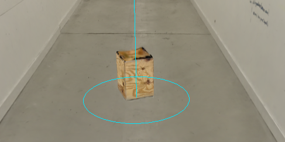
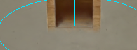
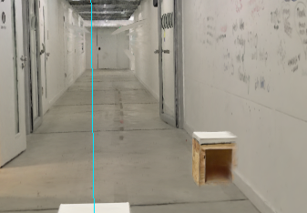
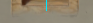

# instead of the 3d box that is mocked I want to place this splat public\splats\WoodenBox.ply with the entrance animation going up f

Provider: codex; source: subagent; session: 01a1a64d-5ea1-71b1-b497-8d7b995469da.

Original local record: C:\Users\user\.codex\sessions\2026\11\04\rollout-2026-11-04T12-24-10-01a1a64d-5ea1-71b1-b497-8d7b995469da.jsonl.

Created: 2026-11-04T11:24:10.785Z. Export snapshot: 2026-11-05T11:08:59.327Z.

This transcript contains stored user-facing user/assistant messages, with image links. System/developer prompts, tool payloads and internal reasoning are omitted. Credential-shaped strings are redacted. A delegated thread's user-role messages may be inherited context or instructions from another agent.

## 1. user · 2026-11-04T11:24:10.825Z

# AGENTS.md instructions for C:\Users\user\Documents\Hallway_Project\02_Git\calibrated

<INSTRUCTIONS>
# Rules for coding agents

## Start here

Read `ai/strategy.md`, then the relevant sections of `docs/PROJECT_PLAN.md`, `docs/CALIBRATION.md`, and `docs/VALIDATION.md`.

This repository is in active implementation (viewer, XR session, calibration; hardware-validated on the Quest Browser and SteamVR/Steam Link routes). Continue through the agreed work without asking for a new “go” after every step, but keep the plan/build/check/log loop and record decisions in `ai/strategy.md`.

## Work loop

0. **Git and network operations:** Never push, pull, or fetch. Commits are local only.
   Before publishing anything, **ask the user** — they push and pull manually via
   GitHub Desktop. Never trigger credential prompts or other network authentication.

1. Record the current task and acceptance criteria in `ai/strategy.md`.
2. Build one reviewable step at a time. Keep modules small and separate calibration mathematics from rendering and device input.
3. Run the checks relevant to the change. Once implemented, use `npm test` for logic and `npm run check` for desktop browser behavior. These commands do not exist during the planning phase.
4. Read generated reports and inspect screenshots before describing them. Repair failures, then record the outcome and next step in `ai/strategy.md`.
5. Distinguish automated checks, desktop visual checks, and tests performed on the real PC/Quest/hallway. Never report a hardware milestone as passed from a browser screenshot or simulated pose.

For documentation changes, check consistency and relative links; do not create application tests just to test prose. Keep generated `.check/` results unedited.

## Calibration invariants

- In calibrated mode, one XR unit is one metre. The parent rig for the tracked camera and controllers stays at identity; transform the scan root into XR space.
- No joystick locomotion, teleportation, artificial turning, or user-scale control in calibrated mode.
- Fit explicitly paired physical/scan landmarks. A controller grip pose is not the physical probe tip; account for its measured offset.
- Keep validation landmarks separate from fit landmarks. Report fit residuals and held-out errors separately.
- Recenter, reference-space reset, viewer-tracking interruption, changed scan data, or a new session invalidate acceptance and require the recovery procedure. Invalid controller poses block active capture; loss of an unused controller alone does not invalidate alignment.
- A saved transform is a candidate for revalidation, never evidence of present alignment. Splats provide appearance, not certified wall geometry or collision protection.

## Scope and tools

`src/viewer/scanAsset.ts` contains manually adjusted scan placement. Do not modify this file, including rotation, start point, camera or anchors, without explicit user permission. Configure calibration landmarks in `src/calibration/landmarks.ts` instead; tests must accommodate the manual asset settings.

Use existing project conventions and verify current APIs against the pinned dependencies. Routine reversible changes and dependency choices inside the authorized task do not need separate permission; record material architectural changes. Ask when missing information prevents a sound decision.

Do not change agent model, provider, credentials, or permission defaults as part of ordinary project work. Never print secrets. Do not dump large scan binaries into agent context; inspect metadata or use purpose-built processing when the task requires it. Keep private scans and calibration captures out of Git.

Use bounded checks where possible. When a development server is needed, track its process and stop it when finished unless the user needs it left running. Report blockers with evidence and continue independent work when possible.

## Provenance

Adapted from the Photolipsia agentic kit's small-step plan/build/check/log workflow. See `docs/REFERENCES.md` for source and licensing details.

</INSTRUCTIONS>
<environment_context>
  <cwd>C:\Users\user\Documents\Hallway_Project\02_Git\calibrated</cwd>
  <shell>powershell</shell>
  <current_date>2026-11-04</current_date>
  <timezone>Europe/Zurich</timezone>
  <filesystem><workspace_roots><root>C:\Users\user\Documents\Hallway_Project\02_Git\calibrated</root></workspace_roots><permission_profile type="managed"><file_system type="restricted"><entry access="read"><special>:root</special></entry><entry access="write"><path>C:\Users\user\Documents\Hallway_Project\02_Git\calibrated</path></entry><entry access="write"><special>:slash_tmp</special></entry><entry access="write"><special>:tmpdir</special></entry><entry access="read"><path>C:\Users\user\Documents\Hallway_Project\02_Git\calibrated\.git</path></entry><entry access="read"><path>C:\Users\user\Documents\Hallway_Project\02_Git\calibrated\.agents</path></entry><entry access="read"><path>C:\Users\user\Documents\Hallway_Project\02_Git\calibrated\.codex</path></entry><entry access="read"><path>C:\Users\user\Documents\Hallway_Project\02_Git\calibrated\.aws</path></entry></file_system></permission_profile></filesystem>
</environment_context>

## 2. user · 2026-11-04T11:24:10.825Z

<external_codex_apps_open_page>{"page_id":null}</external_codex_apps_open_page>

## 3. user · 2026-11-04T11:24:10.825Z

# Context from my IDE setup:

## Active file: src/calibration/landmarks.ts

## Open tabs:
- landmarks.ts: src/calibration/landmarks.ts
- scanAsset.ts: src/viewer/scanAsset.ts
- Pasted text.txt: c:\Users\user\.codex\attachments\d35cc99d-bff6-4c23-862e-b78af88ec115\Pasted text.txt
- main.ts: src/main.ts
- movementBoundary.ts: src/xr/movementBoundary.ts

## My request:
instead of the 3d box that is mocked I want to place this splat public\splats\WoodenBox.ply with the entrance animation going up from the floor with easying in and out back in the floor (below the floor level

## 4. assistant · 2026-11-04T11:24:10.825Z

I’ll find the mocked box and its animation, then replace it with `WoodenBox.ply` and an eased rise from below the floor followed by a descent back beneath it.

## 5. assistant · 2026-11-04T11:24:10.826Z

The installation has two mocked boxes. I’ll use the wooden splat for both, keep their existing positions and trigger footprints, and add eased Show/Hide motion. I’ll also preload them with the hallway so showing a box won’t need a new load.

## 6. assistant · 2026-11-04T11:24:10.826Z

The supplied PLY contains 27,577 splats. I’m mapping its bounds to the existing 36 × 36 × 43 cm boxes and adding a 1.5-second rise and descent. I’ll clip the animation at the floor so the splats don’t show through while submerged.

## 7. user · 2026-11-04T11:24:10.827Z

# Context from my IDE setup:

## Active file: src/calibration/landmarks.ts

## Open tabs:
- landmarks.ts: src/calibration/landmarks.ts
- scanAsset.ts: src/viewer/scanAsset.ts
- Pasted text.txt: c:\Users\user\.codex\attachments\d35cc99d-bff6-4c23-862e-b78af88ec115\Pasted text.txt
- main.ts: src/main.ts
- movementBoundary.ts: src/xr/movementBoundary.ts

## My request:
currently its rotated and upside down, i want it to have sides paralell to the walls like the mock box was

## 8. assistant · 2026-11-04T11:24:10.827Z

I’ll correct the splat’s orientation so it stands upright with its sides parallel to the hallway walls, matching the mock box.

## 9. assistant · 2026-11-04T11:24:10.829Z

The source box’s faces are rotated about 19° within the PLY. I’ve removed that rotation and corrected which end faces upward. The box now inherits the same hallway-aligned heading as the mock; I’m checking the rendered result and Show/Hide behavior.

## 10. assistant · 2026-11-04T11:24:10.831Z

The corrected render shows the box’s white top facing upward, and the orientation checks pass. The animation checks also confirm that it starts fully below the floor and keeps its placement fixed. I’m finishing the browser checks and production build.

## 11. assistant · 2026-11-04T11:24:10.832Z

The corrected box looks upright with its sides aligned, and the Show/Hide checks pass against the actual PLY. The build also passes. A final browser run hit a file-watcher conflict with generated build files; I’m resolving that check-runner issue before the last pass.

## 12. assistant · 2026-11-04T11:24:10.832Z

All checks pass: 139 logic tests, the full desktop browser suite, and the production build. I’ve inspected the corrected wooden box and its rise/descent screenshots. It now stands upright with its sides aligned to the hallway; headset testing remains pending.

## 13. assistant · 2026-11-04T11:24:10.835Z

The final verification is running against the latest workspace changes. The box checks are passing, including the hidden endpoint: its top finishes 4 cm below the floor.

## 14. assistant · 2026-11-04T11:24:10.836Z

Fixed: both wooden splat boxes are upright, with sides parallel to the hallway walls. Show/Hide eases them up from and back below the floor over 1.5 seconds.

140 tests, 31 desktop checks, and build pass. Headset verification remains pending.

## 15. user · 2026-11-04T11:24:10.836Z

# Context from my IDE setup:

## Active file: src/calibration/landmarks.ts

## Open tabs:
- landmarks.ts: src/calibration/landmarks.ts
- scanAsset.ts: src/viewer/scanAsset.ts
- Pasted text.txt: c:\Users\user\.codex\attachments\d35cc99d-bff6-4c23-862e-b78af88ec115\Pasted text.txt
- main.ts: src/main.ts
- movementBoundary.ts: src/xr/movementBoundary.ts

## My request:
orientation is good, can you move the splat a tiny bit up so its sitting on the floor and not merging with it

## 16. assistant · 2026-11-04T11:24:10.836Z

I’ll lift the box splats slightly so their bases clear the floor, while keeping the placement and trigger positions fixed.

## 17. assistant · 2026-11-04T11:24:10.836Z

Both box splats now sit 2 cm higher. The actual-splat browser checks confirm the lift and the fully hidden endpoint below the floor; I’m finishing the remaining checks.

## 18. assistant · 2026-11-04T11:24:10.837Z

Raised both box splats by **2 cm** to reduce floor blending, keeping their orientation and animations intact.

140 tests and 31 desktop checks pass. Refresh the page to see the adjustment.

## 19. user · 2026-11-04T11:24:10.837Z

<external_codex_apps_open_page>{"page_id":null}</external_codex_apps_open_page>

## 20. user · 2026-11-04T11:24:10.837Z

# Context from my IDE setup:

## Active file: src/calibration/landmarks.ts

## Open tabs:
- landmarks.ts: src/calibration/landmarks.ts
- scanAsset.ts: src/viewer/scanAsset.ts
- Pasted text.txt: c:\Users\user\.codex\attachments\d35cc99d-bff6-4c23-862e-b78af88ec115\Pasted text.txt
- main.ts: src/main.ts
- movementBoundary.ts: src/xr/movementBoundary.ts

## My request:
the boxes are actually on the right spot, but I have a problem with the walls not being centered after rotation anymore? the real box in reality is aligned with the splat box but its sitting inside the gausian splat wall a bit, can we have an offset during rotation to fix that, that is: to align the walls of the flipped hallway to the real walls in reality? the walls are nicely aligned before rotation.

## 21. assistant · 2026-11-04T11:24:10.838Z

I’ll check how the hallway turns around the first box, then add a way to adjust the flipped hallway’s sideways offset while keeping both boxes fixed. I’ll also check whether the scan’s width changes across the turn, since an offset alone may not align both walls.

## 22. assistant · 2026-11-04T11:24:10.839Z

The turn math is correct, but it swaps hallway sections whose fitted wall positions, widths and directions differ slightly. I’ll add a signed centimetre adjustment that eases in during the turn and can be tuned afterward. It can improve alignment at the box, but a sideways shift alone may not match both walls along the whole corridor.

## 23. user · 2026-11-04T11:24:10.840Z

<send_user_message_question_reply>
[{"questionItemId":"[\"request_user_input_async\",\"call_6f87ea6010a440f8a9b7f35a064513d1\",0]","question":"Do you know the sideways correction needed after the flip—for example, “10 cm left when facing down the original hallway”? I’m adding a centimetre adjustment you can tune on the PC; I can’t determine the physical offset from the screenshot.","answer":"lets say its 10 cm for now, i will test it. so the walls need to be moved 10 cm in this directon when they are rotated (during rotation the offset is corrected)"}]
</send_user_message_question_reply>

## 24. user · 2026-11-04T11:24:10.840Z

<external_codex_apps_open_page>{"page_id":null}</external_codex_apps_open_page>

## 25. user · 2026-11-04T11:24:10.840Z

# Context from my IDE setup:

## Active file: src/calibration/landmarks.ts

## Open tabs:
- landmarks.ts: src/calibration/landmarks.ts
- scanAsset.ts: src/viewer/scanAsset.ts
- Pasted text.txt: c:\Users\user\.codex\attachments\d35cc99d-bff6-4c23-862e-b78af88ec115\Pasted text.txt
- main.ts: src/main.ts
- movementBoundary.ts: src/xr/movementBoundary.ts

## My request:
both boxes are still inside the floor so I would move them up a bit 

## 26. assistant · 2026-11-04T11:24:10.840Z

I’ll start with a 10 cm hallway correction, blended into the turn, and raise both box splats another 3 cm—5 cm total.

I’m taking the hallway direction to mean toward the wall beside the second box in your screenshot. The signed control will let you reverse it if needed.

## 27. assistant · 2026-11-04T11:24:10.841Z

The 10 cm turn correction and 5 cm total box lift are implemented. The original hallway view stays unchanged, and the correction eases in as it turns. Logic tests and the build pass; I’m now checking the controls and fixed box positions in the browser.

## 28. assistant · 2026-11-04T11:24:10.842Z

The browser checks pass too: the 10 cm shift leaves both box splats fixed, and their appearances now sit 5 cm above the logical floor. You can tune or reverse the shift under **Flipped hallway wall alignment**. The amount and direction still need your headset check.

## 29. assistant · 2026-11-04T11:24:10.842Z

Raised both box splats another **3 cm—5 cm total**.

The hallway now eases **10 cm right during the flip**, relative to the original hallway direction. Tune or reverse it under **Flipped hallway wall alignment**.

144 tests, 33 desktop checks, and build pass. Physical alignment still needs your headset test.

## 30. user · 2026-11-04T11:24:10.842Z

# Context from my IDE setup:

## Active file: src/calibration/landmarks.ts

## Open tabs:
- landmarks.ts: src/calibration/landmarks.ts
- scanAsset.ts: src/viewer/scanAsset.ts
- Pasted text.txt: c:\Users\user\.codex\attachments\d35cc99d-bff6-4c23-862e-b78af88ec115\Pasted text.txt
- main.ts: src/main.ts
- movementBoundary.ts: src/xr/movementBoundary.ts

## My request:
remove the box raises, in vr they are too high, make them sit on the floor, also can you move all other things from the hallway with the offset as well? the wall and the broom and the hole are ment to be in the rotated coordinate space so they should be still centered (broom) and the wall should go from one wall in the splats to the other (covering the whole hallway width) the same with the hole, the second chair should always be aligned with the wall from the splats in reality is gonna stand exactly next to the wall

## 31. assistant · 2026-11-04T11:24:10.842Z

I’ll remove the boxes’ visual lift and check the coordinate handling for the other objects. I’ll make the broom, wall, hole and second box follow the shifted, rotated hallway, while keeping the first box’s physical turn pivot fixed.

## 32. assistant · 2026-11-04T11:26:50.089Z

Keep the recent world-Z stations/routes unless the user explicitly wants longitudinal positions mirrored too. Parenting everything under the rotating scan would move broom Z6 to roughly Z−1 and turn the wall’s −8→−2 route into a different world path.

Recommended approach:

- Add a cached current-scan cross-section helper returning centre, direction, wall planes and span at a chosen world station.
- Fit broom placement to that section’s centre instead of pivot X.
- Fit wall geometry at its actual moving station; scale only its width to span both walls. Update entry and player-clearance bounds using the rendered width. Preserve the two-second delay, −8→−2 world-Z bounds, speed and pause behavior.
- Replace the hole’s fixed world-axis rectangle with an oriented hallway clip frame or fitted wall-plane bounds. Refresh its pose when the scan/offset changes.
- Refit the second box against the current selected wall at its existing longitudinal station. Use the selected plane’s normal/tangent for exact edge contact; the existing placement helper instead assumes parallel walls at centre ±width/2.
- Keep the first box/pivot fixed and set both visual lifts to zero.

Avoid fitting all 2.1 million centres every frame: cache station samples and invalidate/reproject when the scan transform changes. No files edited or hardware/browser/network actions performed.

## 33. assistant · 2026-11-04T11:34:40.535Z

Implemented only:

- [hallwaySection.ts](C:/Users/user/Documents/Hallway_Project/02_Git/calibrated/src/experience/hallwaySection.ts): cached current-scan sections, exact world-Z centres, normalized wall distances, metric/unsupported-pose guards.
- [hallwaySection.test.ts](C:/Users/user/Documents/Hallway_Project/02_Git/calibrated/tests/hallwaySection.test.ts): four passing tests covering transforms, nonparallel walls, caching and rejection.

Typecheck passes.

Actual scan supports the rotated route at Z **8, 6, 3 and 2**. Fitted widths are approximately **2.23–2.24 m**, with roughly **4 cm residuals**. These are appearance estimates, not physical alignment evidence.

## 34. assistant · 2026-11-04T11:44:35.077Z

Updated only `tests/browser/rotationOffsetScenario.mjs`; syntax check passes.

It now checks that the first box stays fixed while the seat meets the current wall, the broom stays centred, the hole matches both wall edges, and the full wall spans the hallway. It also verifies zero box lift and the existing offset controls, captures all props, and restores test state afterward.

Ready for the full browser run.
