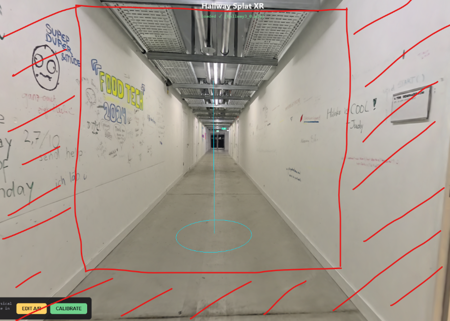
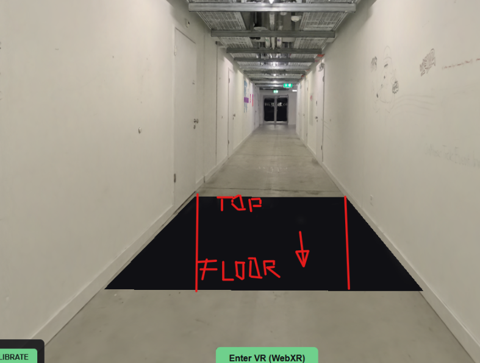

# Create hallway splat cutout

Provider: codex; source: user; session: 01a1a6b5-d63e-7c60-9f15-eadbe9e2ec28.

Original local record: \\?\C:\Users\user\.codex\sessions\2026\11\04\rollout-2026-11-04T14-18-17-01a1a6b5-d63e-7c60-9f15-eadbe9e2ec28.jsonl.

Created: 2026-11-04T13:18:17.154Z. Export snapshot: 2026-11-05T11:08:59.327Z.

This transcript contains stored user-facing user/assistant messages, with image links. System/developer prompts, tool payloads and internal reasoning are omitted. Credential-shaped strings are redacted. A delegated thread's user-role messages may be inherited context or instructions from another agent.

## 1. user · 2026-11-04T13:18:17.862Z

# AGENTS.md instructions for C:\Users\user\Documents\Hallway_Project\02_Git\calibrated

<INSTRUCTIONS>
# Rules for coding agents

## Start here

Read `ai/strategy.md`, then the relevant sections of `docs/PROJECT_PLAN.md`, `docs/CALIBRATION.md`, and `docs/VALIDATION.md`.

This repository is in active implementation (viewer, XR session, calibration; hardware-validated on the Quest Browser and SteamVR/Steam Link routes). Continue through the agreed work without asking for a new “go” after every step, but keep the plan/build/check/log loop and record decisions in `ai/strategy.md`.

## Work loop

0. **Git and network operations:** Never push, pull, or fetch. Commits are local only.
   Before publishing anything, **ask the user** — they push and pull manually via
   GitHub Desktop. Never trigger credential prompts or other network authentication.

1. Record the current task and acceptance criteria in `ai/strategy.md`.
2. Build one reviewable step at a time. Keep modules small and separate calibration mathematics from rendering and device input.
3. Run the checks relevant to the change. Once implemented, use `npm test` for logic and `npm run check` for desktop browser behavior. These commands do not exist during the planning phase.
4. Read generated reports and inspect screenshots before describing them. Repair failures, then record the outcome and next step in `ai/strategy.md`.
5. Distinguish automated checks, desktop visual checks, and tests performed on the real PC/Quest/hallway. Never report a hardware milestone as passed from a browser screenshot or simulated pose.

For documentation changes, check consistency and relative links; do not create application tests just to test prose. Keep generated `.check/` results unedited.

## Calibration invariants

- In calibrated mode, one XR unit is one metre. The parent rig for the tracked camera and controllers stays at identity; transform the scan root into XR space.
- No joystick locomotion, teleportation, artificial turning, or user-scale control in calibrated mode.
- Fit explicitly paired physical/scan landmarks. A controller grip pose is not the physical probe tip; account for its measured offset.
- Keep validation landmarks separate from fit landmarks. Report fit residuals and held-out errors separately.
- Recenter, reference-space reset, viewer-tracking interruption, changed scan data, or a new session invalidate acceptance and require the recovery procedure. Invalid controller poses block active capture; loss of an unused controller alone does not invalidate alignment.
- A saved transform is a candidate for revalidation, never evidence of present alignment. Splats provide appearance, not certified wall geometry or collision protection.

## Scope and tools

`src/viewer/scanAsset.ts` contains manually adjusted scan placement. Do not modify this file, including rotation, start point, camera or anchors, without explicit user permission. Configure calibration landmarks in `src/calibration/landmarks.ts` instead; tests must accommodate the manual asset settings.

Use existing project conventions and verify current APIs against the pinned dependencies. Routine reversible changes and dependency choices inside the authorized task do not need separate permission; record material architectural changes. Ask when missing information prevents a sound decision.

Do not change agent model, provider, credentials, or permission defaults as part of ordinary project work. Never print secrets. Do not dump large scan binaries into agent context; inspect metadata or use purpose-built processing when the task requires it. Keep private scans and calibration captures out of Git.

Use bounded checks where possible. When a development server is needed, track its process and stop it when finished unless the user needs it left running. Report blockers with evidence and continue independent work when possible.

## Provenance

Adapted from the Photolipsia agentic kit's small-step plan/build/check/log workflow. See `docs/REFERENCES.md` for source and licensing details.

</INSTRUCTIONS>
<environment_context>
  <cwd>C:\Users\user\Documents\Hallway_Project\02_Git\calibrated</cwd>
  <shell>powershell</shell>
  <current_date>2026-11-04</current_date>
  <timezone>Europe/Zurich</timezone>
  <filesystem><workspace_roots><root>C:\Users\user\Documents\Hallway_Project\02_Git\calibrated</root></workspace_roots><permission_profile type="managed"><file_system type="restricted"><entry access="read"><special>:root</special></entry><entry access="write"><path>C:\Users\user\Documents\Hallway_Project\02_Git\calibrated</path></entry><entry access="write"><special>:slash_tmp</special></entry><entry access="write"><special>:tmpdir</special></entry><entry access="read"><path>C:\Users\user\Documents\Hallway_Project\02_Git\calibrated\.git</path></entry><entry access="read"><path>C:\Users\user\Documents\Hallway_Project\02_Git\calibrated\.agents</path></entry><entry access="read"><path>C:\Users\user\Documents\Hallway_Project\02_Git\calibrated\.codex</path></entry><entry access="read"><path>C:\Users\user\Documents\Hallway_Project\02_Git\calibrated\.aws</path></entry></file_system></permission_profile></filesystem>
</environment_context>

## 2. user · 2026-11-04T13:18:17.875Z

<external_codex_apps_open_page>{"page_id":null}</external_codex_apps_open_page>

## 3. user · 2026-11-04T13:18:17.891Z

# Context from my IDE setup:

## Active file: src/calibration/landmarks.ts

## Open tabs:
- landmarks.ts: src/calibration/landmarks.ts
- scanAsset.ts: src/viewer/scanAsset.ts
- Pasted text.txt: c:\Users\user\.codex\attachments\d35cc99d-bff6-4c23-862e-b78af88ec115\Pasted text.txt
- main.ts: src/main.ts
- movementBoundary.ts: src/xr/movementBoundary.ts

## My request:
can you make me another splat from the halway3 splat that is currently used and have it as a seperate "object" I want to have it cut off perfectly ortagonal to the splat walls and floor approximately in this spot. do not change the existing interaction gameplay or coordinates of anything and just give me my new cut off hallway splat

## 4. assistant · 2026-11-04T13:18:22.181Z

I’ll inspect the hallway splat and its placement, then make a separate cropped asset with a flat cut across the corridor near your red outline. I’ll keep the current asset, coordinates, and gameplay unchanged.

## 5. assistant · 2026-11-04T13:19:51.827Z

The active source is `hallway3_0.ply`. I’m making a separate copy of the hallway beyond the marked opening, with the cut plane aligned to the scanned corridor. The new file will retain the source coordinate frame so it can be placed independently.

## 6. assistant · 2026-11-04T13:24:15.826Z

The crop is created, retaining about 1.03 million splats in their original coordinates. I placed the opening roughly one metre before the cyan start marker and aligned it to the fitted floor and average wall direction. I’m checking the render now; the PLY has a planar crop, though individual Gaussian edges remain soft.

## 7. assistant · 2026-11-04T13:27:19.097Z

Every retained splat matches the original byte for byte, and all 169 logic tests pass. The walls are slightly nonparallel, so the cut follows their average direction and is perpendicular to the fitted floor. I’m finishing the standalone visual check and gameplay regression checks.

## 8. assistant · 2026-11-04T13:29:00.609Z

The first render still included the nearby doorway. I’m moving the new asset’s cut farther down, near the “FoodTech 2021” writing in your reference. The existing scene remains untouched.

## 9. assistant · 2026-11-04T13:34:03.314Z

The final crop is checked and the side-room debris is removed. It contains 828,473 splats (56 MB), with all retained coordinates and appearance data preserved. The standalone render checks and all 35 desktop regression checks pass; the new asset is saved separately and is not loaded into gameplay.

## 10. assistant · 2026-11-04T13:34:44.954Z

Created your separate [hallway3-cut.ply](C:/Users/user/Documents/Hallway_Project/02_Git/calibrated/public/splats/hallway-cut/hallway3-cut.ply) — 56 MB, cut near the marked FoodTech section.

Original coordinates, existing splat, and gameplay are unchanged. The cut aligns with the fitted walls and floor; Gaussian edges retain softness.

[View preview](C:/Users/user/Documents/Hallway_Project/02_Git/calibrated/.check/hallway-cut/front.png). All 170 logic tests and 35 desktop checks passed.

## 11. user · 2026-11-04T15:56:59.320Z

# Context from my IDE setup:

## Active file: src/calibration/landmarks.ts

## Open tabs:
- landmarks.ts: src/calibration/landmarks.ts
- scanAsset.ts: src/viewer/scanAsset.ts
- Pasted text.txt: c:\Users\user\.codex\attachments\d35cc99d-bff6-4c23-862e-b78af88ec115\Pasted text.txt
- main.ts: src/main.ts
- movementBoundary.ts: src/xr/movementBoundary.ts

## My request:
I need you to place the hallway cutout to be connected exactly where the hole is, align the cutout... so the side where the second box is there needs to be the part with the floor and on the oposite side the ceiling part of the hallway cutout. on the sides the walls.. it should be tied to the hole always

## 12. assistant · 2026-11-04T15:57:06.192Z

I’ll attach the cutout to the floor hole, with its floor edge on the second-box side, its ceiling edge opposite, and its walls along the sides. I’ll make it follow the hole whenever the alignment changes.

## 13. assistant · 2026-11-04T16:01:09.154Z

The hole already captures its fitted shape when it opens. I’ll use those same corners for the cutout’s mouth, so later scan adjustments cannot separate them. The cutout will extend downward, with its floor toward the second box and its ceiling toward the opposite edge.

## 14. assistant · 2026-11-04T16:05:16.599Z

The placement now matches all four hole corners, including a slightly tapered opening. It also accounts for calibration rotation and translation and the second box’s actual side. I’m checking the rendered join and open/close behavior next, so the cutout appears only through the hole.

## 15. assistant · 2026-11-04T16:09:28.119Z

The shared-renderer check passes: the cutout meets the rim, its floor is on the second-box side, and it hides when the hole closes or the sequence stops. All 243 logic tests and the full 42-check desktop suite pass. I’m checking the real hallway asset next.

## 16. assistant · 2026-11-04T16:12:13.627Z

The desktop render shows a clean join around the rim, including checks with rotated calibration frames. The production build also passes. The real scan is still loading in the isolated browser check; that check includes the full hallway plus the cutout.

## 17. assistant · 2026-11-04T16:14:15.876Z

The software-rendered check of the full scan exited before producing a report. I’m retrying it with desktop GPU rendering while keeping XR disabled, and separately checking the real cutout’s appearance and attachment.

## 18. assistant · 2026-11-04T16:16:52.955Z

The full original scan check now passes. I inspected the real-asset render: the hallway extends down through the hole with its walls meeting the sides. Its mouth stays fixed to the captured opening, and closing or recovery hides it immediately. The existing hole and box positions are unchanged.

## 19. assistant · 2026-11-04T16:18:43.332Z

Connected the cutout to the hole: floor toward the second box, ceiling opposite, and walls along both sides. It stays attached to the hole’s fitted corners and hides whenever the hole closes.

Existing positions and gameplay timing are unchanged.

[View the real-scan preview](C:/Users/user/Documents/Hallway_Project/02_Git/calibrated/.check/hallway-hole-original-gpu/private-hole-hallway-connected.png).

Reload the page to see it. All 243 logic tests and 42 desktop checks pass; headset performance still needs testing.

## 20. user · 2026-11-04T16:18:43.659Z

# Context from my IDE setup:

## Active file: src/calibration/landmarks.ts

## Open tabs:
- landmarks.ts: src/calibration/landmarks.ts
- scanAsset.ts: src/viewer/scanAsset.ts
- Pasted text.txt: c:\Users\user\.codex\attachments\d35cc99d-bff6-4c23-862e-b78af88ec115\Pasted text.txt
- main.ts: src/main.ts
- movementBoundary.ts: src/xr/movementBoundary.ts

## My request:
after all the tests pass, I need you to do a transition when someone steps on the hole (now cutout hallway going down) and the transition should be that the whole world rotates for 90 degrees so at the end you should be standing like the hallway cutout going down is the normal hallway that you can walk inside.. so everything rotates like the hole is going upwards until it reaches the horizontal position.. use easing

## 21. assistant · 2026-11-04T16:18:48.815Z

I’ll add an eased 90° rotation triggered by stepping above the open hole, so the downward hallway finishes horizontal. I’ll keep the tracked headset and controllers unchanged, check the current tests first, then implement and verify the transition.

## 22. assistant · 2026-11-04T16:23:46.531Z

The 243 logic tests pass; the desktop suite is still running. I’ve worked out the rotation hinge: the cutout’s floor edge. Rotating around that edge brings its floor onto the real floor at the end, without moving your tracked viewpoint. I’ll use a four-second eased turn and retain the existing two-second musical lead-in.

## 23. assistant · 2026-11-04T16:25:54.098Z

The baseline is green: 243 logic tests and 42 desktop checks. I’m implementing the turn now. It will keep the hole and cutout joined, finish with the new corridor horizontal, and restore the original orientation on STOP, reset, recalibration or tracking loss.

## 24. assistant · 2026-11-04T16:32:23.051Z

The rotation math passes checks for both hole orientations and rotated calibration frames: the new floor ends level, the ceiling stays above it, and depth remains at the same scale. I also adjusted the cutout clipping so it remains visible once you are inside the horizontal hallway. I’m now testing the complete trigger, animation and recovery path in the browser.

## 25. assistant · 2026-11-04T16:41:06.566Z

The real cutout now renders as a normal horizontal hallway at the end of the turn. The browser checks confirm that the viewpoint stays fixed, the new floor is level, the join stays attached, and the hallway remains visible after a simulated one-metre step forward. Close, STOP, reset and recalibration also restore the baseline correctly. I’m finishing the full regression run.

## 26. assistant · 2026-11-04T16:48:06.204Z

All 247 logic tests and 43 desktop checks pass. The additional 23-check run with the full original scan also passes, including the animated turn and final level floor. The remaining work is checking comfort and stereo appearance in the headset; no immersive session was started.

## 27. assistant · 2026-11-04T16:51:11.615Z

Implemented: entering the open hole starts the existing 2-second lead-in, then eases the whole environment through 90° over 4 seconds. The cutout finishes as a level, horizontal hallway; headset tracking stays unchanged.

247 logic tests, 43 desktop checks, the original-scan checks and build pass.

[View the final orientation](C:/Users/user/Documents/Hallway_Project/02_Git/calibrated/.check/hole-turn-original-final/private-hole-turn-horizontal.png).

Reload to try it. Headset comfort and stereo still need checking.
