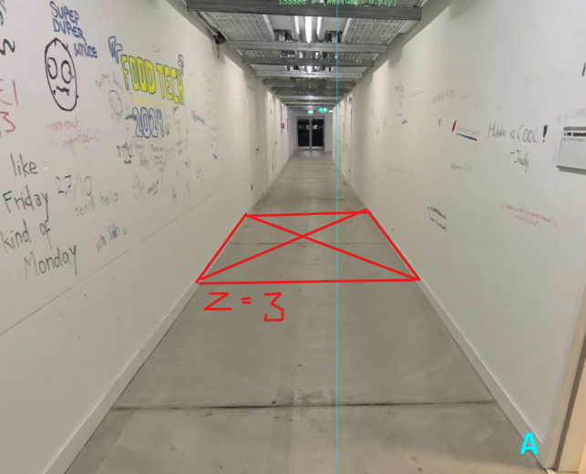
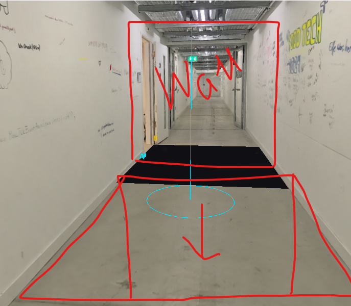

# I want you to cut a hole in the floor (have a button for the trigger of that) so that there is a cutout into the void that has the

Provider: codex; source: subagent; session: 01a1a6cf-d0b8-7731-8169-5a296fea1c49.

Original local record: C:\Users\user\.codex\sessions\2026\11\04\rollout-2026-11-04T14-46-39-01a1a6cf-d0b8-7731-8169-5a296fea1c49.jsonl.

Created: 2026-11-04T13:46:39.672Z. Export snapshot: 2026-11-05T11:08:59.327Z.

This transcript contains stored user-facing user/assistant messages, with image links. System/developer prompts, tool payloads and internal reasoning are omitted. Credential-shaped strings are redacted. A delegated thread's user-role messages may be inherited context or instructions from another agent.

## 1. user · 2026-11-04T13:46:39.802Z

# AGENTS.md instructions for C:\Users\user\Documents\Hallway_Project\02_Git\calibrated

<INSTRUCTIONS>
# Rules for coding agents

## Start here

Read `ai/strategy.md`, then the relevant sections of `docs/PROJECT_PLAN.md`, `docs/CALIBRATION.md`, and `docs/VALIDATION.md`.

This repository is in active implementation (viewer, XR session, calibration; hardware-validated on the Quest Browser and SteamVR/Steam Link routes). Continue through the agreed work without asking for a new “go” after every step, but keep the plan/build/check/log loop and record decisions in `ai/strategy.md`.

## Work loop

0. **Git and network operations:** Never push, pull, or fetch. Commits are local only.
   Before publishing anything, **ask the user** — they push and pull manually via
   GitHub Desktop. Never trigger credential prompts or other network authentication.

1. Record the current task and acceptance criteria in `ai/strategy.md`.
2. Build one reviewable step at a time. Keep modules small and separate calibration mathematics from rendering and device input.
3. Run the checks relevant to the change. Once implemented, use `npm test` for logic and `npm run check` for desktop browser behavior. These commands do not exist during the planning phase.
4. Read generated reports and inspect screenshots before describing them. Repair failures, then record the outcome and next step in `ai/strategy.md`.
5. Distinguish automated checks, desktop visual checks, and tests performed on the real PC/Quest/hallway. Never report a hardware milestone as passed from a browser screenshot or simulated pose.

For documentation changes, check consistency and relative links; do not create application tests just to test prose. Keep generated `.check/` results unedited.

## Calibration invariants

- In calibrated mode, one XR unit is one metre. The parent rig for the tracked camera and controllers stays at identity; transform the scan root into XR space.
- No joystick locomotion, teleportation, artificial turning, or user-scale control in calibrated mode.
- Fit explicitly paired physical/scan landmarks. A controller grip pose is not the physical probe tip; account for its measured offset.
- Keep validation landmarks separate from fit landmarks. Report fit residuals and held-out errors separately.
- Recenter, reference-space reset, viewer-tracking interruption, changed scan data, or a new session invalidate acceptance and require the recovery procedure. Invalid controller poses block active capture; loss of an unused controller alone does not invalidate alignment.
- A saved transform is a candidate for revalidation, never evidence of present alignment. Splats provide appearance, not certified wall geometry or collision protection.

## Scope and tools

`src/viewer/scanAsset.ts` contains manually adjusted scan placement. Do not modify this file, including rotation, start point, camera or anchors, without explicit user permission. Configure calibration landmarks in `src/calibration/landmarks.ts` instead; tests must accommodate the manual asset settings.

Use existing project conventions and verify current APIs against the pinned dependencies. Routine reversible changes and dependency choices inside the authorized task do not need separate permission; record material architectural changes. Ask when missing information prevents a sound decision.

Do not change agent model, provider, credentials, or permission defaults as part of ordinary project work. Never print secrets. Do not dump large scan binaries into agent context; inspect metadata or use purpose-built processing when the task requires it. Keep private scans and calibration captures out of Git.

Use bounded checks where possible. When a development server is needed, track its process and stop it when finished unless the user needs it left running. Report blockers with evidence and continue independent work when possible.

## Provenance

Adapted from the Photolipsia agentic kit's small-step plan/build/check/log workflow. See `docs/REFERENCES.md` for source and licensing details.

</INSTRUCTIONS>
<environment_context>
  <cwd>C:\Users\user\Documents\Hallway_Project\02_Git\calibrated</cwd>
  <shell>powershell</shell>
  <current_date>2026-11-04</current_date>
  <timezone>Europe/Zurich</timezone>
  <filesystem><workspace_roots><root>C:\Users\user\Documents\Hallway_Project\02_Git\calibrated</root></workspace_roots><permission_profile type="managed"><file_system type="restricted"><entry access="read"><special>:root</special></entry><entry access="write"><path>C:\Users\user\Documents\Hallway_Project\02_Git\calibrated</path></entry><entry access="write"><special>:slash_tmp</special></entry><entry access="write"><special>:tmpdir</special></entry><entry access="read"><path>C:\Users\user\Documents\Hallway_Project\02_Git\calibrated\.git</path></entry><entry access="read"><path>C:\Users\user\Documents\Hallway_Project\02_Git\calibrated\.agents</path></entry><entry access="read"><path>C:\Users\user\Documents\Hallway_Project\02_Git\calibrated\.codex</path></entry><entry access="read"><path>C:\Users\user\Documents\Hallway_Project\02_Git\calibrated\.aws</path></entry></file_system></permission_profile></filesystem>
</environment_context>

## 2. user · 2026-11-04T13:46:39.812Z

<external_codex_apps_open_page>{"page_id":null}</external_codex_apps_open_page>

## 3. user · 2026-11-04T13:46:39.812Z

# Context from my IDE setup:

## Active file: src/calibration/landmarks.ts

## Open tabs:
- landmarks.ts: src/calibration/landmarks.ts
- scanAsset.ts: src/viewer/scanAsset.ts
- Pasted text.txt: c:\Users\user\.codex\attachments\d35cc99d-bff6-4c23-862e-b78af88ec115\Pasted text.txt
- main.ts: src/main.ts
- movementBoundary.ts: src/xr/movementBoundary.ts

## My request:
I want you to cut a hole in the floor (have a button for the trigger of that) so that there is a cutout into the void that has the size of the wall that we added, the hole starts on the position z = 3

## 4. assistant · 2026-11-04T13:46:39.814Z

I’ll check how the wall and scan are rendered, then add a button-controlled floor opening starting at z = 3 and matching the wall’s size.

## 5. assistant · 2026-11-04T13:46:39.818Z

The wall is 2.10 × 2.60 m, so I’ll use those dimensions for the opening: 2.10 m across the hallway and 2.60 m along it, from z = 3 to z = 5.6. The button will remove the rendered floor in that area and restore it when closed.

## 6. assistant · 2026-11-04T13:46:39.819Z

The floor cutout and Open/Close button are wired in. The opening stays fixed in world space through the hallway turn, and uses the existing STOP, reset, calibration and tracking recovery controls to close it. I’m now checking the rendered result and the existing controls.

## 7. assistant · 2026-11-04T13:46:39.842Z

The rendered checks confirm a sharp rectangular opening, intact surrounding floor and walls, and exact restoration when closed. I’ve inspected the synthetic view; next I’ll check the original hallway scan and finish the full regression run.

## 8. assistant · 2026-11-04T13:46:39.855Z

The hole’s pixel and recovery checks pass. The full suite has hit failures in the wooden-box and narration changes currently being edited in this workspace. I’m preserving those edits and continuing the original-scan check.

## 9. assistant · 2026-11-04T13:46:39.941Z

All 139 logic tests and the production build now pass. I’m finishing the original-scan capture and will rerun the browser suite against the updated box and narration code.

## 10. assistant · 2026-11-04T13:46:39.945Z

A file watcher interrupted the original-scan check when it hit a locked generated scan file. I’ve disabled watching in the isolated check server and restarted verification.

## 11. assistant · 2026-11-04T13:46:39.973Z

I’ve inspected the opening in the original hallway scan: it matches the rectangle, with the surrounding floor and walls intact. The focused original-scan checks pass, and the final full browser run is underway.

## 12. assistant · 2026-11-04T13:46:39.974Z

The full synthetic browser suite, all 140 logic tests, and the production build now pass. Only the final original-scan capture is still running.

## 13. assistant · 2026-11-04T13:46:39.985Z

Added **Open floor hole / Close floor hole** in Hallway controls. Refresh the page to use it.

The opening is **2.10 × 2.60 m**, matching the wall’s face, from **z = 3 to z = 5.6**. STOP/reset closes it automatically.

Verified on the original scan. All 140 logic tests, 35 browser checks and the build pass. Headset validation remains pending.

## 14. user · 2026-11-04T13:46:39.986Z

<external_codex_apps_open_page>{"page_id":null}</external_codex_apps_open_page>

## 15. user · 2026-11-04T13:46:39.986Z

# Context from my IDE setup:

## Active file: src/calibration/landmarks.ts

## Open tabs:
- landmarks.ts: src/calibration/landmarks.ts
- scanAsset.ts: src/viewer/scanAsset.ts
- Pasted text.txt: c:\Users\user\.codex\attachments\d35cc99d-bff6-4c23-862e-b78af88ec115\Pasted text.txt
- main.ts: src/main.ts
- movementBoundary.ts: src/xr/movementBoundary.ts

## My request:
ok amaying, this is where the hole is currentlz places with the button and where the wall is animated to come to. I want to have buttons to check the wall start position and wall movement end position what is in simulatio,. i also want to move the hole a bit to this side you see from the sketch, and when the wall stops moving then it glitches out and the hole is behid it from the user perspective.. apart from the buttons add that sequence to the both desktop preview and vr experience

## 16. assistant · 2026-11-04T13:46:39.988Z

I’ll add buttons to inspect the wall’s actual start and end poses, move the hole toward the viewer as shown, and connect the wall-stop, glitch and hole reveal to both desktop preview and VR. I’ll also check what currently happens when the wall reaches its endpoint.

## 17. assistant · 2026-11-04T13:50:32.851Z

Implemented:

- `src/viewer/wallGlitch.ts`: configurable 0.15 s hold, 0.55 s dissolve, repeat-safe arming and cancellation.
- `src/viewer/wallGlitchShader.ts`: wall-only sliced jitter/dropout using existing shared material; preserves pose and other effects.
- `tests/wallGlitch.test.ts`: 5 passing consequential tests.

Typecheck and scoped whitespace checks pass. Parent integration and rendered browser verification remain.

## 18. assistant · 2026-11-04T13:56:59.967Z

Updated the two floor test files for the relocated, wall-relative opening.

- Config-derived intervals, camera and pixel probes.
- Preserved refit, guards, source integrity, restoration and visibility checks.
- Added behind-wall placement, calibrated corners, frozen geometry, duplicate-callback and rejection coverage.

All 8 floor unit tests, typecheck and scoped whitespace checks pass. Browser execution remains with the parent.

## 19. assistant · 2026-11-04T14:02:17.430Z

No remaining material bug found after the Stop-button and zero-length-route fixes.

Confirmed frozen endpoint reuse, player-wait behavior, one-shot arrival, shared calibrated frame, and cancellation without stale revival.

Recommended browser coverage: inspect end → Run, and Stop during arrival hold → no later glitch or hole.

## 20. assistant · 2026-11-04T14:06:52.317Z

Updated only `tests/browser/rotationOffsetScenario.mjs`.

Wall Show now runs before manual hole preview. Initial checks verify fitted bounds, corners and shader frame at the actual interval; later offset edits verify the hole stays frozen with the wall. Existing box, broom, seat and wall checks remain intact.

Syntax and scoped whitespace checks pass. Ready for the full browser rerun.

## 21. assistant · 2026-11-04T14:09:40.381Z

Stale claims found:

- `PROJECT_PLAN.md:55`: still uses hole Z3/5.6.
- `INTERACTION_PLAN.md:34`, `CALIBRATION.md:23`, `VALIDATION.md:54`: still say the opening follows later alignment offsets.
- `PROJECT_PLAN.md`: wall summary omits endpoint buttons and arrival glitch/reveal.

Also clarify `VALIDATION.md:82` that endpoint holding is brief before the glitch. Detailed new floor sections otherwise agree.

## 22. assistant · 2026-11-04T14:11:51.815Z

Updated the four docs with consistent frozen wall/hole behavior, relocated opening, endpoint controls and arrival timing. Broom and second-box correction behavior remains clear.

All 75 relative links and scoped whitespace checks pass. No code, tests or strategy changes.

## 23. assistant · 2026-11-04T14:33:17.452Z

Fixed two reproducible audio failures in `voiceGuide.ts`:

- Failed fetch/decode results no longer poison the cache across games.
- Previously enabled audio contexts get a bounded 500 ms resume attempt.

Generation guards prevent cancelled or timed-out requests from playing later. Initial permission and mute remain explicit.

All 11 audio tests and scoped whitespace checks pass. Typecheck currently hits the unrelated in-progress `InstallationOptions.placementFrame` error. No audible or hardware validation performed.

## 24. assistant · 2026-11-04T14:39:39.895Z

No remaining lifecycle or stale-cue blocker found.

Fresh-fit reset, frame setup, placement preparation and audio cancellation now occur before new cues. Failed scenarios disarm cleanly; old unlock continuations cannot restart playback.

Timing limitation: the five-second gate starts at the cue request. A slow authorized resume can trim about 260 ms from the 4.7-second lead at earliest headset entry.

## 25. assistant · 2026-11-04T14:43:28.370Z

Added `voices.isCuePlaying(cue)` for the actual scheduled/playing lead only. It stays false during loading, suspension, whispers alone, and after end/stop/mute/disposal.

All 13 audio tests pass, including resumed startup and stale end-event isolation. Typecheck and scoped whitespace checks pass.

## 26. user · 2026-11-05T08:43:43.343Z

<environment_context>
  <current_date>2026-11-05</current_date>
  <timezone>Europe/Zurich</timezone>
  <filesystem><workspace_roots><root>C:\Users\user\Documents\Hallway_Project\02_Git\calibrated</root></workspace_roots><permission_profile type="managed"><file_system type="restricted"><entry access="read"><special>:root</special></entry><entry access="write"><path>C:\Users\user\Documents\Hallway_Project\02_Git\calibrated</path></entry><entry access="write"><special>:slash_tmp</special></entry><entry access="write"><special>:tmpdir</special></entry><entry access="read"><path>C:\Users\user\Documents\Hallway_Project\02_Git\calibrated\.git</path></entry><entry access="read"><path>C:\Users\user\Documents\Hallway_Project\02_Git\calibrated\.agents</path></entry><entry access="read"><path>C:\Users\user\Documents\Hallway_Project\02_Git\calibrated\.codex</path></entry><entry access="read"><path>C:\Users\user\Documents\Hallway_Project\02_Git\calibrated\.aws</path></entry></file_system></permission_profile></filesystem>
</environment_context>

## 27. assistant · 2026-11-05T08:59:16.020Z

Extended the existing native-main browser scenario, so default checks cover reversal and repetition.

Verified: two complete cycles, outside-aperture misses, no instant retriggers, fixed camera/hinge/resources, one Transition 3 request, authoring guards, Close/Reopen and recovery.

Focused synthetic run passes 12/12 with zero browser errors. Original-cut verification remains with the parent.

## 28. assistant · 2026-11-05T10:34:43.441Z

Added native collapse browser coverage and default/focused registration.

Focused D3D11 check: **11/11 passed**, zero JavaScript errors. Verified overlapping fractures, progressive opaque black removal, preserved near floor, unchanged original-corridor mask control, working return portal, stable resources, and cancellation.

Inspected all five generated screenshots in `.check/hallway-collapse-focus6/`. Syntax and scoped whitespace checks pass. No production files edited.

## 29. assistant · 2026-11-05T10:43:39.484Z

Repaired the collector’s sorter race. Original-cut check passes **11/11**, zero errors.

Inspected all six screenshots in `.check/collapse-original-collector2/`. Near floor, walls and ceiling remain intact before erosion. Native blast frames before and after probe collection match exactly: **0 changed pixels**.

Only the browser test changed; syntax and whitespace checks pass.
