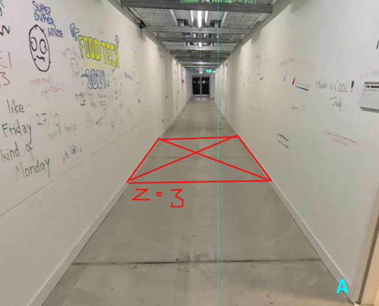
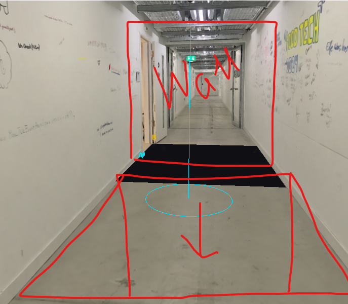

# I want you to cut a hole in the floor (have a button for the trigger of that) so that there is a cutout into the void that has the

Provider: codex; source: subagent; session: 01a1a6cf-f8d4-7940-bd42-762cac911f02.

Original local record: C:\Users\user\.codex\sessions\2026\11\04\rollout-2026-11-04T14-46-49-01a1a6cf-f8d4-7940-bd42-762cac911f02.jsonl.

Created: 2026-11-04T13:46:49.940Z. Export snapshot: 2026-11-05T11:08:59.327Z.

This transcript contains stored user-facing user/assistant messages, with image links. System/developer prompts, tool payloads and internal reasoning are omitted. Credential-shaped strings are redacted. A delegated thread's user-role messages may be inherited context or instructions from another agent.

## 1. user · 2026-11-04T13:46:50.020Z

# AGENTS.md instructions for C:\Users\user\Documents\Hallway_Project\02_Git\calibrated

<INSTRUCTIONS>
# Rules for coding agents

## Start here

Read `ai/strategy.md`, then the relevant sections of `docs/PROJECT_PLAN.md`, `docs/CALIBRATION.md`, and `docs/VALIDATION.md`.

This repository is in active implementation (viewer, XR session, calibration; hardware-validated on the Quest Browser and SteamVR/Steam Link routes). Continue through the agreed work without asking for a new “go” after every step, but keep the plan/build/check/log loop and record decisions in `ai/strategy.md`.

## Work loop

0. **Git and network operations:** Never push, pull, or fetch. Commits are local only.
   Before publishing anything, **ask the user** — they push and pull manually via
   GitHub Desktop. Never trigger credential prompts or other network authentication.

1. Record the current task and acceptance criteria in `ai/strategy.md`.
2. Build one reviewable step at a time. Keep modules small and separate calibration mathematics from rendering and device input.
3. Run the checks relevant to the change. Once implemented, use `npm test` for logic and `npm run check` for desktop browser behavior. These commands do not exist during the planning phase.
4. Read generated reports and inspect screenshots before describing them. Repair failures, then record the outcome and next step in `ai/strategy.md`.
5. Distinguish automated checks, desktop visual checks, and tests performed on the real PC/Quest/hallway. Never report a hardware milestone as passed from a browser screenshot or simulated pose.

For documentation changes, check consistency and relative links; do not create application tests just to test prose. Keep generated `.check/` results unedited.

## Calibration invariants

- In calibrated mode, one XR unit is one metre. The parent rig for the tracked camera and controllers stays at identity; transform the scan root into XR space.
- No joystick locomotion, teleportation, artificial turning, or user-scale control in calibrated mode.
- Fit explicitly paired physical/scan landmarks. A controller grip pose is not the physical probe tip; account for its measured offset.
- Keep validation landmarks separate from fit landmarks. Report fit residuals and held-out errors separately.
- Recenter, reference-space reset, viewer-tracking interruption, changed scan data, or a new session invalidate acceptance and require the recovery procedure. Invalid controller poses block active capture; loss of an unused controller alone does not invalidate alignment.
- A saved transform is a candidate for revalidation, never evidence of present alignment. Splats provide appearance, not certified wall geometry or collision protection.

## Scope and tools

`src/viewer/scanAsset.ts` contains manually adjusted scan placement. Do not modify this file, including rotation, start point, camera or anchors, without explicit user permission. Configure calibration landmarks in `src/calibration/landmarks.ts` instead; tests must accommodate the manual asset settings.

Use existing project conventions and verify current APIs against the pinned dependencies. Routine reversible changes and dependency choices inside the authorized task do not need separate permission; record material architectural changes. Ask when missing information prevents a sound decision.

Do not change agent model, provider, credentials, or permission defaults as part of ordinary project work. Never print secrets. Do not dump large scan binaries into agent context; inspect metadata or use purpose-built processing when the task requires it. Keep private scans and calibration captures out of Git.

Use bounded checks where possible. When a development server is needed, track its process and stop it when finished unless the user needs it left running. Report blockers with evidence and continue independent work when possible.

## Provenance

Adapted from the Photolipsia agentic kit's small-step plan/build/check/log workflow. See `docs/REFERENCES.md` for source and licensing details.

</INSTRUCTIONS>
<environment_context>
  <cwd>C:\Users\user\Documents\Hallway_Project\02_Git\calibrated</cwd>
  <shell>powershell</shell>
  <current_date>2026-11-04</current_date>
  <timezone>Europe/Zurich</timezone>
  <filesystem><workspace_roots><root>C:\Users\user\Documents\Hallway_Project\02_Git\calibrated</root></workspace_roots><permission_profile type="managed"><file_system type="restricted"><entry access="read"><special>:root</special></entry><entry access="write"><path>C:\Users\user\Documents\Hallway_Project\02_Git\calibrated</path></entry><entry access="write"><special>:slash_tmp</special></entry><entry access="write"><special>:tmpdir</special></entry><entry access="read"><path>C:\Users\user\Documents\Hallway_Project\02_Git\calibrated\.git</path></entry><entry access="read"><path>C:\Users\user\Documents\Hallway_Project\02_Git\calibrated\.agents</path></entry><entry access="read"><path>C:\Users\user\Documents\Hallway_Project\02_Git\calibrated\.codex</path></entry><entry access="read"><path>C:\Users\user\Documents\Hallway_Project\02_Git\calibrated\.aws</path></entry></file_system></permission_profile></filesystem>
</environment_context>

## 2. user · 2026-11-04T13:46:50.032Z

<external_codex_apps_open_page>{"page_id":null}</external_codex_apps_open_page>

## 3. user · 2026-11-04T13:46:50.032Z

# Context from my IDE setup:

## Active file: src/calibration/landmarks.ts

## Open tabs:
- landmarks.ts: src/calibration/landmarks.ts
- scanAsset.ts: src/viewer/scanAsset.ts
- Pasted text.txt: c:\Users\user\.codex\attachments\d35cc99d-bff6-4c23-862e-b78af88ec115\Pasted text.txt
- main.ts: src/main.ts
- movementBoundary.ts: src/xr/movementBoundary.ts

## My request:
I want you to cut a hole in the floor (have a button for the trigger of that) so that there is a cutout into the void that has the size of the wall that we added, the hole starts on the position z = 3

## 4. assistant · 2026-11-04T13:46:50.037Z

I’ll check how the wall and scan are rendered, then add a button-controlled floor opening starting at z = 3 and matching the wall’s size.

## 5. assistant · 2026-11-04T13:46:50.043Z

The wall is 2.10 × 2.60 m, so I’ll use those dimensions for the opening: 2.10 m across the hallway and 2.60 m along it, from z = 3 to z = 5.6. The button will remove the rendered floor in that area and restore it when closed.

## 6. assistant · 2026-11-04T13:46:50.068Z

The floor cutout and Open/Close button are wired in. The opening stays fixed in world space through the hallway turn, and uses the existing STOP, reset, calibration and tracking recovery controls to close it. I’m now checking the rendered result and the existing controls.

## 7. assistant · 2026-11-04T13:46:50.076Z

The rendered checks confirm a sharp rectangular opening, intact surrounding floor and walls, and exact restoration when closed. I’ve inspected the synthetic view; next I’ll check the original hallway scan and finish the full regression run.

## 8. assistant · 2026-11-04T13:46:50.083Z

The hole’s pixel and recovery checks pass. The full suite has hit failures in the wooden-box and narration changes currently being edited in this workspace. I’m preserving those edits and continuing the original-scan check.

## 9. assistant · 2026-11-04T13:46:50.305Z

All 139 logic tests and the production build now pass. I’m finishing the original-scan capture and will rerun the browser suite against the updated box and narration code.

## 10. assistant · 2026-11-04T13:46:50.316Z

A file watcher interrupted the original-scan check when it hit a locked generated scan file. I’ve disabled watching in the isolated check server and restarted verification.

## 11. assistant · 2026-11-04T13:46:50.343Z

I’ve inspected the opening in the original hallway scan: it matches the rectangle, with the surrounding floor and walls intact. The focused original-scan checks pass, and the final full browser run is underway.

## 12. assistant · 2026-11-04T13:46:50.350Z

The full synthetic browser suite, all 140 logic tests, and the production build now pass. Only the final original-scan capture is still running.

## 13. assistant · 2026-11-04T13:46:50.382Z

Added **Open floor hole / Close floor hole** in Hallway controls. Refresh the page to use it.

The opening is **2.10 × 2.60 m**, matching the wall’s face, from **z = 3 to z = 5.6**. STOP/reset closes it automatically.

Verified on the original scan. All 140 logic tests, 35 browser checks and the build pass. Headset validation remains pending.

## 14. user · 2026-11-04T13:46:50.385Z

<external_codex_apps_open_page>{"page_id":null}</external_codex_apps_open_page>

## 15. user · 2026-11-04T13:46:50.385Z

# Context from my IDE setup:

## Active file: src/calibration/landmarks.ts

## Open tabs:
- landmarks.ts: src/calibration/landmarks.ts
- scanAsset.ts: src/viewer/scanAsset.ts
- Pasted text.txt: c:\Users\user\.codex\attachments\d35cc99d-bff6-4c23-862e-b78af88ec115\Pasted text.txt
- main.ts: src/main.ts
- movementBoundary.ts: src/xr/movementBoundary.ts

## My request:
ok amaying, this is where the hole is currentlz places with the button and where the wall is animated to come to. I want to have buttons to check the wall start position and wall movement end position what is in simulatio,. i also want to move the hole a bit to this side you see from the sketch, and when the wall stops moving then it glitches out and the hole is behid it from the user perspective.. apart from the buttons add that sequence to the both desktop preview and vr experience

## 16. assistant · 2026-11-04T13:46:50.388Z

I’ll add buttons to inspect the wall’s actual start and end poses, move the hole toward the viewer as shown, and connect the wall-stop, glitch and hole reveal to both desktop preview and VR. I’ll also check what currently happens when the wall reaches its endpoint.

## 17. assistant · 2026-11-04T13:58:11.510Z

Added `tests/browser/wallRevealScenario.mjs` exporting `runWallRevealScenario(page, output)`.

Covers endpoint buttons and actual scene poses, player pauses, concealed hole opening at arrival, rendered glitch, unchanged standing pose, persistent hole, STOP/reset, failed hole placement, resource reuse, and mapped calibration frames. Generates five requested screenshots.

`node --check` passes. Browser execution awaits runner integration.

## 18. assistant · 2026-11-04T14:00:40.055Z

Fixed the mapped test’s stale disabled-button click. It now waits up to three seconds for the real main-loop UI refresh, asserts button and wall diagnostics, and checks a visible non-null pose before coordinate conversion.

True pose/frame assertions remain intact. Syntax check passes; ready for the browser rerun.

## 19. assistant · 2026-11-04T14:03:04.368Z

Added both checks to `wallRevealScenario.mjs`: Run replays the inspected route with the floor closed before arrival; Stop motion cancels the arrival cue while retaining the standing wall and closing the hole.

Syntax and scoped whitespace checks pass. No browser rerun.

## 20. assistant · 2026-11-04T14:05:56.181Z

Added `capturePrivateWallReveal(page, output)` with actual endpoint/Run buttons, sorted before/during/after captures, fixed-pose and hole-visibility assertions, and small returned metrics.

It restores camera/player state without moving the scan, resetting the installation, or changing prepared boxes. Syntax and whitespace checks pass; no browser run.

## 21. assistant · 2026-11-04T14:35:45.187Z

Added `runGameRestartScenario(parentPage)` in `tests/browser/gameRestartScenario.mjs`.

Covers restart from seven prior states, full games across four calibration yaws, box narration protection through 15 seconds, stale callback suppression, and atomic secondary-placement failure/recovery. Syntax passes; browser run awaits integration.

Audit also identified suspended audio contexts as a separate possible cause of missing sound.

## 22. assistant · 2026-11-04T14:43:42.080Z

Added `runVoiceRestartScenario(parentPage)` in `tests/browser/voiceRestartScenario.mjs`.

It tests real local MP3 decoding and native source scheduling at zero output gain, retry after decoding failure, stale-load cancellation, cached replay across two games, and suspended-context recovery. Cleanup restores globals and closes audio/page resources.

Syntax passes. No browser run or audibility claim.

## 23. user · 2026-11-05T08:43:26.099Z

<environment_context>
  <current_date>2026-11-05</current_date>
  <timezone>Europe/Zurich</timezone>
  <filesystem><workspace_roots><root>C:\Users\user\Documents\Hallway_Project\02_Git\calibrated</root></workspace_roots><permission_profile type="managed"><file_system type="restricted"><entry access="read"><special>:root</special></entry><entry access="write"><path>C:\Users\user\Documents\Hallway_Project\02_Git\calibrated</path></entry><entry access="write"><special>:slash_tmp</special></entry><entry access="write"><special>:tmpdir</special></entry><entry access="read"><path>C:\Users\user\Documents\Hallway_Project\02_Git\calibrated\.git</path></entry><entry access="read"><path>C:\Users\user\Documents\Hallway_Project\02_Git\calibrated\.agents</path></entry><entry access="read"><path>C:\Users\user\Documents\Hallway_Project\02_Git\calibrated\.codex</path></entry><entry access="read"><path>C:\Users\user\Documents\Hallway_Project\02_Git\calibrated\.aws</path></entry></file_system></permission_profile></filesystem>
</environment_context>

## 24. assistant · 2026-11-05T08:52:32.240Z

Implemented reversible four-second turns on one frozen hinge, plus finite tapered-portal crossing with hysteresis and pose-jump rejection.

All 15 owned tests, typecheck and scoped whitespace checks pass. Only the four assigned math/test files changed; integration remains with the parent.

## 25. assistant · 2026-11-05T10:27:13.574Z

Read-only review found three issues:

- Affine rectangle clipping can miss the actual tapered aperture; use the exact taper inverse.
- Nonorthogonal opening axes can shear fragment panels; orthogonalize the basis.
- Late GLTF completion or metadata failure can leak loaded resources; dispose unadopted geometry/materials.

GLB normalization, animation bindings, clone sharing, absolute clip sampling, shader warmup, and presentation-frame ordering match the prepared asset. No files changed.

## 26. assistant · 2026-11-05T10:57:52.604Z

Implemented shared-context rumble controller plus six passing unit/PCM tests and an optional native browser scenario.

Each blast plays one normalized 1.8-second supplied excerpt. Overlaps remain bounded; mute, pause, reset and recovery prevent stale playback. Source audio is unchanged.

Browser scenario syntax passes. Full typecheck currently reports unrelated concurrent collapse-test changes.

## 27. assistant · 2026-11-05T11:05:37.925Z

Read-only integration review passed: shared unlock/context/master gain, preload timing, unique blast IDs, pause/mute/recovery, and disposal are coherent. Typecheck and six rumble tests pass.

Native browser validation is queued in `wall_glitch`’s existing focused run; no additional browser was launched.
