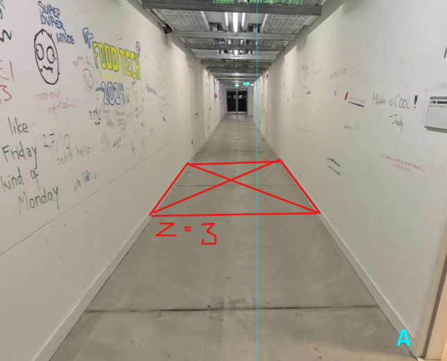
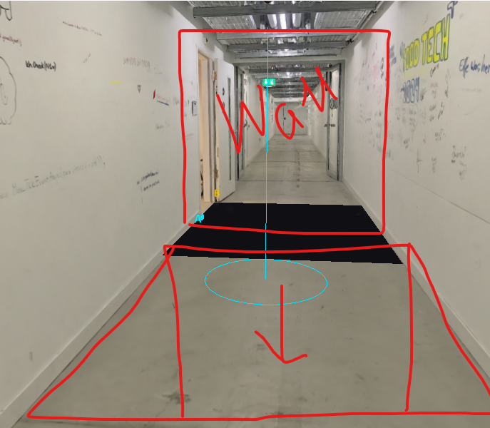

# I want you to cut a hole in the floor (have a button for the trigger of that) so that there is a cutout into the void that has the

Provider: codex; source: subagent; session: 01a1a6f7-9c5e-79e1-8bff-13028ffd83c6.

Original local record: C:\Users\user\.codex\sessions\2026\11\04\rollout-2026-11-04T15-30-07-01a1a6f7-9c5e-79e1-8bff-13028ffd83c6.jsonl.

Created: 2026-11-04T14:30:07.710Z. Export snapshot: 2026-11-05T11:08:59.327Z.

This transcript contains stored user-facing user/assistant messages, with image links. System/developer prompts, tool payloads and internal reasoning are omitted. Credential-shaped strings are redacted. A delegated thread's user-role messages may be inherited context or instructions from another agent.

## 1. user · 2026-11-04T14:30:07.770Z

# AGENTS.md instructions for C:\Users\user\Documents\Hallway_Project\02_Git\calibrated

<INSTRUCTIONS>
# Rules for coding agents

## Start here

Read `ai/strategy.md`, then the relevant sections of `docs/PROJECT_PLAN.md`, `docs/CALIBRATION.md`, and `docs/VALIDATION.md`.

This repository is in active implementation (viewer, XR session, calibration; hardware-validated on the Quest Browser and SteamVR/Steam Link routes). Continue through the agreed work without asking for a new “go” after every step, but keep the plan/build/check/log loop and record decisions in `ai/strategy.md`.

## Work loop

0. **Git and network operations:** Never push, pull, or fetch. Commits are local only.
   Before publishing anything, **ask the user** — they push and pull manually via
   GitHub Desktop. Never trigger credential prompts or other network authentication.

1. Record the current task and acceptance criteria in `ai/strategy.md`.
2. Build one reviewable step at a time. Keep modules small and separate calibration mathematics from rendering and device input.
3. Run the checks relevant to the change. Once implemented, use `npm test` for logic and `npm run check` for desktop browser behavior. These commands do not exist during the planning phase.
4. Read generated reports and inspect screenshots before describing them. Repair failures, then record the outcome and next step in `ai/strategy.md`.
5. Distinguish automated checks, desktop visual checks, and tests performed on the real PC/Quest/hallway. Never report a hardware milestone as passed from a browser screenshot or simulated pose.

For documentation changes, check consistency and relative links; do not create application tests just to test prose. Keep generated `.check/` results unedited.

## Calibration invariants

- In calibrated mode, one XR unit is one metre. The parent rig for the tracked camera and controllers stays at identity; transform the scan root into XR space.
- No joystick locomotion, teleportation, artificial turning, or user-scale control in calibrated mode.
- Fit explicitly paired physical/scan landmarks. A controller grip pose is not the physical probe tip; account for its measured offset.
- Keep validation landmarks separate from fit landmarks. Report fit residuals and held-out errors separately.
- Recenter, reference-space reset, viewer-tracking interruption, changed scan data, or a new session invalidate acceptance and require the recovery procedure. Invalid controller poses block active capture; loss of an unused controller alone does not invalidate alignment.
- A saved transform is a candidate for revalidation, never evidence of present alignment. Splats provide appearance, not certified wall geometry or collision protection.

## Scope and tools

`src/viewer/scanAsset.ts` contains manually adjusted scan placement. Do not modify this file, including rotation, start point, camera or anchors, without explicit user permission. Configure calibration landmarks in `src/calibration/landmarks.ts` instead; tests must accommodate the manual asset settings.

Use existing project conventions and verify current APIs against the pinned dependencies. Routine reversible changes and dependency choices inside the authorized task do not need separate permission; record material architectural changes. Ask when missing information prevents a sound decision.

Do not change agent model, provider, credentials, or permission defaults as part of ordinary project work. Never print secrets. Do not dump large scan binaries into agent context; inspect metadata or use purpose-built processing when the task requires it. Keep private scans and calibration captures out of Git.

Use bounded checks where possible. When a development server is needed, track its process and stop it when finished unless the user needs it left running. Report blockers with evidence and continue independent work when possible.

## Provenance

Adapted from the Photolipsia agentic kit's small-step plan/build/check/log workflow. See `docs/REFERENCES.md` for source and licensing details.

</INSTRUCTIONS>
<environment_context>
  <cwd>C:\Users\user\Documents\Hallway_Project\02_Git\calibrated</cwd>
  <shell>powershell</shell>
  <current_date>2026-11-04</current_date>
  <timezone>Europe/Zurich</timezone>
  <filesystem><workspace_roots><root>C:\Users\user\Documents\Hallway_Project\02_Git\calibrated</root></workspace_roots><permission_profile type="managed"><file_system type="restricted"><entry access="read"><special>:root</special></entry><entry access="write"><path>C:\Users\user\Documents\Hallway_Project\02_Git\calibrated</path></entry><entry access="write"><special>:slash_tmp</special></entry><entry access="write"><special>:tmpdir</special></entry><entry access="read"><path>C:\Users\user\Documents\Hallway_Project\02_Git\calibrated\.git</path></entry><entry access="read"><path>C:\Users\user\Documents\Hallway_Project\02_Git\calibrated\.agents</path></entry><entry access="read"><path>C:\Users\user\Documents\Hallway_Project\02_Git\calibrated\.codex</path></entry><entry access="read"><path>C:\Users\user\Documents\Hallway_Project\02_Git\calibrated\.aws</path></entry></file_system></permission_profile></filesystem>
</environment_context>

## 2. user · 2026-11-04T14:30:07.771Z

<external_codex_apps_open_page>{"page_id":null}</external_codex_apps_open_page>

## 3. user · 2026-11-04T14:30:07.771Z

# Context from my IDE setup:

## Active file: src/calibration/landmarks.ts

## Open tabs:
- landmarks.ts: src/calibration/landmarks.ts
- scanAsset.ts: src/viewer/scanAsset.ts
- Pasted text.txt: c:\Users\user\.codex\attachments\d35cc99d-bff6-4c23-862e-b78af88ec115\Pasted text.txt
- main.ts: src/main.ts
- movementBoundary.ts: src/xr/movementBoundary.ts

## My request:
I want you to cut a hole in the floor (have a button for the trigger of that) so that there is a cutout into the void that has the size of the wall that we added, the hole starts on the position z = 3

## 4. assistant · 2026-11-04T14:30:07.772Z

I’ll check how the wall and scan are rendered, then add a button-controlled floor opening starting at z = 3 and matching the wall’s size.

## 5. assistant · 2026-11-04T14:30:07.773Z

The wall is 2.10 × 2.60 m, so I’ll use those dimensions for the opening: 2.10 m across the hallway and 2.60 m along it, from z = 3 to z = 5.6. The button will remove the rendered floor in that area and restore it when closed.

## 6. assistant · 2026-11-04T14:30:07.774Z

The floor cutout and Open/Close button are wired in. The opening stays fixed in world space through the hallway turn, and uses the existing STOP, reset, calibration and tracking recovery controls to close it. I’m now checking the rendered result and the existing controls.

## 7. assistant · 2026-11-04T14:30:07.776Z

The rendered checks confirm a sharp rectangular opening, intact surrounding floor and walls, and exact restoration when closed. I’ve inspected the synthetic view; next I’ll check the original hallway scan and finish the full regression run.

## 8. assistant · 2026-11-04T14:30:07.776Z

The hole’s pixel and recovery checks pass. The full suite has hit failures in the wooden-box and narration changes currently being edited in this workspace. I’m preserving those edits and continuing the original-scan check.

## 9. assistant · 2026-11-04T14:30:07.779Z

All 139 logic tests and the production build now pass. I’m finishing the original-scan capture and will rerun the browser suite against the updated box and narration code.

## 10. assistant · 2026-11-04T14:30:07.779Z

A file watcher interrupted the original-scan check when it hit a locked generated scan file. I’ve disabled watching in the isolated check server and restarted verification.

## 11. assistant · 2026-11-04T14:30:07.784Z

I’ve inspected the opening in the original hallway scan: it matches the rectangle, with the surrounding floor and walls intact. The focused original-scan checks pass, and the final full browser run is underway.

## 12. assistant · 2026-11-04T14:30:07.784Z

The full synthetic browser suite, all 140 logic tests, and the production build now pass. Only the final original-scan capture is still running.

## 13. assistant · 2026-11-04T14:30:07.786Z

Added **Open floor hole / Close floor hole** in Hallway controls. Refresh the page to use it.

The opening is **2.10 × 2.60 m**, matching the wall’s face, from **z = 3 to z = 5.6**. STOP/reset closes it automatically.

Verified on the original scan. All 140 logic tests, 35 browser checks and the build pass. Headset validation remains pending.

## 14. user · 2026-11-04T14:30:07.787Z

<external_codex_apps_open_page>{"page_id":null}</external_codex_apps_open_page>

## 15. user · 2026-11-04T14:30:07.787Z

# Context from my IDE setup:

## Active file: src/calibration/landmarks.ts

## Open tabs:
- landmarks.ts: src/calibration/landmarks.ts
- scanAsset.ts: src/viewer/scanAsset.ts
- Pasted text.txt: c:\Users\user\.codex\attachments\d35cc99d-bff6-4c23-862e-b78af88ec115\Pasted text.txt
- main.ts: src/main.ts
- movementBoundary.ts: src/xr/movementBoundary.ts

## My request:
ok amaying, this is where the hole is currentlz places with the button and where the wall is animated to come to. I want to have buttons to check the wall start position and wall movement end position what is in simulatio,. i also want to move the hole a bit to this side you see from the sketch, and when the wall stops moving then it glitches out and the hole is behid it from the user perspective.. apart from the buttons add that sequence to the both desktop preview and vr experience

## 16. assistant · 2026-11-04T14:30:07.788Z

I’ll add buttons to inspect the wall’s actual start and end poses, move the hole toward the viewer as shown, and connect the wall-stop, glitch and hole reveal to both desktop preview and VR. I’ll also check what currently happens when the wall reaches its endpoint.

## 17. user · 2026-11-04T14:30:07.790Z

<send_user_message_question_reply>
[{"questionItemId":"[\"request_user_input_async\",\"call_4857ca7a3405429a85541ca01b31c69d\",0]","question":"I’m reading the sequence as: the wall approaches, stops, glitches away, then reveals the hole immediately behind it. Should the hole sit just beyond the wall’s final face, or in front of that position toward the viewer as the lower red outline suggests?","answer":"it should appear while the user is seeing the wall, so when the wall glitches out the hole seems to have always been there"}]
</send_user_message_question_reply>

## 18. assistant · 2026-11-04T14:30:07.790Z

Got it—the hole should open while the wall still hides it, so the glitch reveals a hole that appears to have been there all along. I’ll open it behind the stopped wall before the glitch begins, using the wall’s fitted endpoint to place it.

## 19. assistant · 2026-11-04T14:30:07.791Z

The wall currently travels from hallway Z = −8 to −2, while the old hole used a separate positive-Z position. I’m linking the hole to the wall’s endpoint so they line up in preview and calibrated VR, and adding buttons that show each endpoint without starting the sequence.

## 20. assistant · 2026-11-04T14:30:07.796Z

The before/during/after views show the intended reveal: the wall hides the open hole, glitches away at its fixed stop position, then leaves the hole visible. The endpoint buttons also match the rendered wall coordinates. I’m finishing the calibrated-coordinate and cancellation checks.

## 21. assistant · 2026-11-04T14:30:07.798Z

The checks now cover player pauses, replaying the inspected route, stopping during the arrival hold, and rotated/translated calibration frames. All 184 logic tests pass. The full browser regression and original-scan captures are running.

## 22. assistant · 2026-11-04T14:30:07.798Z

The full synthetic desktop suite now passes, including the alignment controls. The remaining check is rendering the original hallway and scanned wall so I can inspect the real-asset reveal.

## 23. assistant · 2026-11-04T14:30:07.806Z

Added **Check wall start**, **Check wall end**, and **Run wall sequence**. The check buttons hold the actual simulation poses and display their coordinates.

In both desktop preview and VR, the relocated hole opens behind the still-visible wall. The wall then glitches away, revealing it.

Original-scan visuals verified; 184 tests, 43 browser checks and build pass. Headset validation remains pending. Refresh to use the controls.

## 24. user · 2026-11-04T14:30:07.806Z

<external_codex_apps_open_page>{"page_id":null}</external_codex_apps_open_page>

## 25. user · 2026-11-04T14:30:07.806Z

# Context from my IDE setup:

## Active file: src/calibration/landmarks.ts

## Open tabs:
- landmarks.ts: src/calibration/landmarks.ts
- scanAsset.ts: src/viewer/scanAsset.ts
- Pasted text.txt: c:\Users\user\.codex\attachments\d35cc99d-bff6-4c23-862e-b78af88ec115\Pasted text.txt
- main.ts: src/main.ts
- movementBoundary.ts: src/xr/movementBoundary.ts

## My request:
I think there is a bug where sometimes the whole interactuion flow is played and sometimes there is no trigger nor the voice that the first box appeared, i need every game to have the same interaction and if you recalibrate it starts from the beginning

## 26. assistant · 2026-11-04T14:30:07.806Z

I’ll trace how calibration starts the interaction and how recalibration cancels the previous run, then make each fresh calibration restart the same box, trigger and narration sequence from the beginning.

## 27. assistant · 2026-11-04T14:30:07.807Z

I found several concrete ways this can happen: manual-only mode survives recalibration, a failed second-box placement can leave the first box visible without its narration or trigger, and an immediate headset trigger can cut the box announcement short. The audio loader also retains failed downloads across games. I’m fixing those paths and adding repeated-game checks.

## 28. assistant · 2026-11-04T14:35:03.447Z

Implemented calibrated secondary-box placement in `installation.ts`, preserving route station and physical wall side across arbitrary calibration yaw and hallway turns. Failed refits hide the seat immediately.

Added five regressions covering translated 90°/180°/−0.63 calibrations, wall contact, offsets, and recalibration restart.

Validation: 38/38 focused tests and TypeScript checks pass.

## 29. assistant · 2026-11-04T14:40:35.669Z

Updated all four assigned docs with restart behavior, narration timing, placement failure handling, calibrated route coordinates, and audio recovery.

Validation: 75 relative links pass; scoped whitespace check passes. Hardware limitations remain explicit.

## 30. assistant · 2026-11-04T14:46:28.347Z

Updated the four docs with the live lead-completion guard and its nonblocking exceptions. Documented the zero-output browser audio check.

All 75 relative links and scoped whitespace checks pass.

## 31. user · 2026-11-05T08:43:32.944Z

<environment_context>
  <current_date>2026-11-05</current_date>
  <timezone>Europe/Zurich</timezone>
  <filesystem><workspace_roots><root>C:\Users\user\Documents\Hallway_Project\02_Git\calibrated</root></workspace_roots><permission_profile type="managed"><file_system type="restricted"><entry access="read"><special>:root</special></entry><entry access="write"><path>C:\Users\user\Documents\Hallway_Project\02_Git\calibrated</path></entry><entry access="write"><special>:slash_tmp</special></entry><entry access="write"><special>:tmpdir</special></entry><entry access="read"><path>C:\Users\user\Documents\Hallway_Project\02_Git\calibrated\.git</path></entry><entry access="read"><path>C:\Users\user\Documents\Hallway_Project\02_Git\calibrated\.agents</path></entry><entry access="read"><path>C:\Users\user\Documents\Hallway_Project\02_Git\calibrated\.codex</path></entry><entry access="read"><path>C:\Users\user\Documents\Hallway_Project\02_Git\calibrated\.aws</path></entry></file_system></permission_profile></filesystem>
</environment_context>

## 32. assistant · 2026-11-05T08:46:55.581Z

Updated all five docs for repeated hole transitions: bounded outward crossing, smooth return, clear/reentry before repeating, preserved music and recovery behavior.

Validation: 90 relative links and scoped whitespace checks pass. Hardware passage and comfort remain untested.

## 33. assistant · 2026-11-05T08:52:00.310Z

Closed the authoring gap in `setupExperience.ts` and `experiencePanel.ts`: controls, forced events, pending picks, offsets and scan inspection now honor the transition lock. Reset, STOP, fresh preview and audio remain available.

TypeScript and 32 focused tests pass. Browser agent has the control IDs for verification.

## 34. assistant · 2026-11-05T10:14:17.662Z

Implemented the pure collapse state and tests. It schedules five overlapping blasts, retreats the distant disintegration front, preserves an expanding user/return area, and pauses through reversals.

Validation: 23 relevant tests, TypeScript and whitespace checks pass. Renderer/main integration remains with the parent task.

## 35. assistant · 2026-11-05T10:18:37.766Z

Updated all five docs with collapse timing, protected return space, reversal behavior, recovery, fixed resources and verified fracture-asset provenance.

Validation: 99 relative links and scoped whitespace checks pass. Hardware appearance and comfort remain pending.

## 36. assistant · 2026-11-05T10:58:53.265Z

Reworked the pure collapse model to use ten seeded local damage patches—five per wall—with varied timing and positions progressing from far to near. Each blast starts a three-second local fade; user protection, return pauses and cancellation remain intact.

Validation: 25 relevant tests, TypeScript and whitespace checks pass. Renderer and docs updates remain with the parent task.

## 37. assistant · 2026-11-05T11:02:20.323Z

Updated the five assigned docs and the collapse entry’s steering/acceptance note for ten seeded local damage sites and per-blast rumble. No final verification claims added.

All 99 relative links and scoped whitespace checks pass. `GAMEPLAY_FLOW.md` still needs the parent’s update.

## 38. assistant · 2026-11-05T11:05:26.431Z

Updated `GAMEPLAY_FLOW.md`; 99 links and whitespace checks pass.

Shader review found no new blockers. Per-patch noise seeds are packed but unused. The five-actor pool supports current timing; longer configurable bursts could exceed it.
