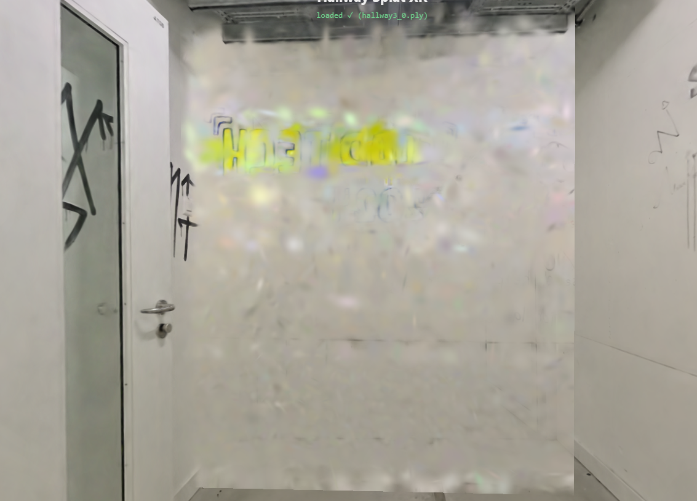
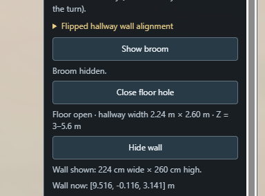

# can you slice up one wall from the hallway? I need it to be empty (no doors, grafiti is fine) from the highest resolution part of 

Provider: codex; source: subagent; session: 01a1a74d-8b92-7442-8dfe-70d32634dc45.

Original local record: C:\Users\user\.codex\sessions\2026\11\04\rollout-2026-11-04T17-03-59-01a1a74d-8b92-7442-8dfe-70d32634dc45.jsonl.

Created: 2026-11-04T16:03:59.506Z. Export snapshot: 2026-11-05T11:08:59.327Z.

This transcript contains stored user-facing user/assistant messages, with image links. System/developer prompts, tool payloads and internal reasoning are omitted. Credential-shaped strings are redacted. A delegated thread's user-role messages may be inherited context or instructions from another agent.

## 1. user · 2026-11-04T16:03:59.554Z

# AGENTS.md instructions for C:\Users\user\Documents\Hallway_Project\02_Git\calibrated

<INSTRUCTIONS>
# Rules for coding agents

## Start here

Read `ai/strategy.md`, then the relevant sections of `docs/PROJECT_PLAN.md`, `docs/CALIBRATION.md`, and `docs/VALIDATION.md`.

This repository is in active implementation (viewer, XR session, calibration; hardware-validated on the Quest Browser and SteamVR/Steam Link routes). Continue through the agreed work without asking for a new “go” after every step, but keep the plan/build/check/log loop and record decisions in `ai/strategy.md`.

## Work loop

0. **Git and network operations:** Never push, pull, or fetch. Commits are local only.
   Before publishing anything, **ask the user** — they push and pull manually via
   GitHub Desktop. Never trigger credential prompts or other network authentication.

1. Record the current task and acceptance criteria in `ai/strategy.md`.
2. Build one reviewable step at a time. Keep modules small and separate calibration mathematics from rendering and device input.
3. Run the checks relevant to the change. Once implemented, use `npm test` for logic and `npm run check` for desktop browser behavior. These commands do not exist during the planning phase.
4. Read generated reports and inspect screenshots before describing them. Repair failures, then record the outcome and next step in `ai/strategy.md`.
5. Distinguish automated checks, desktop visual checks, and tests performed on the real PC/Quest/hallway. Never report a hardware milestone as passed from a browser screenshot or simulated pose.

For documentation changes, check consistency and relative links; do not create application tests just to test prose. Keep generated `.check/` results unedited.

## Calibration invariants

- In calibrated mode, one XR unit is one metre. The parent rig for the tracked camera and controllers stays at identity; transform the scan root into XR space.
- No joystick locomotion, teleportation, artificial turning, or user-scale control in calibrated mode.
- Fit explicitly paired physical/scan landmarks. A controller grip pose is not the physical probe tip; account for its measured offset.
- Keep validation landmarks separate from fit landmarks. Report fit residuals and held-out errors separately.
- Recenter, reference-space reset, viewer-tracking interruption, changed scan data, or a new session invalidate acceptance and require the recovery procedure. Invalid controller poses block active capture; loss of an unused controller alone does not invalidate alignment.
- A saved transform is a candidate for revalidation, never evidence of present alignment. Splats provide appearance, not certified wall geometry or collision protection.

## Scope and tools

`src/viewer/scanAsset.ts` contains manually adjusted scan placement. Do not modify this file, including rotation, start point, camera or anchors, without explicit user permission. Configure calibration landmarks in `src/calibration/landmarks.ts` instead; tests must accommodate the manual asset settings.

Use existing project conventions and verify current APIs against the pinned dependencies. Routine reversible changes and dependency choices inside the authorized task do not need separate permission; record material architectural changes. Ask when missing information prevents a sound decision.

Do not change agent model, provider, credentials, or permission defaults as part of ordinary project work. Never print secrets. Do not dump large scan binaries into agent context; inspect metadata or use purpose-built processing when the task requires it. Keep private scans and calibration captures out of Git.

Use bounded checks where possible. When a development server is needed, track its process and stop it when finished unless the user needs it left running. Report blockers with evidence and continue independent work when possible.

## Provenance

Adapted from the Photolipsia agentic kit's small-step plan/build/check/log workflow. See `docs/REFERENCES.md` for source and licensing details.

</INSTRUCTIONS>
<environment_context>
  <cwd>C:\Users\user\Documents\Hallway_Project\02_Git\calibrated</cwd>
  <shell>powershell</shell>
  <current_date>2026-11-03</current_date>
  <timezone>Europe/Zurich</timezone>
  <filesystem><workspace_roots><root>C:\Users\user\Documents\Hallway_Project\02_Git\calibrated</root></workspace_roots><permission_profile type="managed"><file_system type="restricted"><entry access="read"><special>:root</special></entry><entry access="write"><path>C:\Users\user\Documents\Hallway_Project\02_Git\calibrated</path></entry><entry access="write"><special>:slash_tmp</special></entry><entry access="write"><special>:tmpdir</special></entry><entry access="read"><path>C:\Users\user\Documents\Hallway_Project\02_Git\calibrated\.git</path></entry><entry access="read"><path>C:\Users\user\Documents\Hallway_Project\02_Git\calibrated\.agents</path></entry><entry access="read"><path>C:\Users\user\Documents\Hallway_Project\02_Git\calibrated\.codex</path></entry><entry access="read"><path>C:\Users\user\Documents\Hallway_Project\02_Git\calibrated\.aws</path></entry></file_system></permission_profile></filesystem>
</environment_context>

## 2. user · 2026-11-04T16:03:59.554Z

<external_codex_apps_open_page>{"page_id":null}</external_codex_apps_open_page>

## 3. user · 2026-11-04T16:03:59.554Z

# Context from my IDE setup:

## Active file: src/calibration/landmarks.ts

## Open tabs:
- landmarks.ts: src/calibration/landmarks.ts
- scanAsset.ts: src/viewer/scanAsset.ts
- Pasted text.txt: c:\Users\user\.codex\attachments\d35cc99d-bff6-4c23-862e-b78af88ec115\Pasted text.txt
- main.ts: src/main.ts
- movementBoundary.ts: src/xr/movementBoundary.ts

## My request:
can you slice up one wall from the hallway? I need it to be empty (no doors, grafiti is fine) from the highest resolution part of the scan and it should be the height from the hallway, but wide 210 cm, I want to have it as an "object" and then to place it in the hallway to "block" the way... first try to isolate one wall section and then make it block the way inside the hallway and give me one button for it to appear

## 4. assistant · 2026-11-04T16:03:59.554Z

I’ll inspect the scan format and hallway layout, isolate a door-free wall section, and add a button to show it across the hallway. I’ll leave the manual scan placement unchanged.

## 5. assistant · 2026-11-04T16:03:59.555Z

The active scan is the original, uncompressed hallway3 export. I’m checking its wall density and appearance to choose a clean section, while building the wall as a separate object with a Show/Hide button.

## 6. assistant · 2026-11-04T16:03:59.556Z

The scan has a continuous graffiti wall opposite the doors. I’m selecting the densest 2.10 m section within that door-free stretch and keeping its full floor-to-ceiling height. The copied splats will share the hallway’s depth sorting so the wall can obscure the passage properly.

## 7. assistant · 2026-11-04T16:03:59.557Z

The chosen section comes from the densest part of that door-free wall. The Show wall control is being connected, with loading kept hidden until requested. Reset, recalibration, or a tracking interruption will hide it and cancel any pending reveal.

## 8. assistant · 2026-11-04T16:03:59.559Z

The isolated object is 210 cm wide and 260 cm high, based on the full visible wall in the scan. It retains 33,437 original splats without compression. The first browser run passed show/hide, sizing, and loading-cancellation checks, then was interrupted by a source reload; I’m rerunning with the files stable.

## 9. assistant · 2026-11-04T16:03:59.561Z

The logic tests and production build pass, and the synthetic browser checks confirm a wall across the corridor. I’m now checking the extracted graffiti wall in the actual scan and reviewing that screenshot. Steam Link headset validation will still need a separate run.

## 10. assistant · 2026-11-04T16:03:59.565Z

The actual-scan screenshot caught a problem: the wall was marked visible but hadn’t appeared in the depth sort after being moved into place. I’m fixing that update order and will verify the graffiti wall itself is visible across the passage.

## 11. assistant · 2026-11-04T16:03:59.566Z

The extracted PLY renders correctly on its own. I’ve corrected its transform update in the shared viewer and changed the screenshot check to wait for the completed depth sort. The actual hallway render is now running; unrelated narration work is also changing in this workspace, so its checks are being tracked separately.

## 12. user · 2026-11-04T16:03:59.567Z

# Context from my IDE setup:

## Active file: src/calibration/landmarks.ts

## Open tabs:
- landmarks.ts: src/calibration/landmarks.ts
- scanAsset.ts: src/viewer/scanAsset.ts
- Pasted text.txt: c:\Users\user\.codex\attachments\d35cc99d-bff6-4c23-862e-b78af88ec115\Pasted text.txt
- main.ts: src/main.ts
- movementBoundary.ts: src/xr/movementBoundary.ts

## My request:
push to git

## 13. assistant · 2026-11-04T16:03:59.567Z

I’ll finish the wall verification, review the pending changes for private files, then commit and push this batch. I’ll keep scans and generated audio out of Git and use non-interactive authentication.

## 14. assistant · 2026-11-04T16:03:59.569Z

The wall now visibly blocks the scanned hallway, and I’ve turned its graffiti face toward the start. The publication review found no private scans, audio, credentials, or generated reports among the 41 pending files. The final full check is running before the push.

## 15. assistant · 2026-11-04T16:03:59.569Z

The reviewed batch is staged. Logic tests, the production build, and desktop regressions pass; the final original-scan render check is still running. Once it finishes, I’ll commit and push to `origin/main`.

## 16. user · 2026-11-04T16:03:59.571Z

# Context from my IDE setup:

## Active file: src/calibration/landmarks.ts

## Open tabs:
- landmarks.ts: src/calibration/landmarks.ts
- scanAsset.ts: src/viewer/scanAsset.ts
- Pasted text.txt: c:\Users\user\.codex\attachments\d35cc99d-bff6-4c23-862e-b78af88ec115\Pasted text.txt
- main.ts: src/main.ts
- movementBoundary.ts: src/xr/movementBoundary.ts

## My request:
pushed?

## 17. assistant · 2026-11-04T16:03:59.571Z

Not yet. All 108 logic tests and 27 desktop checks passed, including the actual wall render. I’m creating the commit and pushing it now.

## 18. assistant · 2026-11-04T16:03:59.571Z

Yes—pushed [e6f9a8f](https://github.com/leonarda4/calibrated/commit/e6f9a8fc203c6d6cf9d040f8993420fe7967592d) to `origin/main` and verified it.

108 tests and 27 desktop checks passed. Working tree is clean; private scans and audio stayed local.

## 19. user · 2026-11-04T16:03:59.571Z

<environment_context>
  <current_date>2026-11-04</current_date>
  <timezone>Europe/Zurich</timezone>
  <filesystem><workspace_roots><root>C:\Users\user\Documents\Hallway_Project\02_Git\calibrated</root></workspace_roots><permission_profile type="managed"><file_system type="restricted"><entry access="read"><special>:root</special></entry><entry access="write"><path>C:\Users\user\Documents\Hallway_Project\02_Git\calibrated</path></entry><entry access="write"><special>:slash_tmp</special></entry><entry access="write"><special>:tmpdir</special></entry><entry access="read"><path>C:\Users\user\Documents\Hallway_Project\02_Git\calibrated\.git</path></entry><entry access="read"><path>C:\Users\user\Documents\Hallway_Project\02_Git\calibrated\.agents</path></entry><entry access="read"><path>C:\Users\user\Documents\Hallway_Project\02_Git\calibrated\.codex</path></entry><entry access="read"><path>C:\Users\user\Documents\Hallway_Project\02_Git\calibrated\.aws</path></entry></file_system></permission_profile></filesystem>
  <subagents>
    <agent name="/root/wall_checks" />
    <agent name="/root/wall_renderer" />
    <agent name="/root/wall_source" />
  </subagents>
</environment_context>

## 20. user · 2026-11-04T16:03:59.571Z

# Context from my IDE setup:

## Active file: src/calibration/landmarks.ts

## Open tabs:
- landmarks.ts: src/calibration/landmarks.ts
- scanAsset.ts: src/viewer/scanAsset.ts
- Pasted text.txt: c:\Users\user\.codex\attachments\d35cc99d-bff6-4c23-862e-b78af88ec115\Pasted text.txt
- main.ts: src/main.ts
- movementBoundary.ts: src/xr/movementBoundary.ts

## My request:
can you make the wall kind of being animated for hide and appear by sliding from left to right always? also when the wall is loaded for the first time everything kinda glitches and that is why I want the wall to be loaded with the scene from the beginning and then it slides in the hallway or out of it

## 21. assistant · 2026-11-04T16:03:59.571Z

I’ll load the wall with the hallway at startup, then make it slide in from the left and slide out to the right. I’ll check the loading and animation paths against the calibration and reset behavior.

## 22. assistant · 2026-11-04T16:03:59.572Z

The first-show hitch comes from adding another splat scene after the hallway is running, which rebuilds shared rendering data. I’ll load both in the initial batch and warm the wall shader before the controls become ready. Both animations will move rightward; reset and tracking interruptions will still hide the wall immediately.

## 23. assistant · 2026-11-04T16:03:59.573Z

The wall now preloads hidden with the hallway, and both slides take 1.25 seconds. The new checks pass for rightward motion, reset cancellation, and reuse of the same material, geometry, textures, and sorter. I’m checking the rendered transitions and the remaining regressions now.

## 24. assistant · 2026-11-04T16:03:59.574Z

All 113 logic tests, 25 desktop checks, and the production build pass. The transition screenshots show entry from the left and exit to the right. The final check is loading the full private scan to verify the new startup batch at its actual size.

## 25. assistant · 2026-11-04T16:03:59.576Z

Done—refresh the page.

The wall now preloads hidden with the hallway. **Show wall** slides it in from the left; **Hide wall** slides it out to the right. Each transition takes **1.25 seconds**, with no loading during toggles.

113 tests and desktop/actual-scan checks passed. Headset smoothness still needs testing.

## 26. user · 2026-11-04T16:03:59.576Z

# Context from my IDE setup:

## Active file: src/calibration/landmarks.ts

## Open tabs:
- landmarks.ts: src/calibration/landmarks.ts
- scanAsset.ts: src/viewer/scanAsset.ts
- Pasted text.txt: c:\Users\user\.codex\attachments\d35cc99d-bff6-4c23-862e-b78af88ec115\Pasted text.txt
- main.ts: src/main.ts
- movementBoundary.ts: src/xr/movementBoundary.ts

## My request:
I want to have a button for the wall slowly moving both front and back and for it to have a coordinate where it stands, so i can test positions and animations in the gameplay

## 27. assistant · 2026-11-04T16:03:59.576Z

I’ll add wall position controls in metres and buttons to move it slowly forward and backward along the hallway, so you can test placement during gameplay.

## 28. assistant · 2026-11-04T16:03:59.577Z

I’ll show the wall’s bottom-centre XYZ position, with editable coordinates, travel distance and speed. The controls will include Forward, Back, Back & forth, and Stop motion. I’ll define “forward” as away from the hallway start and keep your chosen position when you hide and show the wall.

## 29. assistant · 2026-11-04T16:03:59.578Z

The controls work in the desktop checks: coordinates place the wall exactly, Stop holds its current position, and hide/show retains that position. Forward and backward movement also follow the hallway after calibration rotation. I’m checking the controls visually and updating the usage notes.

## 30. assistant · 2026-11-04T16:03:59.579Z

Added. Refresh and open **Wall position & motion**:

- **X/Y/Z + Set wall position** sets the bottom-centre coordinate in metres.
- **Move forward / Move back** moves the visible wall.
- **Back & forth** repeats continuously; **Stop motion** freezes it.
- **Travel / Speed** adjusts movement—defaults are **1 m at 0.15 m/s**.

Positions survive hide/show for the current page. Logic and desktop checks passed; headset testing remains pending.

## 31. user · 2026-11-04T16:03:59.579Z

# Context from my IDE setup:

## Active file: src/calibration/landmarks.ts

## Open tabs:
- landmarks.ts: src/calibration/landmarks.ts
- scanAsset.ts: src/viewer/scanAsset.ts
- Pasted text.txt: c:\Users\user\.codex\attachments\d35cc99d-bff6-4c23-862e-b78af88ec115\Pasted text.txt
- main.ts: src/main.ts
- movementBoundary.ts: src/xr/movementBoundary.ts

## My request:
make the wall have a z position 8 at the beginning when it appears and then it should be slowly moving to the position z = 2, it should approximately be at the position z = 2 while the second box appears

## 32. assistant · 2026-11-04T16:03:59.580Z

I’ll set the wall’s starting position to world Z = 8 and time its movement toward Z = 2 to finish around the second-box reveal. I’ll check the gameplay timing first so the two actions stay coordinated.

## 33. assistant · 2026-11-04T16:03:59.580Z

The live second-box reveal is tied to when you enter the first box, so its timing can vary. I’ll start the wall at Z = 8 in the gameplay sequence, move it slowly toward Z = 2, and adjust the remaining movement when the turn starts. The scripted path will keep those world coordinates through the hallway rotation; manual testing controls will stay available.

## 34. assistant · 2026-11-04T16:03:59.581Z

The wall now starts at Z = 8 and approaches at a nominal 0.3 m/s. When the turn starts, it retimes the remaining distance to the second-box reveal. The scripted wall stays on that world-space path through the hallway rotation, so the turn won’t change its Z coordinate.

## 35. assistant · 2026-11-04T16:03:59.584Z

The timing check reaches Z = 2 exactly when the second box is revealed, including through the hallway turn. It also keeps the wall’s height and heading steady. I’m finishing the checks for reset cancellation and manual overrides.

## 36. assistant · 2026-11-04T16:03:59.585Z

The wall reaches Z = 2 at the reveal in the timing test, and reset cancels the movement without restarting it. I’m running the final focused checks while separate lighting and prop changes are still being edited in this workspace.

## 37. assistant · 2026-11-04T16:03:59.586Z

Done—the wall starts at **world Z = 8**, slowly approaches **Z = 2**, and adjusts its timing to reach Z = 2 when the second box appears. If it arrives early, it waits there.

Refresh and restart gameplay. Focused wall checks passed; headset timing is untested. The full suite still has an unrelated box-control test failure.

## 38. user · 2026-11-04T16:03:59.586Z

# Context from my IDE setup:

## Active file: src/calibration/landmarks.ts

## Open tabs:
- landmarks.ts: src/calibration/landmarks.ts
- scanAsset.ts: src/viewer/scanAsset.ts
- Pasted text.txt: c:\Users\user\.codex\attachments\d35cc99d-bff6-4c23-862e-b78af88ec115\Pasted text.txt
- main.ts: src/main.ts
- movementBoundary.ts: src/xr/movementBoundary.ts

## My request:
the wall looks bad from the other side, can you paste the good side on the back as well? so both sides can be "the good side" thickness can be double, do not smush them together, they should be always be moving as one wall

## 39. assistant · 2026-11-04T16:03:59.589Z

I’ll duplicate the good face onto the back, rotate it outward, and keep both copies at their original thickness with a small gap. I’ll make them one wall object so all positioning and animations move both faces together.

## 40. assistant · 2026-11-04T16:03:59.592Z

The wall uses a 3D scan crop, so I’ll make a second copy facing backward. Both copies will keep their full thickness, with a small gap, and share one object so the existing movement controls stay in sync.

## 41. assistant · 2026-11-04T16:03:59.592Z

Both faces are now in the same wall asset: 33,437 original splats per side, with no flattening or resampling. I’ve regenerated it and all 140 logic tests pass. I’m checking rendered views from both directions and the existing animations next.

## 42. assistant · 2026-11-04T16:03:59.593Z

The rendered front and back match in the test panel, and the sliding, movement and Z8-to-Z2 gameplay checks pass. The build passes too. I’m now loading the full private scan to inspect both sides of the actual graffiti wall.

## 43. assistant · 2026-11-04T16:03:59.597Z

The actual scan looks clear from both directions—the graffiti reads correctly on the front and back. Each copy retains its 24 cm depth, with a 2 cm gap for 50 cm total thickness. Both still use one transform; the full regression check is finishing now.

## 44. assistant · 2026-11-04T16:03:59.597Z

Done—both sides now show the good face. Each copy keeps its original thickness, with a 2 cm gap (50 cm total). Both move together as one wall through all animations.

Refresh the scene to load it. Verified both sides in desktop renders; 140 logic tests, 31 browser checks and build passed. Headset appearance still needs checking.

## 45. user · 2026-11-04T16:03:59.598Z

<external_codex_apps_open_page>{"page_id":null}</external_codex_apps_open_page>

## 46. user · 2026-11-04T16:03:59.598Z

# Context from my IDE setup:

## Active file: src/calibration/landmarks.ts

## Open tabs:
- landmarks.ts: src/calibration/landmarks.ts
- scanAsset.ts: src/viewer/scanAsset.ts
- Pasted text.txt: c:\Users\user\.codex\attachments\d35cc99d-bff6-4c23-862e-b78af88ec115\Pasted text.txt
- main.ts: src/main.ts
- movementBoundary.ts: src/xr/movementBoundary.ts

## My request:
great now for the test flow when the things are appearing, the wall actually appears only after rotation, lets say 2 sec after it and it appears on z = -8 and not 8 cuz the coordinates are flipped now right? then it can go from -8 to -2 and make sure to not go through the player, if the player is close to it it can stop and wait for the player to go away and then continue to -2, it should have a hard limit of -8 and not go backwards than that or backwards at all

## 47. assistant · 2026-11-04T16:03:59.598Z

I’ll change the test flow so the wall appears two seconds after the rotation finishes, starts at world Z = −8, and moves only toward −2. I’ll also make it pause when it gets close to the player and resume when there’s room to continue.

## 48. assistant · 2026-11-04T16:03:59.599Z

I’m treating −8 and −2 as fixed world coordinates; rotating the scan doesn’t reverse the world axes. I’ll use a 75 cm buffer around the wall and require another 15 cm of clearance before it resumes, so it won’t chatter between stopping and moving.

## 49. assistant · 2026-11-04T16:03:59.600Z

The wall is now tied to the rotation’s actual completion, and the second-box cue no longer forces it to its destination. The movement checks cover stopping before the player, waiting without drifting backward, and resuming at 0.30 m/s without catching up for lost time.

## 50. assistant · 2026-11-04T16:03:59.602Z

The browser check confirms the new flow: the wall stayed hidden until two seconds after the completed turn, appeared at −8, and stopped at −7.8 for a player at −6.8. It resumed at the same speed and finished at −2. I also checked that angled side slides keep the wall’s world Z fixed.

## 51. assistant · 2026-11-04T16:03:59.602Z

The full desktop suite passed all 33 checks. I’m checking one final performance change: while the wall waits for someone to clear its entry path, it now reuses the fitted position instead of refitting the scan every frame.

## 52. assistant · 2026-11-04T16:03:59.603Z

Updated the test flow:

- Wall starts appearing **2 seconds after rotation finishes**, at **world Z = −8**.
- Moves toward **−2 at 0.30 m/s**, never reversing or exceeding those bounds.
- Pauses with a **75 cm player buffer**, then resumes once clear. No catch-up movement after waiting.

Refresh the scene. All 145 logic tests, 33 desktop checks and build passed. Headset clearance testing remains pending.

## 53. user · 2026-11-04T16:03:59.603Z

# Context from my IDE setup:

## Active file: src/calibration/landmarks.ts

## Open tabs:
- landmarks.ts: src/calibration/landmarks.ts
- scanAsset.ts: src/viewer/scanAsset.ts
- Pasted text.txt: c:\Users\user\.codex\attachments\d35cc99d-bff6-4c23-862e-b78af88ec115\Pasted text.txt
- main.ts: src/main.ts
- movementBoundary.ts: src/xr/movementBoundary.ts

## My request:
the wall should be perfectly aligned and be from one wall to another but it should not continually check the wall position and adjust because it looks like its glitching. I want to have the trajectory adjusted and then just have it fixed while moving

## 54. assistant · 2026-11-04T16:03:59.603Z

I’ll fit the wall’s width and orientation once before it appears, then keep that trajectory fixed while it moves. The player-distance check will still pause it when needed.

## 55. assistant · 2026-11-04T16:03:59.604Z

I found the jitter source: the wall currently changes its centre, angle and width as it passes between fitted scan sections. I’ll replace that with one straight route and one constant width, chosen before entry to span both hallway walls along the route.

## 56. assistant · 2026-11-04T16:03:59.606Z

The wall now locks its route, angle and width before appearing. Movement uses that saved line and the player-distance check; it no longer refits the scan. The geometry tests also confirm that the fixed slab spans both walls in an angled, tapering hallway.

## 57. assistant · 2026-11-04T16:03:59.607Z

The original scan supports a fixed route with a wall width of about 2.29 m. The desktop motion check confirms that its width and angle stay constant and that no further hallway-fit queries occur after reveal, including while paused for the player.

## 58. assistant · 2026-11-04T16:03:59.609Z

Done—the wall now fits wall-to-wall once before appearing, then moves along a locked straight trajectory with constant width and angle. Player pause/resume still works without changing that alignment.

Refresh the scene. All 165 logic tests, 35 desktop checks and the build passed; headset appearance still needs checking.

## 59. user · 2026-11-04T16:03:59.609Z

# Context from my IDE setup:

## Active file: src/calibration/landmarks.ts

## Open tabs:
- landmarks.ts: src/calibration/landmarks.ts
- scanAsset.ts: src/viewer/scanAsset.ts
- Pasted text.txt: c:\Users\user\.codex\attachments\d35cc99d-bff6-4c23-862e-b78af88ec115\Pasted text.txt
- main.ts: src/main.ts
- movementBoundary.ts: src/xr/movementBoundary.ts

## My request:
are these comands fucked up and have the legacy way of placing the things? I want the buttons, the desktop preview and the vr experience to all move the thing the same way, the buttons are just a manual way of placing sth. check that

## 60. assistant · 2026-11-04T16:03:59.609Z

I’ll trace the wall, broom and floor-hole buttons against the desktop preview and VR paths, then fix any differences so each uses the same placement and movement logic.

## 61. assistant · 2026-11-04T16:03:59.609Z

I found two mismatches. Hiding the wall could save its current position as a manual override, so the next button reveal differed from gameplay. Also, the broom and floor hole still use absolute world-Z stations, while the wall uses the calibrated hallway frame. I’ll unify those paths.

## 62. assistant · 2026-11-04T16:03:59.610Z

The prop actions now share one calibrated hallway frame. Hide no longer creates a wall-position override, and scheduled wall reveals now honor deliberate position edits just as the button does. I’m testing the buttons with rotated and translated VR coordinate frames, including rendered floor clipping.

## 63. assistant · 2026-11-04T16:03:59.614Z

The button-versus-scenario comparisons passed across three simulated VR orientations. I also found a smaller difference in player waiting: a blocked manual reveal required another click. It now waits and resumes like the scheduled reveal, with a button to cancel the pending action.

## 64. assistant · 2026-11-04T16:03:59.615Z

Yes—there were mismatches. Hide was accidentally saving a custom wall position, and broom/floor used different coordinate rules.

Fixed: buttons now trigger the same placement and movement logic as preview/VR, including player waiting and explicit position edits.

Parity checks passed in three simulated VR orientations; build passed. The full run hit a separate endpoint-preview failure. Refresh the scene; headset confirmation remains pending.

## 65. user · 2026-11-04T16:03:59.615Z

# Context from my IDE setup:

## Open tabs:
- landmarks.ts: src/calibration/landmarks.ts
- scanAsset.ts: src/viewer/scanAsset.ts
- Pasted text.txt: c:\Users\user\.codex\attachments\d35cc99d-bff6-4c23-862e-b78af88ec115\Pasted text.txt
- main.ts: src/main.ts
- movementBoundary.ts: src/xr/movementBoundary.ts

## My request:
I want to change the wall interaction a bit, you see the wall is gonna start moving only when the player looks in that direction of the hallway and it moves 2x quicker, but the trick is, it is gonna move for 2 meters and then stop and then from there it only moves while the player is not looking at it. so to recap.. the wall appears after the room spins and the first box glitches out.. then moves for 2 meters or shorter while the player is looking, and after that it only moves when the player is not looking at it but it has a half a secod of delay to stop when the player looks at it... while the wall is moving there should be the sound from the sound fx wall moving... so the feel is the wall starts moving and then it moves till you are not looking.. the rule of not going through the player presists.. but the player can go through the wall because the wall cannot go back... for the final position the wall dissapears after the player is looking at it for 2 seconds with the glitch out... the hole should be placed approximately 2 meters closer to the player and where the second box is placed, the hole is nicely aligned with walls but it needs to be closer

## 66. assistant · 2026-11-04T16:03:59.615Z

I’ll make the wall move at twice its current speed, use the player’s gaze to control its two movement stages, and keep the existing player-clearance rule. I’ll also add the movement sound, require a two-second look before the final glitch-out, and move the hole closer to the second box.

## 67. user · 2026-11-04T16:03:59.617Z

<send_user_message_question_reply>
[{"questionItemId":"[\"request_user_input_async\",\"call_eab05ad732d0452e9ecac027fb78135e\",0]","question":"For the hole, which position should take priority? Its current position and the second box are several metres apart along the hallway.","answer":"Move the current hole about 2m toward the second box and keep it aligned to the gausian splat walls... the player position is not fixed"}]
</send_user_message_question_reply>

## 68. assistant · 2026-11-04T16:03:59.617Z

Got it—the hole will shift about 2 m toward the second box, using the box’s fixed hallway position rather than the player’s moving position. I’ll fit its edges to the scan walls at the new location.

## 69. assistant · 2026-11-04T16:03:59.618Z

The gaze rules and moving-wall sound are implemented. The tests cover the two-metre cap, the half-second stopping delay, and the final two-second look. I’m now checking the full flow in the app, including player blocking and the hole’s shift toward the second box.

## 70. assistant · 2026-11-04T16:03:59.619Z

The desktop playthrough passes the new gaze rules, and the app plays the supplied WAV during real wall movement and stops it while waiting. I’m finishing the calibrated-frame and glitch-reveal checks, including the relocated hole.

## 71. assistant · 2026-11-04T16:03:59.620Z

The movement and gaze checks now pass in the desktop preview and all three simulated VR orientations. The hole also stays fixed relative to the box. I’m correcting a test that expected the reveal before its actual two-second post-turn deadline, then rerunning the full sequence.

## 72. assistant · 2026-11-04T16:03:59.621Z

The full desktop regression passed all 40 checks. That includes the gaze stages, player blocking, movement-only sound, two-second final look and glitch-out, and the hole’s shift toward the fixed second box. I’m reviewing the captured frames and final diff now.

## 73. assistant · 2026-11-04T16:03:59.623Z

Implemented using headset direction, or the desktop camera in preview:

- After the spin and box glitch, the first look starts up to **2 m at 0.6 m/s**.
- Then it moves while unseen, stopping **0.5 seconds after you look back**.
- Player clearance still pauses it; it never reverses.
- At the endpoint, **2 continuous seconds looking** triggers glitch-out.
- `WallMoving.wav` plays during movement.
- The hole shifts **2 m toward the fixed second box**, fitted to the scan walls.

237 logic tests, 40 desktop checks and build passed. Refresh; headset feel and audio still need testing.

## 74. user · 2026-11-04T16:03:59.623Z

<external_codex_apps_open_page>{"page_id":null}</external_codex_apps_open_page>

## 75. user · 2026-11-04T16:03:59.623Z

# Context from my IDE setup:

## Active file: src/calibration/landmarks.ts

## Open tabs:
- landmarks.ts: src/calibration/landmarks.ts
- scanAsset.ts: src/viewer/scanAsset.ts
- Pasted text.txt: c:\Users\user\.codex\attachments\d35cc99d-bff6-4c23-862e-b78af88ec115\Pasted text.txt
- main.ts: src/main.ts
- movementBoundary.ts: src/xr/movementBoundary.ts

## My request:
the wall stops in the middle of the hole, and its final position should be 2m towards the second box (centered between the walls ofc

## 76. assistant · 2026-11-04T16:03:59.623Z

I’ll move the wall’s endpoint 2 m toward the second box, centre it between the scan walls there, and keep that route fixed while it moves.

## 77. assistant · 2026-11-04T16:03:59.624Z

I found the cause: the hole had an extra 2 m offset tied to the wall’s endpoint. I’ve removed that offset and moved the wall’s endpoint from hallway Z = −2 to Z = 0. This keeps the hole in place and restores a 5 cm gap behind the stopped wall.

## 78. assistant · 2026-11-04T16:03:59.625Z

The scan check gives equal distances to both walls at the new endpoint. The hole stays effectively unchanged, with 5 cm between its edge and the full wall slab. All 41 desktop checks passed; I’m checking the captured endpoint and reveal images now.

## 79. assistant · 2026-11-04T16:03:59.629Z

Moved the wall’s endpoint 2 m toward the second box, to hallway Z = 0, centred between the scan walls. Its trajectory stays fixed, and the hole remains in place with 5 cm clearance.

239 tests, 41 desktop checks and the build passed. Refresh and click **Check wall end** to inspect it. Headset verification remains.

## 80. user · 2026-11-04T16:03:59.629Z

# Context from my IDE setup:

## Active file: src/calibration/landmarks.ts

## Open tabs:
- landmarks.ts: src/calibration/landmarks.ts
- scanAsset.ts: src/viewer/scanAsset.ts
- Pasted text.txt: c:\Users\user\.codex\attachments\d35cc99d-bff6-4c23-862e-b78af88ec115\Pasted text.txt
- main.ts: src/main.ts
- movementBoundary.ts: src/xr/movementBoundary.ts

## My request:
use the Rumbling sound for the wall moving instead of the wall moving sound, and this sound can be louder

## 81. assistant · 2026-11-04T16:03:59.629Z

I’ll switch the wall’s movement audio to Rumbling and raise its volume, keeping it tied to when the wall actually moves.

## 82. assistant · 2026-11-04T16:04:58.092Z

Recommend `RumblingSound01.wav` at `.30` gain: its normalized recording already makes this about 26 dB louder than the old effect. `.50` gives a pronounced 30 dB increase while keeping this source’s peak below full scale.

Clip: stereo, 48 kHz, 24-bit PCM, 8 seconds. Update existing browser/unit expectations for its duration, gain and path. No files edited or audible playback performed.
